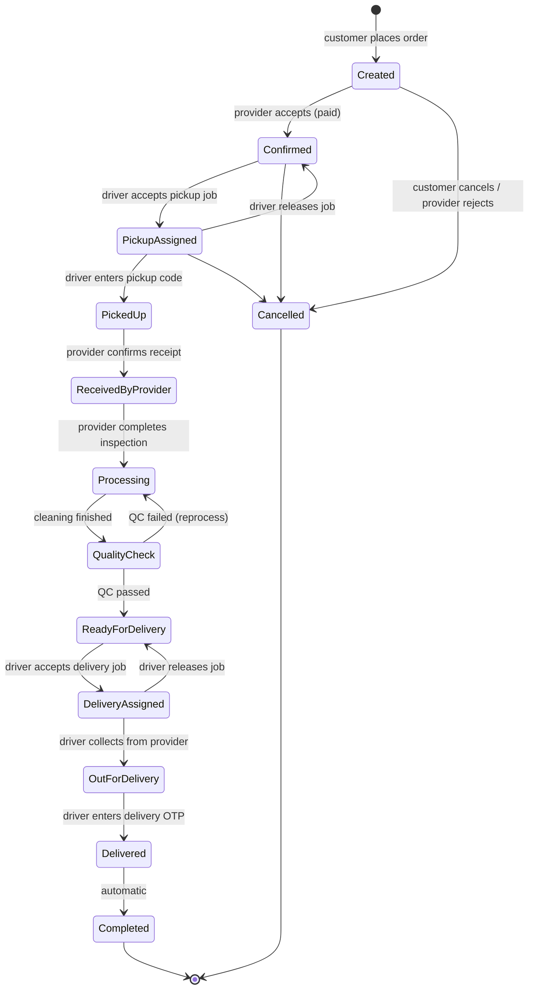
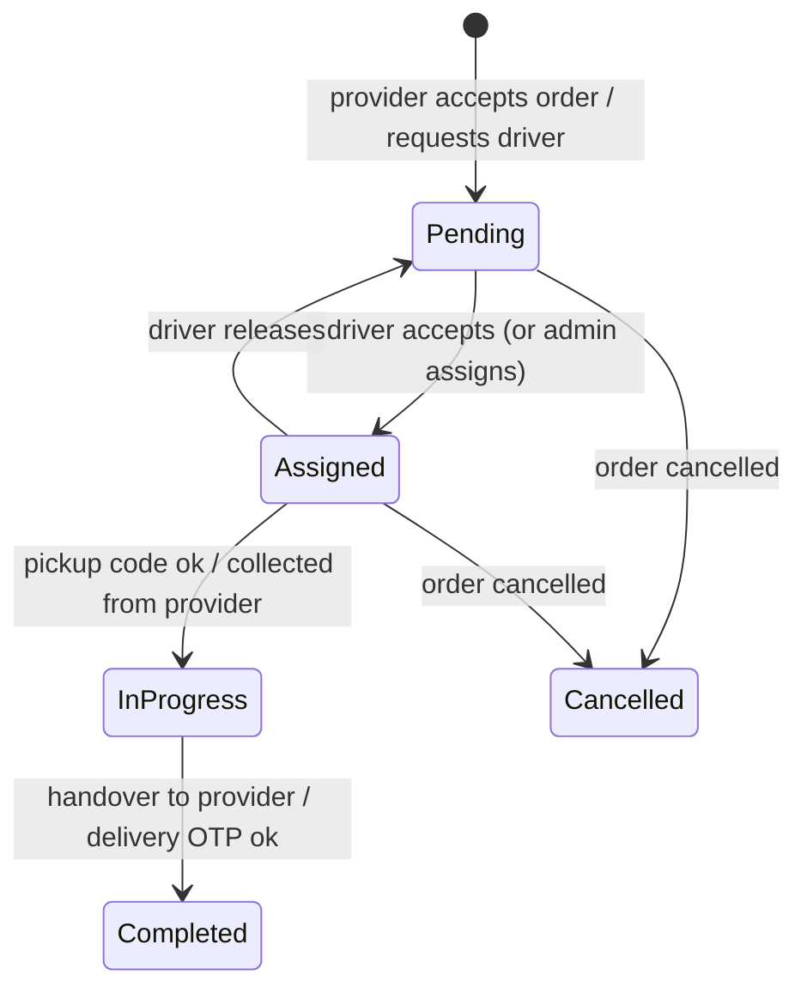
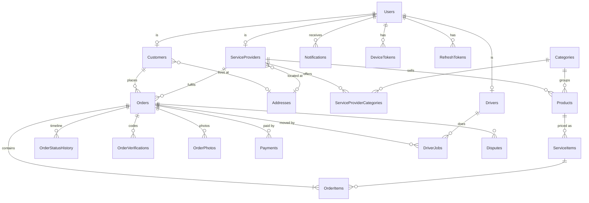

# EDry Cleaners

On-demand dry cleaning and laundry marketplace for South Africa (prices in ZAR).
Customers book pickups, service providers clean the items, and shared marketplace drivers collect and deliver.

| Folder | What it is |
|---|---|
| [`DryCleaning/`](DryCleaning/) | .NET MAUI app (Android + iOS, MVVM) – Customer, Service Provider and Driver roles in one app |
| [`DryCleaning.Api/`](DryCleaning.Api/) | ASP.NET Core Web API (.NET 10) – SQL Server, EF Core, JWT, Swagger, Paystack. See [API](#api-net-10) and the [API guide](#api-guide--endpoints-workflows-and-data) below |
| [`DryCleaning.Admin/`](DryCleaning.Admin/) | Admin web portal (Blazor, .NET 10) – dashboard, orders, driver jobs, payments, disputes, provider approvals, drivers, customers, categories, delivery pricing, extra order charges and push announcements to any user or everyone. Talks to the API only |
| `run-api.sh` / `run-api.ps1` | One-command local API runner – macOS (bash) / Windows (PowerShell) |
| `set-app-env.sh` / `set-app-env.ps1` | Switch the app between environments (mock, local, staging, production) |
| `DryCleaning.sln` | Solution with all projects |

## Contents

> **Publishing to a server?** Go to the [Server checklist](#2-server-checklist) (every setting and key to change) and [File storage (MinIO)](#file-storage-minio).

- [Quick start](#quick-start)
  - [API + Swagger](#api--swagger)
  - [Mobile app](#mobile-app)
- [Secrets: one file for everything](#secrets-one-file-for-everything)
- [Admin portal](#admin-portal)
- [Testing the app against a deployed API](#testing-the-app-against-a-deployed-api)
  - [1. Point the app at the server](#1-point-the-app-at-the-server)
  - [2. Server checklist](#2-server-checklist)
  - [File storage (MinIO)](#file-storage-minio)
  - [3. Smoke test after each deploy](#3-smoke-test-after-each-deploy)
  - [Troubleshooting](#troubleshooting)
- [Switching environments](#switching-environments)
- [Configuration](#configuration)
- [API (.NET 10)](#api-net-10)
  - [Run locally](#run-locally)
  - [Troubleshooting (running the API)](#troubleshooting-running-the-api)
  - [Configuration (`appsettings.json`)](#configuration-appsettingsjson)
  - [Sign-in, sessions and passwords](#sign-in-sessions-and-passwords)
  - [Push notifications (Android: Firebase, iOS: Apple APNs)](#push-notifications-android-firebase-ios-apple-apns)
  - [Paystack flow](#paystack-flow)
  - [Order lifecycle](#order-lifecycle)
  - [Schema notes](#schema-notes)
- [API guide – endpoints, workflows and data](#api-guide--endpoints-workflows-and-data)
  - [1. Quick start](#1-quick-start)
  - [2. Conventions](#2-conventions)
  - [3. Roles and access](#3-roles-and-access)
  - [4. Workflows](#4-workflows)
  - [5. Endpoint reference](#5-endpoint-reference)
  - [6. Request bodies and validation rules](#6-request-bodies-and-validation-rules)
  - [7. Response models](#7-response-models)
  - [8. Enums](#8-enums)
  - [9. Database tables](#9-database-tables)
  - [10. Configuration](#10-configuration)
  - [11. Testing checklist](#11-testing-checklist)
- [Status (V1)](#status-v1)

## Quick start

### API + Swagger

```bash
./run-api.sh          # macOS (Terminal)
```
```powershell
.\run-api.ps1         # Windows (PowerShell)
```

Checks your setup first (Docker, SQL Server container, .NET 10, `dotnet-ef`, HTTPS certificate, migrations),
fixes only what's missing after asking, then runs the API and opens **https://localhost:7180/swagger**.
Check only: `--check` / `-Check`. Fresh database: `--reset-db` / `-ResetDb`. All options, other ways to run
the scripts (permissions, execution policy) and troubleshooting:
[Run locally](#run-locally).

Demo users (password `Demo@12345`): `sipho@example.co.za` (Customer), `thandi@sparkledrycleaners.co.za` (Provider),
`bongani@drivers.edrycleaners.co.za` (Driver), `admin@edrycleaners.co.za` (Admin).

### Mobile app

Open `DryCleaning.sln` in Rider (or Visual Studio) and run the **DryCleaning** project on an Android emulator or iOS simulator.

The app talks to the **real API** (`"UseMockData": false` in `DryCleaning/appsettings.json`):

> Tip: `./set-app-env.sh local` / `mock` / `staging` switches all of this in one command – see
> [Switching environments](#switching-environments).

1. Start the API first: `./run-api.sh` (it listens on `http://localhost:5180`).
2. Run the app in **Debug**. It calls your machine automatically:
   - Android emulator → `http://10.0.2.2:5180/`
   - iOS simulator → `http://localhost:5180/`
   - Physical phone → set `Api:LocalBaseUrlAndroid` / `Api:LocalBaseUrlApple` to `http://<your Mac's LAN IP>:5180/`
     (and on Android add that IP to `Platforms/Android/Resources/xml/network_security_config.xml`). Start the API with the
     `http` profile so the phone can reach it: `cd DryCleaning.Api && dotnet run --launch-profile http`.
3. Release builds use `Api:BaseUrl` (`https://edrycleaners.co.za/`). To test against a server, see
   [Testing the app against a deployed API](#testing-the-app-against-a-deployed-api).

Pick a role, then sign in with a demo account (password `Demo@12345`). Codes (sign-up, forgot password) are only ever **emailed** – never shown in the app or returned by the API – so use a real email address you can open. Choosing the wrong role for an account shows which role to pick. The session is kept
on the phone (SecureStorage) and refreshed automatically, so you stay signed in after closing the app.

**Accounts and passwords in the app**

| Where | What |
|---|---|
| Login → *Create account* | Sign up for the role picked on the Role screen. An **email is required**: the app emails a 6-digit code and the account is only created once the code is entered (customers and drivers are then signed in straight away; a new **Service Provider** (business name, description, categories) is reviewed by an admin first, so the app confirms the registration and returns to Login). Passwords: at least 8 characters with a letter and a number. |
| Login → *Forgot password?* | Enter your email → enter the 6-digit code we **email** (use a real email you can open) and a new password → you're signed in; other devices are signed out. |
| Profile → *Change Password* | Customer, Service Provider and Driver profiles: current password + new password. |
| Provider Profile → *Edit* (Business) | Business name, description, phone, email and logo (take or choose a photo – uploaded to `POST api/provider/profile/logo`). |
| Provider Profile → *Manage* (Categories) | Switch the categories you offer on or off; customers only see your products in categories that are on. |

| Role | Demo account | Try |
|---|---|---|
| Customer | `sipho@example.co.za` | Browse → provider → items → cart → pickup address & slot → pay (Paystack test card) → track |
| Service Provider | `thandi@sparkledrycleaners.co.za` | Accept → receive → inspect → process → quality check → request driver |
| Driver | `bongani@drivers.edrycleaners.co.za` | Go online → accept a job → navigate → verify items → pickup code → hand over / deliver with OTP |

**Demo data instead of the API:** set `"UseMockData": true` – no API needed, any email/phone + 4-character password,
code `123456` (demo mode only), and the "simulate driver" / show-customer-code shortcuts (`Features:ShowDemoActions`).

**First launch:** someone who isn't signed in and hasn't seen it yet gets the intro screen and three onboarding slides (Get Started /
Next / Skip) before the role picker, built from the Figma "Customer General Onboarding" screens. Finishing, skipping or tapping *Log in*
remembers that on the phone, so later launches go straight to the role picker (or to the home screen when signed in). To see it again,
uninstall the app (Android) or, on an iOS simulator, also log out first, because the iOS keychain keeps the sign-in after an uninstall.

**Address search** uses Google: Places API (New) for suggestions and Geocoding API for "Use my current location".
The key is **never committed**. It lives in the repository's single secrets file (see [Secrets](#secrets-one-file-for-everything)),
under `local` → `App` → `GoogleMaps` → `ApiKey`. Add it there, then run `./set-app-env.sh local` to copy the `App` section into the build.

`set-app-env` copies only the chosen environment's `App` section into the build (as the git-ignored
`DryCleaning/appsettings.secrets.json`, merged last) – the `Api` section never goes into the app. Environments without an `App`
section or key get none. To give another environment a key later, fill its `App` section in `secrets.json` the same way.
In Google Cloud Console enable both APIs, restrict the key to them, and (for released apps) to your Android package /
iOS bundle id. Without a key the app uses sample Cape Town addresses. A key built into an app can be extracted
from it – the API restrictions are what protect it.

**Payments:** the app opens Paystack's checkout page and Paystack returns to the app via
`edrycleaners://payment-complete` (must match `Paystack:CallbackUrl` in the API). The API then verifies the payment.
Use Paystack test keys and a [test card](https://paystack.com/docs/payments/test-payments/) while developing.

**Push notifications in the app** (Android: Firebase, iOS: Apple APNs – server setup in [Push notifications](#push-notifications-android-firebase-ios-apple-apns)):

- The app asks for notification permission after sign-in, registers the phone with the API and unregisters it on sign-out. Tapping a
  notification opens the order. Demo (mock) mode has no push.
- **iOS needs a real iPhone** to receive pushes: the simulator can't get an APNs token because simulator builds aren't signed with the
  push entitlement. In the simulator you can still check how a notification looks with
  `xcrun simctl push <device> com.dev.edrycleaners payload.apns` (payload with `aps.alert` and an `orderId`).
- A real iPhone build needs an App ID with **Push Notifications** enabled and a development provisioning profile that includes it.
- **Android** works on an emulator with Google Play services; the first run asks for the Android 13+ notification permission.
- **Android build tip:** `DryCleaning.csproj` pins `Xamarin.AndroidX.Fragment.Ktx` to 1.9.0 next to the Firebase packages. Without it the
  build fails with "Type androidx.fragment.app… is defined multiple times". After adding or upgrading Android packages, delete
  `DryCleaning/obj` and `DryCleaning/bin` and rebuild – a stale incremental build can crash on start with a missing-resource error.

## Secrets: one file for everything

Every secret of the repo lives in **one git-ignored file at the repository root: `secrets.json`**. Create it by copying the
committed template and filling it in:

```bash
cp secrets.example.json secrets.json     # then edit secrets.json (chmod 600 is a good idea)
```

It has one block per environment (`local`, `staging`, `production`) and, in each, one section per project:

| Section | Read by | Holds |
|---|---|---|
| `Api` | the API (`DryCleaning.Api`) | Paystack keys and callback URL, Routes API key (`Routes.ApiKey`, for driving distance), the Firebase service-account JSON (`Push.FirebaseCredentialsJson`, pasted in as an object), the Apple APNs `.p8` text (`ApnsSettings.PrivateKey`), the email login (`Email.*`), the MinIO file-storage keys (`Storage.Minio.AccessKey` / `SecretKey`), and any other API setting you want kept out of git |
| `Admin` | the admin portal | nothing secret yet (it only needs the API address) |
| `App` | `./set-app-env.sh <env>` → the mobile app build | keys that are restricted in Google's console, e.g. `GoogleMaps.ApiKey`. **Never put server secrets here** – anything in the app can be extracted |

- **Which block:** the API and portal pick the block from `ASPNETCORE_ENVIRONMENT` (`Development` → `local`). Override with
  `EDRY_ENVIRONMENT=staging`. Override the file location with `EDRY_SECRETS_FILE=/path/secrets.json`.
- **Order of precedence:** `appsettings*.json` < user-secrets < `secrets.json` < real environment variables. So on a server you can skip the
  file and set variables like `Paystack__SecretKey`; they win over the file.
- **Production:** don't copy `secrets.json` to the server or into an image. Keep the `production` block empty on developer
  machines and supply production values as environment variables or from a secret manager (e.g. Azure Key Vault).
- **Property names ending in `Json`** keep their object as raw JSON text (that is how the Firebase file is pasted in unchanged).
- **Rotating a key** = edit one line in `secrets.json` and restart the API.

## Admin portal

```bash
cd DryCleaning.Admin && dotnet run --launch-profile http   # http://localhost:5190
```

Sign in with an **Admin** account (locally `admin@edrycleaners.co.za`, password in the [API guide](#1-quick-start)).
The portal calls the API at `Api:BaseUrl` (`DryCleaning.Admin/appsettings.json`, default `http://localhost:5180/`); in production set
`Api__BaseUrl` to your API address. It keeps no data of its own, so there is nothing to migrate. The sign-in lasts as long as
the API's access token (60 minutes), then you sign in again.

From **Send notification** an admin can notify one user (search by name, email or phone), everyone, or all customers / providers /
drivers. Each recipient gets an in-app notification and a push on their phone.

## Testing the app against a deployed API

Use this when the API runs on a server (staging or production) instead of your machine.

### 1. Point the app at the server

Quickest: put the server address in `DryCleaning/environments/staging.json` and run `./set-app-env.sh staging`
(see [Switching environments](#switching-environments)). The settings it applies, if you prefer to edit
`DryCleaning/appsettings.json` directly:

```json
"Features": { "UseMockData": false },
"Api": {
  "BaseUrl": "https://your-server.example.com/",
  "UseLocalApiInDebug": false
}
```

- `BaseUrl` is the server root – **without** `api/` (request paths already include it) and **with** a trailing `/`.
- `UseLocalApiInDebug: false` makes **Debug** builds use `BaseUrl` too. Leave it `true` and Debug builds keep calling
  your local API, whatever `BaseUrl` says. Release builds always use `BaseUrl`.
- The server must use **HTTPS**. Android only allows plain `http` to `10.0.2.2` / `localhost` / `127.0.0.1`
  (`Platforms/Android/Resources/xml/network_security_config.xml`), and iOS only to local network addresses.
- To hand the app to testers, build a **Release** version (Android: an `.apk`/`.aab` from Rider's *Publish*;
  iOS: TestFlight).

### 2. Server checklist

**Go-live checklist.** Set every row below on the server as environment variables (`__` separates sections, e.g.
`Jwt__SigningKey`) or in `appsettings.Production.json` – never commit real secrets. The defaults in `appsettings.json` are for
development only: the connection string holds the local Docker password, and the API **will not start** without
`Jwt__SigningKey` and the two MinIO keys.

| Setting | Value |
|---|---|
| `ASPNETCORE_ENVIRONMENT` | `Production` (or `Staging`). Development-only behaviour (OTP code in the response, HTTP allowed, demo data) is then off. |
| `ConnectionStrings__DefaultConnection` | Your SQL Server. With `Database:InitializeOnStartup: true` (default) the API applies migrations on start-up. |
| `Jwt__SigningKey` | A long random secret (32+ characters). Changing it later signs everyone out. |
| `Paystack__SecretKey` / `Paystack__PublicKey` | Test keys (`sk_test_…`/`pk_test_…`) on staging, live keys only in production. |
| `Paystack__CallbackUrl` | `edrycleaners://payment-complete` – must match `Api:PaymentCallbackUrl` in the app. |
| Paystack dashboard → Webhook URL | `https://your-server.example.com/api/payments/paystack/webhook` |
| `Database__SeedDemoData` | `true` on a **test** server to get the demo accounts (only seeds an empty database). Keep `false` in production. |
| `Push__FirebaseCredentialsJson` | The Firebase service-account JSON (the whole file's text) for Android pushes (optional – without it they are only logged). |
| `ApnsSettings__PrivateKey` (+ `ApnsSettings__UseSandbox=false` on TestFlight/App Store) | The text of the Apple APNs `.p8` key for iPhone pushes (or a file path in `ApnsSettings__PrivateKeyPath`); `TeamId`, `KeyId`, `BundleId` are in `appsettings.json` (optional – without the key they are only logged). |
| `Email__Username` / `Email__Password` / `Email__From` (+ `Email__SmtpServer`, `Email__Port`) | The sending mailbox (Office 365 SMTP) – or `Email__Key` for SendGrid. Without it, emails are only logged and nobody receives sign-up or reset codes. |
| `Routes__ApiKey` | Google key for driving distance (Routes API enabled, restricted to your server). Also set the app's `GoogleMaps.ApiKey` in the `App` block of `secrets.json` (Places + Geocoding enabled, restricted to the app). |
| `Storage__Minio__AccessKey` / `Storage__Minio__SecretKey` | A MinIO user limited to this app's bucket – never the MinIO admin account. See [File storage (MinIO)](#file-storage-minio). |
| `Cors__AllowedOrigins` | The browser origins that may call the API (empty = any). |
| `Swagger__Enabled` | `true` on staging; your choice in production. |
| Uploads | Every photo, logo and verification document goes to MinIO – see [File storage (MinIO)](#file-storage-minio). Nothing is saved on the API server's disk. |

**Before launch, rotate anything that was ever shared in a chat, ticket or email** (Paystack keys, the MinIO password, mailbox
password, JWT signing key) and use the live Paystack keys only on the production server.

### File storage (MinIO)

All files live in **MinIO** (S3-compatible, the same store as the reference project) – locally, on staging and in production
alike. There is no other store and no debug/release switch.

| Setting (`Storage:Minio`) | Where | Value |
|---|---|---|
| `Url` | `appsettings.json` | `77.237.233.114:9000` (no `http://`) |
| `BucketName` | `appsettings.json` | `edrycleaners-api` – created automatically. **Never use the reference project's bucket `edrycleaners`**: its policy lets anyone read every file in it |
| `UseSsl` | `appsettings.json` | `false` today (plain http) |
| `SignedLinkMinutes` | `appsettings.json` | `15` – lifetime of an order-photo link |
| `PublicUrl` | optional | an https/CDN address for logos |
| `AccessKey` / `SecretKey` | `secrets.json` locally, environment variables on a server | never in git |

Inside the bucket: `public/` (logos – anyone can read), `private/` (order photos – 15-minute signed links) and `protected/`
(verification documents – no link ever; the API streams them after a permission check). The API creates the bucket and sets this
policy itself on first use, and **refuses to start** when the keys are missing.

- **Set up a machine (local or live):** add the keys (locally under `local` → `Api` → `Storage` → `Minio` in `secrets.json`; on a
  server as `Storage__Minio__AccessKey` / `Storage__Minio__SecretKey`), start the API, upload one photo and open it. No database
  change and no app update is needed.
- **Plain http:** phones refuse `http://` addresses by default, so the app has an explicit allowance for the MinIO address and nothing
  else – iOS `DryCleaning/Platforms/iOS/Info.plist` (`NSExceptionDomains`) and Android
  `DryCleaning/Platforms/Android/Resources/xml/network_security_config.xml`. If the MinIO address changes, update both. Logos and order
  photos then travel unencrypted between MinIO and the phone (verification documents do not). To remove the allowance, give MinIO an
  `https://` address, set `Url` and `UseSsl=true`, and delete the two entries.
- **Old files:** photos saved before the switch (the former local `uploads` folder) are not shown; copy them into the bucket under the
  same folders if you need them.

### 3. Smoke test after each deploy

1. Open `https://your-server.example.com/swagger` – it loads and `POST /api/auth/login` works with a demo account.
2. **Customer:** sign in → choose an address (Google search) → add items → pickup slot → pay with a Paystack
   [test card](https://paystack.com/docs/payments/test-payments/) → the order shows as paid.
3. **Service Provider:** the order appears under *New* → accept it.
4. **Driver:** go online → accept the pickup job → enter the customer's pickup code (shown on the customer's order
   screen) → hand over to the provider.
5. **Service Provider:** receive → inspect (add a photo) → processing → quality check → ready → request a driver.
6. **Driver:** accept the delivery → collect → deliver with the customer's delivery OTP → the order is completed.
7. Close and reopen the app – you should still be signed in.

### Troubleshooting

| Problem | Fix |
|---|---|
| App still shows your local data or "Can't reach EDry Cleaners" | Debug build with `UseLocalApiInDebug: true` – set it to `false`, or build Release. Check `BaseUrl` ends with `/` and has no `api/`. |
| "Cleartext HTTP traffic not permitted" (Android) / ATS error (iOS) | The server URL is `http://` – put the API behind HTTPS. |
| Everyone signed out after a deploy, 401 errors | `Jwt:SigningKey` changed between deploys – keep it the same. |
| Login works in Swagger but the app says "This is a … account" | You picked a different role on the role screen than the account has. |
| Code email never arrives | Check the spam folder, the **Email** page in the admin portal (status + test email) and the `Email` settings in `secrets.json`. |
| Paystack page doesn't return to the app | Check `Paystack:CallbackUrl` is `edrycleaners://payment-complete`. If Paystack rejects that address, the API needs a small https page that forwards to the app. |
| Photos or logos don't load in the app | The MinIO address isn't allowed for plain http in the app, or MinIO is unreachable – see [File storage (MinIO)](#file-storage-minio). |
| Photos not loading after a while (Azure) | Signed links expire after 15 minutes; reload the order to get new ones. |
| "Address search isn't working" | Check `secrets.json` has your key under `<env>` → `App` → `GoogleMaps` and re-run `./set-app-env.sh <name>`, enable Places API (New) and Geocoding API for it in Google Cloud Console, and check the key's restrictions. |

## Switching environments

`set-app-env.sh` (macOS) / `set-app-env.ps1` (Windows) point the app at an environment without editing
`DryCleaning/appsettings.json`:

```bash
./set-app-env.sh local                          # API on this machine (./run-api.sh) – emulator / simulator
./set-app-env.sh local --device-ip 192.168.1.20 # API on this machine – physical phone on your Wi-Fi
./set-app-env.sh mock                           # demo data, no API
./set-app-env.sh staging                        # test server
./set-app-env.sh production                     # https://edrycleaners.co.za/
./set-app-env.sh --show                         # which environment / server the next build uses
./set-app-env.sh --list                         # available environments (current one marked)
./set-app-env.sh --reset                        # back to appsettings.json as committed
```
```powershell
.\set-app-env.ps1 local                        # same commands on Windows
.\set-app-env.ps1 local -DeviceIp 192.168.1.20
.\set-app-env.ps1 -Show                        # also -List, -Reset, -Help (or --show, --list, ...)
```

Then **rebuild and run the app** – settings are built into the app. In Debug builds the role screen shows the
environment and server at the bottom (e.g. `Environment: staging · https://staging.edrycleaners.co.za/`).

| Environment | Data | Debug builds call | Release builds call |
|---|---|---|---|
| `mock` | Demo data on the phone | – | – |
| `local` | Your local API | `http://10.0.2.2:5180/` (Android emulator), `http://localhost:5180/` (iOS simulator) | `Api:BaseUrl` |
| `staging` | Test server | `https://staging.edrycleaners.co.za/` | same |
| `production` | Live server | `https://edrycleaners.co.za/` | same |

**How it works**

- Each environment is a small file in `DryCleaning/environments/<name>.json` that lists only the settings that
  differ from `appsettings.json` (sections are merged key by key).
- The script validates it and copies it to `DryCleaning/appsettings.env.json`. That file is git-ignored, so switching
  never shows up in `git status`; each developer picks their own environment.
- The app embeds `appsettings.env.json` when it exists and `AppSettings.Load()` merges it over `appsettings.json`.
  Without it the app uses `appsettings.json` exactly as committed.
- `--device-ip` / `-DeviceIp` sets both local URLs to `http://<ip>:5180/` and adds the IP to
  `Platforms/Android/Resources/xml/network_security_config.xml` (Android blocks plain `http` otherwise). That file
  is committed – remove the extra IP before a release. Start the API with the `http` profile so the phone can reach
  it: `cd DryCleaning.Api && dotnet run --launch-profile http`.
- Keys: the `App` section of that environment in `secrets.json` (git-ignored) is copied as `appsettings.secrets.json`;
  switching to an environment without one removes the key from the build. `--reset` removes both files.
- Warnings: production with demo data, and a server URL that isn't `https://`, doesn't end with `/`, or ends with `api/`.

**Change or add an environment** – edit `DryCleaning/environments/staging.json` to your real test-server address
(`Api:BaseUrl`), or add e.g. `uat.json` with the same shape and run `./set-app-env.sh uat`. Any setting from
`appsettings.json` can go in a profile – but keys go in `secrets.json` (git-ignored), never in
a profile, because profiles are committed.

**API side** – the API already switches with `ASPNETCORE_ENVIRONMENT` (`Development` locally via `run-api.sh`,
`Staging`/`Production` on a server) plus `appsettings.{Environment}.json` and environment variables – see the
[server checklist](#2-server-checklist).

## Configuration

- **App** – `DryCleaning/appsettings.json`: currency (ZAR / R / en-US, so amounts read R1,234.50 – use en-ZA for R1 234,50), the demo-data VAT, the per-km pickup & delivery price for demo data (with the API the admin portal sets it), driver earning per job,
  mock data and demo switches, API URLs (production + local Debug), payment callback.
  Overrides written by `set-app-env`: `appsettings.env.json` (environment) and `appsettings.secrets.json` (that
  environment's keys, from `secrets.json`) – all git-ignored, never committed.
- **API** – `DryCleaning.Api/appsettings.json`: connection string, marketplace rules, JWT, Paystack, OTP, storage.
  Real secrets live in the single `secrets.json` (see [Secrets](#secrets-one-file-for-everything)) or in server environment variables.

---

## API (.NET 10)


ASP.NET Core Web API for the EDry Cleaners marketplace (Customer, Service Provider, shared marketplace Driver, Admin).
SQL Server + EF Core 10, JWT auth, Swagger UI, Paystack payments. Tables follow the V1 schema.

### Run locally

#### Quick start – one command

| OS | Script (in the repo root, next to `DryCleaning.sln`) |
|---|---|
| macOS (Intel or Apple Silicon) | `run-api.sh` – bash |
| Windows 10/11 | `run-api.ps1` – PowerShell 5.1 or PowerShell 7 |

Both scripts work the same way, in three phases:

1. **Check** (changes nothing) – Docker Desktop installed and running, the `edry-sql` SQL Server container
   (exists, running, accepts the SA password, port 1433 free), .NET 10 SDK, `dotnet-ef`, HTTPS dev
   certificate, and the named migrations (`AddPickupSlotAndItemNotes`, `AddPushDevicesAndRefreshTokens`). Each line shows OK, *fix* (the script can
   fix it) or *need* (you must install it – the script stops and tells you what).
2. **Fix** – lists what it will do, asks `Continue? [Y/n]`, then fixes only those items: starts Docker,
   creates/starts the container, installs `dotnet-ef`, trusts the certificate, adds missing migrations.
   It then waits until SQL Server accepts logins and builds the API.
3. **Run** – starts the API (migrations are applied and demo data is seeded on startup) and opens Swagger.

Ctrl+C stops the API; SQL Server keeps running in Docker so the next start is quick.

##### macOS – `run-api.sh`

Open Terminal (zsh or bash both work – the script always runs with bash):

| Command | What it does |
|---|---|
| `./run-api.sh` | Check → fix what's missing (asks first) → run → open Swagger |
| `./run-api.sh --check` | Checks only, changes nothing |
| `./run-api.sh --yes` (or `-y`) | Fix without asking |
| `./run-api.sh --reset-db` | Recreate the SQL Server container – **wipes local data**, reseeds demo data |
| `./run-api.sh --reset-db --yes` | Fresh database without the prompt (options can be combined) |
| `./run-api.sh --stop` | Stop the SQL Server container |
| `./run-api.sh --help` (or `-h`) | Show the options |

Other ways to start it:

| Situation | Command |
|---|---|
| `permission denied` (e.g. after a fresh clone) | `chmod +x run-api.sh` once, or run `bash run-api.sh` |
| From another folder | `~/Repos/DryCleaning/run-api.sh` – the script finds `DryCleaning.Api` relative to itself |
| ⚠️ Don't use | `sh run-api.sh` – `sh` isn't bash; use `./run-api.sh` or `bash run-api.sh` |

##### Windows – `run-api.ps1`

Open **PowerShell** (Windows PowerShell or PowerShell 7) in the repo root. Docker Desktop must use the
WSL 2 backend and **Linux containers** (the script checks this).

| Command | What it does |
|---|---|
| `.\run-api.ps1` | Check → fix what's missing (asks first) → run → open Swagger |
| `.\run-api.ps1 -Check` | Checks only, changes nothing |
| `.\run-api.ps1 -Yes` | Fix without asking |
| `.\run-api.ps1 -ResetDb` | Recreate the SQL Server container – **wipes local data**, reseeds demo data |
| `.\run-api.ps1 -ResetDb -Yes` | Fresh database without the prompt |
| `.\run-api.ps1 -Stop` | Stop the SQL Server container |
| `.\run-api.ps1 -Help` | Show the options |

The macOS-style options also work on Windows: `--check`, `--yes` / `-y`, `--reset-db`, `--stop`, `--help` / `-h`.

Other ways to start it:

| Situation | Command |
|---|---|
| *running scripts is disabled on this system* | `powershell -ExecutionPolicy Bypass -File .\run-api.ps1` (add options at the end, e.g. `-Check`) |
| Allow local scripts permanently (current user) | `Set-ExecutionPolicy -Scope CurrentUser RemoteSigned` |
| Downloaded as a zip and still blocked | `Unblock-File .\run-api.ps1` |
| PowerShell 7 | `pwsh .\run-api.ps1` |
| From Command Prompt (cmd.exe) | `powershell -ExecutionPolicy Bypass -File run-api.ps1` |
| From another folder | `C:\path\to\DryCleaning\run-api.ps1` |

#### Swagger

Open **https://localhost:7180/swagger** (or http://localhost:5180/swagger).

1. `POST /api/auth/login` → **Try it out** →
   `{ "identifier": "bongani@drivers.edrycleaners.co.za", "password": "Demo@12345" }`
2. Copy `accessToken` from the response.
3. **Authorize** (top right) → paste the token (without `Bearer `) → Authorize.

Demo users (seeded in Development, Cape Town data) – password for all: `Demo@12345`

| Role | Login |
|---|---|
| Customer | sipho@example.co.za |
| Provider | thandi@sparkledrycleaners.co.za |
| Driver | bongani@drivers.edrycleaners.co.za |
| Admin | admin@edrycleaners.co.za |

OTP login in Development: the code is returned in the `POST /api/auth/otp/request` response (no SMS needed).

#### Manual setup (any OS)

1. **SQL Server** (Docker; on Apple Silicon enable *Docker Desktop → Settings → General → Use Rosetta*):
   ```bash
   docker run -d --name edry-sql --platform linux/amd64 \
     -e "ACCEPT_EULA=Y" -e "MSSQL_SA_PASSWORD=YourStrong!Passw0rd" \
     -p 1433:1433 mcr.microsoft.com/mssql/server:2022-latest
   ```
   Wait for `docker logs edry-sql` to show *SQL Server is now ready for client connections*.
   Change `ConnectionStrings:DefaultConnection` in `appsettings.json` if your server or password differs.
2. **Tools**:
   ```bash
   dotnet tool install --global dotnet-ef
   dotnet dev-certs https --trust
   ```
3. **Migrations** – after changing entities, add one (they're applied automatically on startup):
   ```bash
   cd DryCleaning.Api
   dotnet ef migrations add <Name> -o Data/Migrations
   ```
4. **Run** – `dotnet run --launch-profile https` (or the **https** profile in Rider).

### Troubleshooting (running the API)

| Symptom | Fix |
|---|---|
| `A network-related … error occurred while establishing a connection to SQL Server` / `Connection refused` | SQL Server isn't running or isn't ready yet: `docker start edry-sql`, wait ~30 s (or run the script). |
| `Login failed for user 'sa'` | Container was created with another password: `./run-api.sh --reset-db` (Windows: `.\run-api.ps1 -ResetDb`) |
| Container exits right after starting | Apple Silicon: enable Rosetta in Docker Desktop and give Docker ≥ 4 GB memory, then `./run-api.sh --reset-db` |
| Log says *EF Core model has pending changes; migrations were not applied* | Add a migration (`dotnet ef migrations add <Name> -o Data/Migrations`) or just run `./run-api.sh`. |
| API starts but there are no demo orders | Seeding only runs on an empty database. If a previous run failed half-way, run `./run-api.sh --reset-db` (Windows: `.\run-api.ps1 -ResetDb`). |
| Windows: *Docker is in Windows containers mode* | Right-click the Docker tray icon → **Switch to Linux containers…** |
| Windows: port 1433 in use | A local SQL Server service is running – stop it in *Services*, or `netstat -ano \| findstr :1433` to find it. |
| Browser certificate warning | `dotnet dev-certs https --trust`, or use http://localhost:5180/swagger |
| `401 Unauthorized` in Swagger | Access token missing or expired (1 day in Development) or wrong role – log in again, or call `POST /api/auth/refresh` with the `refreshToken`. |
| Paystack endpoints fail | Add your test keys (`sk_test_…`, `pk_test_…`) to `appsettings.Development.json`. |

### Configuration (`appsettings.json`)

| Section | Purpose |
|---|---|
| `Marketplace` | Currency (`ZAR`), driver earning per job (the pickup & delivery price, extra charges and VAT are set on the admin portal's Pricing page), `RequirePaymentBeforeAccept` |
| `Jwt` | Issuer, audience, **SigningKey (≥ 32 chars – keep it in `secrets.json` / env vars)**, `ExpiryMinutes` (access token, 60; 1440 in Development), `RefreshTokenDays` (30) |
| `Paystack` | `SecretKey`, `PublicKey`, `CallbackUrl` (app deep link) |
| `Otp` | Length/expiry, `MaxAttempts` (wrong guesses before a code is invalidated, 5). Codes are only emailed, never returned by the API |
| `Push` | `Enabled`, `FirebaseCredentialsJson` (the Firebase service-account JSON itself, kept in `secrets.json`) or `FirebaseCredentialsPath` (a file). Nothing set → Android pushes are only logged |
| `Email` | `Key` (a SendGrid key starting `SG.`, preferred) or `SmtpServer`, `Port`, `Username`, `Password`; plus `From`, `Name`, `ReplyTo`, `Enabled` (keys and passwords live in `secrets.json`). Not configured = emails are only logged. Admin portal → **Email** shows the status and sends a test email |
| `ApnsSettings` | `TeamId`, `KeyId`, `BundleId`, `PrivateKey` (the `.p8` text, kept in `secrets.json`) or `PrivateKeyPath` (a file), `UseSandbox` – iPhone pushes through Apple. Missing key → iOS pushes are only logged |
| `Storage` | MinIO address, bucket, keys, signed-link lifetime, max photo size (see the main README, "File storage (MinIO)") |
| `Database` | `InitializeOnStartup`, `SeedDemoData` |

Secrets (don't commit real keys): put them in the repository's single git-ignored `secrets.json` (template: `secrets.example.json`,
explained in the [Secrets](#secrets-one-file-for-everything)), in the `Api` section of your environment's block:

```json
{ "local": { "Api": {
    "Jwt": { "SigningKey": "<long random string>" },
    "Paystack": { "SecretKey": "sk_test_...", "PublicKey": "pk_test_..." }
} } }
```

On a server use environment variables instead (`Jwt__SigningKey`, `Paystack__SecretKey`, …); they override the file.

### Sign-in, sessions and passwords

| Action | Endpoint |
|---|---|
| Log in (password) | `POST /api/auth/login` |
| Log in with a code | `POST /api/auth/otp/request` → `POST /api/auth/otp/verify` |
| Renew the session | `POST /api/auth/refresh` `{ refreshToken }` |
| Log out this device | `POST /api/auth/logout` `{ refreshToken }` |
| Forgot password | `POST /api/auth/password/forgot` `{ identifier }` → `POST /api/auth/password/reset` `{ identifier, code, newPassword }` |
| Change password (signed in) | `POST /api/auth/me/change-password` |

- Login, register, OTP verify, refresh and password reset all return `accessToken` + `expiresAt` **and** a
  `refreshToken` + `refreshTokenExpiresAt`. The app keeps the refresh token in secure storage and calls
  `/api/auth/refresh` when the access token is about to expire (or on a 401).
- **Refresh tokens rotate:** every refresh returns a new one and the old one stops working. If an old (already
  used) refresh token is presented again, all of that user's sessions are revoked – it may have been stolen.
  Only a SHA-256 hash of each refresh token is stored.
- Password reset and change password sign the user out on every other device.
- `password/forgot` answers the same way whether or not the account exists, so it can't be used to discover
  accounts.
- Login and reset codes are invalidated after `Otp:MaxAttempts` (5) wrong guesses.

### Push notifications (Android: Firebase, iOS: Apple APNs)

Every in-app notification the API creates (new order, driver assigned, out for delivery, payment, …) is also
sent as a push to the user's phones. Android phones are reached through **Firebase Cloud Messaging**, iPhones
**directly through Apple's APNs** (no Firebase on iOS).

| Action | Endpoint |
|---|---|
| Register this phone (after sign-in, on app start, when the platform issues a new token) | `POST /api/me/devices` `{ token, platform: "Android" \| "iOS" }` (FCM token / APNs device token in hex) |
| Stop pushes to this phone (on logout) | `DELETE /api/me/devices?token=…` |

Push payload: title and body plus `notificationId`, `type` and `orderId` (when the notification is about an order), so
the app can open the right screen. On Android these keys arrive in the FCM `data` map, on iOS as custom keys next to `aps`.

**Setup – Android (Firebase)**

1. *Firebase console → Project settings → Service accounts → Generate new private key* – download the JSON. **Don't commit it.**
2. Paste the whole JSON as an object into `secrets.json` at `<env>` → `Api` → `Push` → `FirebaseCredentialsJson` (on a server: environment
   variable `Push__FirebaseCredentialsJson` with the file's text). `Push:FirebaseCredentialsPath` (a file path) still works as an alternative.

**Setup – iOS (APNs)**

1. In the Apple Developer account: the App ID has the **Push Notifications** capability, and you have an **APNs auth key** (`AuthKey_XXXX.p8`).
2. Paste the `.p8` text into `secrets.json` at `<env>` → `Api` → `ApnsSettings` → `PrivateKey` (newlines as `\n`), and keep the non-secret
   settings in `appsettings.json`:

   | Setting | Meaning |
   |---|---|
   | `TeamId`, `KeyId` | From the Apple Developer account / the key |
   | `BundleId` | The app's bundle id (`apns-topic`), `com.dev.edrycleaners` |
   | `PrivateKey` | The `.p8` text (from `secrets.json`; on a server `ApnsSettings__PrivateKey`). Alternatively `PrivateKeyPath`, a file path (relative paths start at the API folder) |
   | `UseSandbox` | `true` for Xcode/debug builds (Development environment sets it), `false` for TestFlight and App Store builds |

3. The app's `aps-environment` entitlement is `development` for Debug and `production` for Release
   (`DryCleaning/Platforms/iOS/Entitlements*.plist`); the signing profile must include Push Notifications.

Without a platform's credentials the API runs normally and logs each push for that platform instead of sending it. Sending
happens on a background queue, so API calls never wait for Firebase or Apple. Tokens that Firebase reports as invalid, or that
Apple reports as unregistered (app uninstalled), are removed automatically. Apple's `BadDeviceToken` is only logged: it also
means "sandbox token sent to production (or the reverse)", so a wrong `UseSandbox` never deletes working devices.

### Paystack flow

1. Customer creates an order → `POST /api/customer/orders`
2. `POST /api/customer/orders/{id}/payments/paystack` → open `authorizationUrl` (WebView/browser)
3. Paystack redirects to `CallbackUrl`; app calls `GET /api/customer/orders/{id}/payments/verify?reference=…`
4. Webhook `POST /api/payments/paystack/webhook` (set it in the Paystack dashboard) also confirms `charge.success`.
   The signature (`x-paystack-signature`, HMAC-SHA512) is validated and the transaction is always re-verified with Paystack.
5. Paid orders appear in the provider's **New** list.

### Order lifecycle

```
Created → Confirmed → PickupAssigned → PickedUp → ReceivedByProvider → Processing
→ QualityCheck → ReadyForDelivery → DeliveryAssigned → OutForDelivery → Delivered → Completed
(+ Cancelled, Disputed)
```

| Step | Endpoint |
|---|---|
| Provider accepts (publishes **Pickup** job) | `POST /api/provider/orders/{id}/accept` |
| Driver accepts job | `POST /api/driver/jobs/{jobId}/accept` |
| Driver checks items + verifies customer pickup code (QR) | `POST /api/driver/jobs/{jobId}/pickup` (`Code`, optional per-item `Items`, `Notes`) |
| Driver hands over to provider | `POST /api/driver/jobs/{jobId}/handover` |
| Provider confirms receipt | `POST /api/provider/orders/{id}/receive` |
| Inspection → Processing | `POST /api/provider/orders/{id}/inspection` |
| Quality check | `POST /api/provider/orders/{id}/quality-check` |
| Ready for delivery | `POST /api/provider/orders/{id}/ready` |
| Request driver (publishes **Delivery** job) | `POST /api/provider/orders/{id}/request-driver` |
| Driver collects from provider | `POST /api/driver/jobs/{jobId}/start-delivery` (optional `PackageCount`, `Notes`) |
| Driver delivers with customer OTP → Completed | `POST /api/driver/jobs/{jobId}/deliver` |
| Driver earnings (last 7 days / 4 weeks) | `GET /api/driver/earnings?period=Week\|Month` |
| Driver job history | `GET /api/driver/jobs/history` |
| Driver pickup / delivery photos | `POST /api/orders/{orderId}/photos` (multipart, `Type=Pickup\|Completion`) |

Every status change is written to `OrderStatusHistory`.

Driver job endpoints (`GET /api/driver/jobs/{jobId}`, accept, release, pickup, handover, start-delivery, deliver)
return a `DriverJobDetailDto`: the job, its `NextStep`, the order's items and – only while the job is the
driver's own and active – the customer's and provider's phone numbers.

#### Screen helpers

| Screen | Endpoint |
|---|---|
| Customer home – popular services | `GET /api/catalog/popular?take=6` |
| Providers list (incl. `FastestDays`) | `GET /api/providers?categoryId=…` |
| One provider (products screen header) | `GET /api/providers/{providerId}?categoryId=…` |
| One product with its prices (customer) | `GET /api/catalog/products/{productId}` |
| Edit one service item (provider) | `GET /api/provider/service-items/{serviceItemId}` |
| Upload business logo (provider, multipart field `File`) | `POST /api/provider/profile/logo` |
| Customer order tab counts | `GET /api/customer/orders/counts` |
| Provider order tab counts | `GET /api/provider/orders/counts` |
| Driver dashboard (name, active job, today's jobs, unread) | `GET /api/driver/dashboard` |
| Driver job tab counts | `GET /api/driver/jobs/counts` |
| Driver job for a notification | `GET /api/driver/jobs/by-order/{orderId}` |

### Schema notes

- All 18 tables from the V1 diagram; enums stored as strings; money `decimal(10,2)`; lat/lng `decimal(10,7)`.
- **Drivers have no `ServiceProviderId`** – `DriverJobs` links a marketplace driver to an order.
- `DriverJobs.DriverId` is nullable: a job is `Pending` on the marketplace until a driver accepts it.
  `DriverJobs` also has a `RowVersion` concurrency column so two drivers can't take the same job.
- `AddressId` on Customers/ServiceProviders/Drivers is nullable so users can register before adding an address.
- `OrderVerifications`: `QR` = customer pickup code, `OTP` = delivery code, `Item` = driver item check at pickup / provider receipt check.
- Order numbers come from a SQL sequence: `EDC-10001`, `EDC-10002`, …
- Login OTPs are held in memory (no table in the schema) – plug an SMS provider into `MemoryOtpService`.
- **Schema additions** (not in the V1 diagram):
  - `Orders.PickupDate`, `Orders.PickupSlot`, `OrderItems.Notes` – customer pickup window and item instructions.
  - `DeviceTokens` (UserId, Platform, Token – unique, LastSeenAt) – phones registered for push.
  - `RefreshTokens` (UserId, TokenHash – unique SHA-256, ExpiresAt, RevokedAt, ReplacedByTokenHash) – sessions.

  Migrations: `AddPickupSlotAndItemNotes`, `AddPushDevicesAndRefreshTokens` – the run scripts create them
  automatically when missing, or run `dotnet ef migrations add <Name> -o Data/Migrations`.

## API guide – endpoints, workflows and data


One place for everything about the EDry Cleaners API: how to call it, how each business flow works,
which endpoint does what, and which database tables each step reads and writes.

> **Source of truth:** the code in `DryCleaning.Api/`. This guide describes the API as of the
> `raj/api-integration` branch. Live, try-it-out docs: **Swagger** at `https://localhost:7180/swagger`
> (or `http://localhost:5180/swagger`) after `./run-api.sh`.

### 1. Quick start

1. Start SQL Server and the API: `./run-api.sh` (macOS) or `./run-api.ps1` (Windows).
2. Open `https://localhost:7180/swagger` (or `http://localhost:5180/swagger`).
3. `POST /api/auth/login` with a demo user (Development seed, password `Demo@12345`):

   | Role | Identifier |
   |---|---|
   | Customer | `sipho@example.co.za` |
   | Provider | `thandi@sparkledrycleaners.co.za` |
   | Driver | `bongani@drivers.edrycleaners.co.za` |
   | Admin | `admin@edrycleaners.co.za` |

4. Copy `accessToken`, click **Authorize**, paste it (without `Bearer `).
5. Call any endpoint for that role.

---

### 2. Conventions

#### Base URLs

| Where | Base URL |
|---|---|
| Your Mac (Swagger, curl) | `https://localhost:7180` or `http://localhost:5180` |
| Android emulator | `http://10.0.2.2:5180` |
| iOS simulator | `http://localhost:5180` |
| Real phone on the same Wi-Fi | `http://<your-mac-ip>:5180` |
| Deployed server | `https://<your-domain>` (HTTPS is enforced outside Development) |

All routes start with `/api`. Health check: `GET /health`.

#### Authentication

- **JWT bearer tokens.** Send `Authorization: Bearer <accessToken>` on every endpoint that isn't *Public*.
- **Access token** lasts **60 minutes** (`Jwt:ExpiryMinutes`; 24 hours in Development). It carries the user id, role and profile id.
- **Refresh token** lasts **30 days** (`Jwt:RefreshTokenDays`) and **rotates**: every `POST /api/auth/refresh`
  returns a new one and the old one stops working. Re-using an old one signs the user out on every device.
- **Who you are comes from the token**, never from the request body. `api/me/...` means "the signed-in user".

#### JSON format

| Rule | Example |
|---|---|
| Property names are **camelCase** | `orderNumber`, `totalAmount` |
| Enums are **strings** | `"status": "ReadyForDelivery"` |
| Null properties are **left out** of responses | no `"description": null` |
| Ids are **GUIDs** | `"3fa85f64-5717-4562-b3fc-2c963f66afa6"` |
| Dates/times are **UTC**, ISO 8601 | `"2026-10-14T09:30:00Z"` |
| Pickup date is a **date only** | `"pickupDate": "2026-10-16"` |
| File uploads are **multipart/form-data** | photos, provider logo |

#### Paging

List endpoints that take `page`, `pageSize`, `search`:

| Query | Default | Rules |
|---|---|---|
| `page` | 1 | minimum 1 |
| `pageSize` | 20 | 1 – 100 |
| `search` | — | free text (name, order number, … depending on the list) |

Response shape `PagedResult<T>`: `{ items: [...], page, pageSize, totalCount, totalPages }`.

#### Errors

Errors use the standard **ProblemDetails** format:

```json
{ "type": "...", "title": "This order can no longer be cancelled because the items have been collected.", "status": 409 }
```

Validation errors (`400`) list the problems per field:

```json
{
  "title": "One or more validation errors occurred.",
  "status": 400,
  "errors": { "Password": ["Password must contain a number."] }
}
```

The `title` is written for end users – the app shows it as is.

#### Status codes

| Code | Meaning |
|---|---|
| `200` | OK, body returned |
| `201` | Created (new order; `Location` header points to it) |
| `204` | OK, no body |
| `400` | Invalid request (validation, wrong code, missing address, …) |
| `401` | Not signed in, token expired, or wrong login |
| `403` | Signed in but not allowed (wrong role, account deactivated) |
| `404` | Not found – or not yours (other users' data always looks "not found") |
| `409` | Conflict with the current state (order already paid, job already taken, wrong status, duplicate email/phone) |
| `500` | Unexpected server error |

#### Money, VAT and fees

All amounts are **ZAR** (`currency: "ZAR"`), decimals with 2 places. Prices are always calculated by the server.

| Value | Rule | Default (`Marketplace` settings) |
|---|---|---|
| `subTotal` | Σ (service item price × quantity) | — |
| `deliveryFee` | per kilometre: base fee + price per km beyond the included distance, within min/max (set in the admin portal; starts at R30 for 2 km, then R5/km, min R30, max R250) | R 51.00 for 6.2 km |
| `extraCharges` | the admin's extra charges that were on when the order was placed, each its own line, copied onto the order so later edits never change it. A charge is a **fixed amount** or a **percentage** of the items (or of items + delivery, rounded to the cent); `basis` says how it was worked out (e.g. "5% of items"). Charges never build on each other | Service fee R 10.00 (5% of items) |
| `tax` | `vatRate % × (subTotal + deliveryFee if the VAT setting includes delivery + the extra charges marked taxable)`, rounded to cents; 0 when VAT is switched off | VAT 15 % on the items |
| `vatRate` | the VAT percentage that was applied (0 = no VAT); stored on the order so old orders keep the rate they were charged | 15 |
| `totalAmount` | `subTotal + deliveryFee + Σ extraCharges + tax` | — |
| Driver earning | flat per completed job (pickup or delivery) | R 35.00 |

---

### 3. Roles and access

| Role | Registers via | Uses | Notes |
|---|---|---|---|
| **Customer** | `POST /api/auth/register/start` → `confirm` | Catalog, `api/customer/*`, `api/me/*` | Needs an address before ordering |
| **Provider** | `POST /api/auth/register/start` → `confirm` | `api/provider/*`, `api/me/*` | Inactive until an admin approves; needs an address before accepting orders |
| **Driver** | `POST /api/auth/register/start` → `confirm` | `api/driver/*`, `api/me/*` | Inactive until an admin approves; then must be online to accept jobs; one active job at a time |
| **Admin** | Seeded only (no sign-up) | `api/admin/*` | Approves providers **and drivers**, assigns drivers, resolves disputes |

Every role can use: `api/auth/me*`, `api/notifications/*`, `api/me/devices`, and order photos for orders they're part of.

---

### 4. Workflows

#### 4.1 Sign-up, sign-in and sessions

| Step | Endpoint | Result | Tables |
|---|---|---|---|
| Sign up | `POST /api/auth/register/start` → `POST /api/auth/register/confirm` | Step 1 only holds the details and emails a 6-digit code (**no account yet**). Step 2 checks the code and creates the account + role profile and signs the user in. **Providers and drivers start inactive** (`user.profileStatus: PendingApproval`) until an admin approves them; admins are notified. They can use the app and edit their profile meanwhile; the app shows an "under review" notice on their Profile page. Code valid 10 min, 5 wrong tries cancel the sign-up, one resend per minute (`register/resend`), at most 5 codes per sign-up | `Users`, `Customers` / `ServiceProviders` + `ServiceProviderCategories` / `Drivers`, `RefreshTokens`, `Notifications` |
| Sign in (password) | `POST /api/auth/login` | Access + refresh token | `RefreshTokens` |
| Sign in (OTP) | `POST /api/auth/otp/request` → `POST /api/auth/otp/verify` | 6-digit code, 5 min, 5 attempts | `RefreshTokens` (codes are in memory, not in a table). The code is **only emailed**, never sent by SMS, even when the account is found by mobile number; an account with no email gets a 400 and signs in with its password |
| Keep signed in | `POST /api/auth/refresh` | New access + refresh token (old one revoked) | `RefreshTokens` |
| Restore on app start | `POST /api/auth/refresh` with the stored refresh token | Same as above | `RefreshTokens` |
| Forgot password | `POST /api/auth/password/forgot` → `POST /api/auth/password/reset` | New password, signed in, other sessions revoked, "Password changed" notification | `Users`, `RefreshTokens`, `Notifications` |
| Change password | `POST /api/auth/me/change-password` | New password, all sessions revoked | `Users`, `RefreshTokens` |
| Sign out | `DELETE /api/me/devices?token=` then `POST /api/auth/logout` | Push stopped, refresh token revoked | `DeviceTokens`, `RefreshTokens` |

Codes are only ever **emailed** (there is no SMS), and the API never returns them in a response, so use a real email address you can open.

#### 4.2 Order lifecycle (status machine)



From `Confirmed` up to `Completed`, either party can raise a dispute → **`Disputed`** (on hold). Only an admin
moves it on (`POST /api/admin/disputes/{id}/resolve` with an optional new order status).

| Status | Meaning | Set by (endpoint) | Who is notified |
|---|---|---|---|
| `Created` | Placed, waiting for payment and provider | Customer `POST /api/customer/orders` | — (provider is notified once paid) |
| `Confirmed` | Provider accepted; pickup job published | Provider `.../accept` (or driver `release` of a pickup job) | Customer; drivers ("job available") |
| `PickupAssigned` | A driver took the pickup job | Driver `jobs/{id}/accept` | Customer, provider |
| `PickedUp` | Driver has the items | Driver `jobs/{id}/pickup` (pickup code) | Customer, provider |
| `ReceivedByProvider` | Provider confirmed the items arrived | Provider `.../receive` (after driver `handover`) | Customer |
| `Processing` | Inspected; being cleaned | Provider `.../inspection` (or `reprocess`) | Customer |
| `QualityCheck` | Cleaning done; being checked | Provider `.../quality-check` | — |
| `ReadyForDelivery` | Packed | Provider `.../ready` (or driver `release` of a delivery job) | Customer |
| `DeliveryAssigned` | A driver took the delivery job | Driver `jobs/{id}/accept` | Customer, provider |
| `OutForDelivery` | Driver collected from the provider | Driver `jobs/{id}/start-delivery` | Customer |
| `Delivered` | Handed to the customer (OTP checked) | Driver `jobs/{id}/deliver` | Customer, provider |
| `Completed` | Closed (set right after `Delivered`) | Driver `jobs/{id}/deliver` | — |
| `Cancelled` | Stopped before pickup | Customer `.../cancel`, provider `.../reject` | Provider / customer |
| `Disputed` | On hold for admin review | Customer or provider `.../disputes` | The other party |

Every status change adds a row to `OrderStatusHistory` (who, when, notes) – that's the order timeline.

**Tabs in the apps** group these statuses:

| App | Tab | Statuses |
|---|---|---|
| Customer | Active | everything except Delivered, Completed, Cancelled |
| Customer | Completed | Delivered, Completed |
| Customer | Cancelled | Cancelled |
| Provider | New | Created (paid only) |
| Provider | Incoming | Confirmed, PickupAssigned, PickedUp |
| Provider | In process | ReceivedByProvider, Processing, QualityCheck |
| Provider | Ready | ReadyForDelivery, DeliveryAssigned, OutForDelivery |
| Provider | Completed | Delivered, Completed |
| Provider | Cancelled / Disputed | Cancelled / Disputed |

#### 4.3 End-to-end order walkthrough

| # | Actor | Endpoint | Order status after | Job status after | Tables written | Push to |
|---|---|---|---|---|---|---|
| 1 | Customer | `PUT /api/me/address` (once) | — | — | `Addresses`, `Customers` | — |
| 2 | Customer | `GET /api/categories` → `GET /api/providers?categoryId=` → `GET /api/providers/{id}/catalog` | — | — | — (reads) | — |
| 3 | Customer | `POST /api/customer/orders` | `Created` | — | `Orders`, `OrderItems`, `OrderStatusHistory`, `OrderVerifications` (pickup code + delivery OTP) | — |
| 4 | Customer | `POST /api/customer/orders/{id}/payments/paystack` → browser → `GET .../payments/verify?reference=` | `Created` (paid) | — | `Payments` | Provider "New order received", customer "Payment successful" |
| 5 | Provider | `POST /api/provider/orders/{id}/accept` | `Confirmed` | Pickup job `Pending` | `Orders`, `OrderStatusHistory`, `DriverJobs` | Customer; online drivers |
| 6 | Driver | `PUT /api/driver/availability` `{isActive:true}` → `POST /api/driver/jobs/{jobId}/accept` | `PickupAssigned` | `Assigned` | `Drivers`, `DriverJobs`, `Orders`, `OrderStatusHistory` | Customer, provider |
| 7 | Driver | `POST /api/orders/{id}/photos` (type `Pickup`, optional) → `POST /api/driver/jobs/{jobId}/pickup` with the customer's **pickup code** | `PickedUp` | `InProgress` | `OrderPhotos`, `OrderVerifications`, `DriverJobs`, `Orders`, `OrderStatusHistory` | Customer, provider |
| 8 | Driver | `POST /api/driver/jobs/{jobId}/handover` | `PickedUp` | `Completed` | `DriverJobs` | Provider "Items delivered" |
| 9 | Provider | `POST /api/provider/orders/{id}/receive` | `ReceivedByProvider` | — | `Orders`, `OrderStatusHistory`, `OrderVerifications` | Customer |
| 10 | Provider | photos (type `Inspection`/`Damage`) → `POST .../inspection` | `Processing` | — | `OrderPhotos`, `Orders`, `OrderStatusHistory` | Customer |
| 11 | Provider | `POST .../quality-check` | `QualityCheck` | — | `Orders`, `OrderStatusHistory` | — |
| 12 | Provider | `POST .../ready` (or `.../reprocess` to go back) | `ReadyForDelivery` | — | `Orders`, `OrderStatusHistory` | Customer |
| 13 | Provider | `POST .../request-driver` | `ReadyForDelivery` | Delivery job `Pending` | `DriverJobs` | Online drivers |
| 14 | Driver | `POST /api/driver/jobs/{jobId}/accept` | `DeliveryAssigned` | `Assigned` | `DriverJobs`, `Orders`, `OrderStatusHistory` | Customer, provider |
| 15 | Driver | `POST /api/driver/jobs/{jobId}/start-delivery` | `OutForDelivery` | `InProgress` | `DriverJobs`, `Orders`, `OrderStatusHistory` | Customer |
| 16 | Driver | photos (type `Completion`) → `POST /api/driver/jobs/{jobId}/deliver` with the customer's **delivery OTP** | `Delivered` → `Completed` | `Completed` | `OrderVerifications`, `DriverJobs`, `Orders`, `OrderStatusHistory`, `OrderPhotos` | Customer, provider |

#### 4.4 Payments (Paystack)

1. App: `POST /api/customer/orders/{id}/payments/paystack` → `{ paymentId, reference, authorizationUrl, accessCode, amount, currency, publicKey }`.
   Only for `Created`, unpaid orders. A `Payments` row is created with status `Pending`.
2. App opens `authorizationUrl` (WebAuthenticator). The customer pays on Paystack.
3. Paystack redirects to `edrycleaners://payment-complete?reference=...` (the app's callback).
4. App: `GET /api/customer/orders/{id}/payments/verify?reference=...` – the API asks Paystack and marks the
   payment `Success` or `Failed`.
5. Paystack also calls `POST /api/payments/paystack/webhook` (`charge.success`, HMAC-checked with the secret key).
   Whichever arrives first wins; the other is a no-op.
6. On success: provider gets "New order received", customer gets "Payment successful". The order now shows in the
   provider's **New** tab (unpaid orders are hidden while `Marketplace:RequirePaymentBeforeAccept` is `true`).

#### 4.5 Driver jobs

Each order gets up to two jobs: a **Pickup** job (customer → provider) and a **Delivery** job (provider → customer).



| Job type · status | `nextStep` in the app | Driver endpoint |
|---|---|---|
| any · `Pending` | `Accept` | `POST /api/driver/jobs/{id}/accept` |
| Pickup · `Assigned` | `CollectFromCustomer` | `POST .../pickup` (pickup code) |
| Pickup · `InProgress` | `DropAtProvider` | `POST .../handover` |
| Delivery · `Assigned` | `CollectFromProvider` | `POST .../start-delivery` |
| Delivery · `InProgress` | `DeliverToCustomer` | `POST .../deliver` (delivery OTP) |
| `Completed` | `Done` | — |
| cancelled, taken by someone else, or order on hold | `Unavailable` | — |

Rules: the driver must be **online**; only **one active job** (Assigned/InProgress) at a time; a job can only be
**released** before it starts; jobs of `Cancelled` or `Disputed` orders can't be progressed. Admins can assign or
reassign any job with `POST /api/admin/driver-jobs/{jobId}/assign`. Earnings: flat `DriverEarningPerJob` per completed job.

#### 4.6 Pickup code and delivery OTP

When the order is created the API makes two **4-digit codes** in `OrderVerifications`:

| Code | `OrderVerifications.Type` | Shown to | Used by | Endpoint |
|---|---|---|---|---|
| Pickup code | `QR` | Customer (`pickupCode` in order detail) | Driver at pickup | `POST /api/driver/jobs/{id}/pickup` `{ code }` |
| Delivery OTP | `OTP` | Customer (`deliveryOtp` in order detail) | Driver at delivery | `POST /api/driver/jobs/{id}/deliver` `{ code }` |

Item checks by the driver (pickup) and the provider (receive) are also recorded as `Item` verifications.
Codes are only returned to the customer, never to the provider or driver.

#### 4.7 Cancellations, issues and disputes

| Action | Who | Endpoint | Allowed when | Effect |
|---|---|---|---|---|
| Cancel | Customer | `POST /api/customer/orders/{id}/cancel` `{ reason }` | `Created`, `Confirmed`, `PickupAssigned` | → `Cancelled`; open jobs cancelled; provider notified |
| Reject | Provider | `POST /api/provider/orders/{id}/reject` `{ reason }` | `Created` | → `Cancelled`; customer notified |
| Report issue | Provider | `POST /api/provider/orders/{id}/issues` `{ reason, description }` | any active status | `Disputes` row; customer notified; **order continues** |
| Raise dispute | Customer / provider | `POST .../{id}/disputes` `{ reason, description }` | `Confirmed` … `Completed` | `Disputes` row; order → `Disputed` (on hold); other party notified |
| Review | Admin | `POST /api/admin/disputes/{id}/review` | `Open` | Dispute → `UnderReview` |
| Resolve / reject | Admin | `POST /api/admin/disputes/{id}/resolve` `{ status, resolution, orderStatus? }` | any | Dispute → `Resolved`/`Rejected`; optional new order status; both parties notified |

#### 4.8 Notifications and push

1. A business step calls `db.Notify(userId, order, title, message, type)` → a row in `Notifications`.
2. After the save succeeds, the notification is queued for push (in memory, never blocks the request).
3. A background worker looks up the user's `DeviceTokens` and sends Android tokens through **Firebase Cloud Messaging**
   and iOS tokens straight through **Apple APNs** (HTTP/2, `.p8` key). A platform without credentials is only logged.
4. Push payload: title and body, and `{ notificationId, type, orderId? }` (FCM `data` map on Android, custom keys next to `aps` on iOS).
5. Tokens Firebase reports as invalid, or Apple reports as unregistered, are deleted. Apple's `BadDeviceToken` is only logged
   (it also means a sandbox/production mix-up).

The app reads the same rows with `GET /api/notifications` (bell list) and `GET /api/notifications/unread-count`
(badge). Phones register with `POST /api/me/devices` and unregister with `DELETE /api/me/devices?token=`.

| Event | Customer | Provider | Driver | Admin |
|---|---|---|---|---|
| Provider registers | | | | ✅ New provider registration |
| Provider approved / deactivated | | ✅ | | |
| Payment successful | ✅ | ✅ New order received | | |
| Order accepted / rejected | ✅ | | ✅ Job available (accept) | |
| Driver assigned (pickup / delivery) | ✅ | ✅ | | |
| Admin assigns a job | | | ✅ Job assigned | |
| Driver releases job | | ✅ | | |
| Items picked up | ✅ | ✅ Driver on the way (+ pickup notes) | | |
| Items handed to provider | | ✅ Please confirm receipt | | |
| Received / cleaning started / ready | ✅ | | | |
| Delivery job published | | | ✅ Job available | |
| Out for delivery | ✅ | | | |
| Delivered / completed | ✅ | ✅ | | |
| Order cancelled by customer | | ✅ | | |
| Issue reported / dispute raised | ✅ / other party | ✅ / other party | | |
| Dispute resolved / rejected | ✅ | ✅ | | |
| Password reset | ✅ the user | ✅ the user | ✅ the user | |

#### 4.9 Provider onboarding and catalog

1. `POST /api/auth/register/start` (role `Provider`, with `categoryIds`), then `register/confirm` with the emailed code → business **inactive**; admins notified.
2. Provider: uploads the verification documents the admin asks for (see [4.12](#412-verification-documents)). Admin reviews them, then `GET /api/admin/providers?isActive=false` → `PUT /api/admin/providers/{id}/active` `{ isActive: true }` → provider notified. Approval is refused until every **required** document is verified.
3. Provider: `PUT /api/me/address` (needed before accepting orders), `PUT /api/provider/profile`, `POST /api/provider/profile/logo`.
4. Provider: `PUT /api/provider/categories` – which global categories it offers (admins manage the category list).
5. Provider: `POST /api/provider/products` (under a category) → `POST /api/provider/products/{id}/service-items` (price, estimated days).
6. Customers now see it in `GET /api/providers` and `GET /api/providers/{id}/catalog` (active items only).

Catalog shape: **Category** (global) → **Product** (per provider, e.g. "Suit") → **Service item** (priced, e.g. "Dry clean – R 120, 3 days").

#### 4.10 Photos

`POST /api/orders/{orderId}/photos` (multipart: `file`, `type`), `GET /api/orders/{orderId}/photos`.

| `type` | Typical uploader | When |
|---|---|---|
| `Pickup` | Driver | At the customer, before entering the pickup code |
| `Inspection` | Provider | During inspection |
| `Damage` | Provider / driver | When something is damaged or stained |
| `Completion` | Driver | At delivery |

JPG, PNG, HEIC or WEBP; max 5 MB (`Storage:MaxUploadBytes`). The app shrinks every photo before upload
(longest side 1600 px, JPEG quality 80%), so a 17 MB phone photo arrives as about 1 MB.

**Where files live:** in MinIO, the only file store (see the main README, "File storage (MinIO)"). The database stores
`minio://<public|private|protected>/…`, never a URL; the API turns it into a link on every response. **Order photos** (`private/`)
get a short-lived signed link (`Storage:Minio:SignedLinkMinutes`, default 15) – list the photos again to get a fresh link.
**Provider logos** (`public/`) get a plain link. Verification documents (`protected/`) never get a link; the API streams them.

#### 4.11 Real-time updates (SignalR)

Signed-in apps keep one WebSocket open to the hub at **`/hubs/realtime`** so changes show up without polling
(provider creates a job → drivers see it; driver accepts → provider and customer see it).

**Connect** with the same JWT as the REST API. WebSockets can't send headers, so pass it as `?access_token=<jwt>`
(the SignalR client's `AccessTokenProvider` does this). Anonymous connections are rejected. The connection closes when
the token expires; reconnect with a fresh token.

The hub is **server → client only**. Events are small "something changed" signals – the app then re-reads the data with
the normal REST endpoints (so pickup codes and OTPs never travel over the hub). After any reconnect, refresh the current
screen, because events sent while offline are not replayed.

| Client method | Payload | Sent to | Typical app reaction |
|---|---|---|---|
| `OrderUpdated` | `{ orderId, orderNumber, status }` | The order's customer, provider and driver(s) | Reload that order / the order lists and counts |
| `DriverJobChanged` | `{ jobId, orderId, jobType, status }` | All **online** drivers, plus the job's current and previous driver | Reload available jobs / my jobs; if the open job became `Assigned` to someone else, show "no longer available" |
| `NotificationReceived` | `{ notificationId, userId, title, message, type, orderId?, createdAt }` | The notification's user | Bump the badge, prepend to the bell list |

Enums are sent as strings, like the REST API.

**What triggers events:** nothing is called from the business code. After each successful save the API looks at what changed:
an order's `Status`, a payment's `Status` (a paid order appears in the provider's **New** tab), a driver job added or its
`Status`/`DriverId` changed (accept, release, reassign), and every new `Notification` row. So every workflow in 4.3
produces events automatically.

**Push vs SignalR:** SignalR only reaches apps that are open and connected. Firebase push (4.8) still covers apps in the
background, so both stay on.

**Limits:** one API server only. Running several servers needs a SignalR backplane (Redis or Azure SignalR).

---

#### 4.12 Verification documents

Providers and drivers must show who they are before an admin approves them. **Admins decide which documents are asked for** (portal → *Document types*), and each type can be required or optional, can ask for a **number** (e.g. licence number, with an optional format pattern) and an **expiry date**. A starting list for South Africa is created the first time the API starts.

1. Applicant: `GET /api/me/documents` lists the requested documents with their state (`NotSubmitted`, `Pending`, `Verified`, `Rejected` + the admin's message).
2. Applicant: `POST /api/me/documents/{typeId}` (multipart: `File`, `Number`, `ExpiresOn`) – a PDF (up to **50 MB**) or a JPG, PNG, HEIC or WEBP photo (up to **15 MB**; the app shrinks photos to a clearly readable size, about 2600 px, before sending them). Both limits are settings. The file's real type is checked, not just its name. Uploading again replaces the file and sends it back to review.
3. Applicant: `GET /api/me/documents/{typeId}/file` shows them their own upload again (the app's "View uploaded file" button: photos open in the phone's viewer; PDFs open in the web browser through `POST …/preview-link`, a short-lived signed link, with the phone's PDF viewer as a fallback). Admins are notified once the applicant has uploaded everything required. Admin: `GET /api/admin/verification` (queue) → `GET /api/admin/verification/{userId}` → open a file → `…/verify` or `…/reject` with a **required message**.
4. The applicant gets a push + in-app notice (and an email for a rejection) and uploads a new file for a rejected document.
5. `PUT /api/admin/providers/{id}/active` and `/drivers/{id}/active` refuse the **first** approval with a `409` listing what is missing, waiting or rejected until every required document is verified. Re-activating an account that was approved before, and accounts approved before this feature, are not affected.

**Privacy.** Files are stored in *protected* storage: outside `wwwroot` locally (`App_Data/protected`, git-ignored) or in a separate Azure container that never gets public or signed links. The API streams a file only to an admin (never cached, `nosniff`), and every time one is opened it is recorded in the document's history. Files are deleted `Verification:RetentionMonths` (12) months after a rejection that was never fixed, or after the account was deactivated.

### 5. Endpoint reference

*Access:* **Public** = no token; **Signed in** = any role; otherwise the listed role(s).
Body/response type names link to [section 6](#6-request-bodies-and-validation-rules) and [section 7](#7-response-models).

#### 5.1 Auth

| Method | Path | Access | Request | Response | What it does |
|---|---|---|---|---|---|
| `POST` | `/api/auth/register/start` | Public | Body: `RegisterStartRequest` | `RegisterStartResponse` | Sign-up step 1 for a customer, provider or driver. Checks the details (email or phone already used → `409`), **creates nothing**, holds the sign-up and emails a 6-digit code. |
| `POST` | `/api/auth/register/resend` | Public | Body: `RegisterResendRequest` | `RegisterStartResponse` | Email a new code for a waiting sign-up. One per minute, at most 5 per sign-up. |
| `POST` | `/api/auth/register/confirm` | Public | Body: `RegisterConfirmRequest` | `AuthResponse` | Sign-up step 2: right code → the account (and customer/provider/driver profile) is created and signed in. A provider's business and a driver account stay **inactive** until an admin approves them (`user.profileStatus` = `PendingApproval`). Wrong code → `401`; the 5th wrong code cancels the sign-up. |
| `POST` | `/api/auth/login` | Public | Body: `LoginRequest` | `AuthResponse` | Sign in with email plus password. Returns access token (60 min) + refresh token (30 days). |
| `POST` | `/api/auth/refresh` | Public | Body: `RefreshTokenRequest` | `AuthResponse` | Swap a refresh token for a new access + refresh token. The old refresh token stops working (rotation); re-using it signs the user out everywhere. |
| `POST` | `/api/auth/logout` | Public | Body: `RefreshTokenRequest` | `204` | Revoke this device's refresh token. Call `DELETE /api/me/devices` first to stop pushes. |
| `POST` | `/api/auth/password/forgot` | Public | Body: `ForgotPasswordRequest` | `RequestOtpResponse` | Send a password-reset code. Always answers the same way, so it can't be used to discover accounts. |
| `POST` | `/api/auth/password/reset` | Public | Body: `ResetPasswordRequest` | `AuthResponse` | Check the reset code, set the new password and sign in. All other sessions are signed out. |
| `POST` | `/api/auth/otp/request` | Public | Body: `RequestOtpRequest` | `RequestOtpResponse` | Send a 6-digit login code ("Continue with OTP"). Valid 5 minutes, 5 attempts. |
| `POST` | `/api/auth/otp/verify` | Public | Body: `VerifyOtpRequest` | `AuthResponse` | Check the login code and sign in. |
| `GET` | `/api/auth/me` | Signed in | — | `UserDto` | The signed-in user (id, role, name, email, phone, profileId, `profileStatus`). `profileStatus` is `Active`, `PendingApproval` (a provider or driver the admin hasn't approved yet) or `Deactivated` (approved earlier, then switched off); the app shows an "under review" (or "deactivated") notice on the Profile page for the last two. |
| `PUT` | `/api/auth/me` | Signed in | Body: `UpdateProfileRequest` | `UserDto` | Update my name, email or mobile number (must stay unique). |
| `POST` | `/api/auth/me/change-password` | Signed in | Body: `ChangePasswordRequest` | `204` | Change my password (current password required). |

#### 5.2 Me (address, devices, notifications)

| Method | Path | Access | Request | Response | What it does |
|---|---|---|---|---|---|
| `GET` | `/api/me/address` | Customer, Provider, Driver | — | `AddressDto` or `204` | My saved address. `204 No Content` when none is set. |
| `PUT` | `/api/me/address` | Customer, Provider, Driver | Body: `UpsertAddressRequest` | `AddressDto` | Create or replace my address from a Google Places selection. Customers need one before ordering; providers before accepting orders. |
| `POST` | `/api/me/devices` | Signed in | Body: `RegisterDeviceRequest` | `204` | Register this phone's push token (`token`, `platform`). Call after sign-in, on app start and when the token changes. |
| `DELETE` | `/api/me/devices` | Signed in | Query: `token` | `204` | Stop pushes to this phone (`?token=`). Call on logout. |
| `GET` | `/api/me/documents` | Provider, Driver | — | `MyDocumentsDto` | The documents the admin asks for, with my state for each (`NotSubmitted`, `Pending`, `Verified`, `Rejected` + message) and counts of what is still needed. |
| `GET` | `/api/me/documents/{typeId}/file` | Provider, Driver | — | the file | The file **I** uploaded for that document, so I can check what I sent (only mine; never cached; `404` if I haven't uploaded one). Opening it isn't recorded in the admin history. |
| `POST` | `/api/me/documents/{typeId}/preview-link` | Provider, Driver | — | `PreviewLinkDto` | A private link (valid `Verification:PreviewLinkSeconds`, 120 s by default) that opens **my** uploaded file in a web browser, e.g. a PDF preview. Signed, tied to me and to this exact upload (replacing the file kills old links). |
| `GET` | `/api/documents/preview/{token}` | Public (the link is the credential) | — | the file | Opens a file from a preview link, inline, never cached; `404` once the link has expired or the file was replaced. |
| `POST` | `/api/me/documents/{typeId}` | Provider, Driver | Multipart: `File`, `Number`, `ExpiresOn` | `MyDocumentsDto` | Upload or replace one document (a PDF up to 50 MB, or a JPG, PNG, HEIC or WEBP photo up to 15 MB; both configurable). `Number` is required when the type has a number (and must match its pattern); `ExpiresOn` when it has an expiry. A new file always goes back to review. |
| `POST` | `/api/me/photo` | Customer, Provider, Driver | Multipart: `File` | `UserDto` | Set or replace my profile photo (JPG, PNG, HEIC or WEBP, max 5 MB). Stored in the public-read area; `photoUrl` in the response. |
| `DELETE` | `/api/me/photo` | Customer, Provider, Driver | — | `UserDto` | Remove my profile photo (back to the initials avatar). |
| `GET` | `/api/notifications` | Signed in | Query: `page`, `pageSize`, `search`, `unreadOnly` | `PagedResult<NotificationDto>` | My in-app notifications, newest first (paged; `unreadOnly=true` to filter). |
| `GET` | `/api/notifications/unread-count` | Signed in | — | `int` | Number of unread notifications (for the bell badge). |
| `POST` | `/api/notifications/{id}/read` | Signed in | — | `204` | Mark one notification as read. |
| `POST` | `/api/notifications/read-all` | Signed in | — | `204` | Mark all my notifications as read. |

#### 5.3 Public catalog

| Method | Path | Access | Request | Response | What it does |
|---|---|---|---|---|---|
| `GET` | `/api/categories` | Public | — | `IReadOnlyList<CategoryDto>` | Active categories (Dry Cleaning, Shoe Cleaning, …) in display order. |
| `GET` | `/api/categories/{id}` | Public | — | `CategoryDto` | One category. |
| `GET` | `/api/providers` | Public | Query: `categoryId`, `page`, `pageSize`, `search` | `PagedResult<ProviderSummaryDto>` | Approved providers (paged, `search`), optionally only those offering `categoryId`. |
| `GET` | `/api/providers/{providerId}` | Public | Query: `categoryId` | `ProviderSummaryDto` | One provider's summary (starting price and fastest turnaround, optionally for `categoryId`). |
| `GET` | `/api/catalog/products/{productId}` | Public | — | `ProductDto` | One product with its active service items (prices, estimated days). |
| `GET` | `/api/catalog/popular` | Public | Query: `take` | `IReadOnlyList<PopularServiceItemDto>` | "Popular right now": most-ordered service items in the last 30 days (`take`, default 6). |
| `GET` | `/api/providers/{providerId}/catalog` | Public | — | `ProviderCatalogDto` | A provider's active catalog: categories → products → service items. |
| `GET` | `/api/providers/{providerId}/working-hours` | Public | — | `IReadOnlyList<WorkingHourDto>` | The provider's pickup days and hours (seven entries, Sunday first) – the customer app only offers pickup slots inside them. |

#### 5.4 Customer

| Method | Path | Access | Request | Response | What it does |
|---|---|---|---|---|---|
| `POST` | `/api/customer/orders/quote` | Customer | Body: `CreateOrderRequest` | `OrderQuoteDto` | Price a cart (subtotal, VAT, delivery fee, total) without creating an order. The app's Order Summary calls it, so the price shown is the price charged; it also returns `distanceKm`, `durationMinutes` and `distanceIsEstimate`. |
| `POST` | `/api/customer/orders` | Customer | Body: `CreateOrderRequest` | `201` `OrderDetailDto` | Create an order from the cart. Prices come from the server; pickup address = my saved address. Creates the pickup code and delivery OTP. Status `Created`, unpaid. Returns `201` with the order. |
| `GET` | `/api/customer/orders` | Customer | Query: `filter`, `page`, `pageSize`, `search` | `PagedResult<OrderSummaryDto>` | My orders by tab: `filter` = Active / Completed / Cancelled / All. |
| `GET` | `/api/customer/orders/counts` | Customer | — | `CustomerOrderCountsDto` | Badge counts for the Active / Completed / Cancelled tabs. |
| `GET` | `/api/customer/orders/{id}` | Customer | — | `OrderDetailDto` | Order detail: items, totals, timeline, driver jobs, photos, payments, disputes, **pickup code** and **delivery OTP**. |
| `POST` | `/api/customer/orders/{id}/cancel` | Customer | Body: `ReasonRequest` | `OrderDetailDto` | Cancel with a reason. Only before pickup (`Created`, `Confirmed`, `PickupAssigned`). Open driver jobs are cancelled; the provider is notified. |
| `POST` | `/api/customer/orders/{id}/disputes` | Customer | Body: `IssueRequest` | `DisputeDto` | Raise a dispute: order → `Disputed` (on hold) until an admin resolves it. |
| `POST` | `/api/customer/orders/{id}/payments/paystack` | Customer | — | `InitializePaymentResponse` | Start Paystack checkout for a `Created`, unpaid order. Open `authorizationUrl` in a browser. |
| `GET` | `/api/customer/orders/{id}/payments/verify` | Customer | Query: `reference` | `PaymentDto` | After checkout returns, confirm the payment with Paystack (`?reference=`). On success the provider sees the order as New. |
| `GET` | `/api/customer/orders/{id}/payments` | Customer | — | `IReadOnlyList<PaymentDto>` | Payment attempts for my order. |

#### 5.5 Provider

| Method | Path | Access | Request | Response | What it does |
|---|---|---|---|---|---|
| `GET` | `/api/provider/products` | Provider | Query: `categoryId` | `IReadOnlyList<ProductDto>` | My products (optionally one `categoryId`), with their service items. |
| `GET` | `/api/provider/products/{productId}` | Provider | — | `ProductDto` | One of my products. |
| `POST` | `/api/provider/products` | Provider | Body: `ProductRequest` | `ProductDto` | Add a product under one of my enabled categories. |
| `PUT` | `/api/provider/products/{productId}` | Provider | Body: `ProductRequest` | `ProductDto` | Edit a product (name, description, image, category, order). |
| `PUT` | `/api/provider/products/{productId}/active` | Provider | Body: `SetActiveRequest` | `204` | Show / hide a product in the customer catalog. |
| `POST` | `/api/provider/products/{productId}/service-items` | Provider | Body: `ServiceItemRequest` | `ServiceItemDto` | Add a priced service item (e.g. "Dry clean – R120, 3 days") to a product. |
| `GET` | `/api/provider/service-items/{serviceItemId}` | Provider | — | `ServiceItemDto` | One of my service items. |
| `PUT` | `/api/provider/service-items/{serviceItemId}` | Provider | Body: `ServiceItemRequest` | `ServiceItemDto` | Edit name, price, estimated days, image, order. |
| `PUT` | `/api/provider/service-items/{serviceItemId}/active` | Provider | Body: `SetActiveRequest` | `204` | Show / hide a service item. |
| `GET` | `/api/provider/dashboard` | Provider | — | `ProviderDashboardDto` | Dashboard: counts per tab, today's orders, recent activity, unread notifications. |
| `GET` | `/api/provider/orders` | Provider | Query: `filter`, `page`, `pageSize`, `search` | `PagedResult<OrderSummaryDto>` | My orders by tab: `filter` = New / Incoming / InProcess / Ready / Completed / Cancelled / Disputed / All. Unpaid orders are hidden. |
| `GET` | `/api/provider/orders/counts` | Provider | — | `ProviderOrderCountsDto` | Badge counts for every order tab. |
| `GET` | `/api/provider/orders/{id}` | Provider | — | `OrderDetailDto` | Order detail (no pickup code / OTP – those are the customer's). |
| `POST` | `/api/provider/orders/{id}/accept` | Provider | — | `OrderDetailDto` | Accept a paid `Created` order → `Confirmed`; publishes a **pickup job** to drivers. Needs my business address. |
| `POST` | `/api/provider/orders/{id}/reject` | Provider | Body: `ReasonRequest` | `OrderDetailDto` | Reject a new order with a reason → `Cancelled`. |
| `POST` | `/api/provider/orders/{id}/receive` | Provider | Body: `ReceiveOrderRequest` | `OrderDetailDto` | Confirm the driver handed the items over (actual item count) → `ReceivedByProvider`. |
| `POST` | `/api/provider/orders/{id}/inspection` | Provider | Body: `InspectionRequest` | `OrderDetailDto` | Inspection per item (received quantity, condition Good/Stained/Damaged, note) → `Processing`. |
| `POST` | `/api/provider/orders/{id}/quality-check` | Provider | — | `OrderDetailDto` | Cleaning finished → `QualityCheck`. |
| `POST` | `/api/provider/orders/{id}/reprocess` | Provider | Body: `ReasonRequest` | `OrderDetailDto` | Quality check failed (reason) → back to `Processing`. |
| `POST` | `/api/provider/orders/{id}/ready` | Provider | — | `OrderDetailDto` | Quality check passed, packed → `ReadyForDelivery`. |
| `POST` | `/api/provider/orders/{id}/request-driver` | Provider | — | `OrderDetailDto` | Publish a **delivery job** to drivers (order must be `ReadyForDelivery`). |
| `POST` | `/api/provider/orders/{id}/issues` | Provider | Body: `IssueRequest` | `DisputeDto` | Report a discrepancy or damage; the customer is notified, the order continues. |
| `POST` | `/api/provider/orders/{id}/disputes` | Provider | Body: `IssueRequest` | `DisputeDto` | Raise a dispute: order → `Disputed` (on hold) until an admin resolves it. |
| `GET` | `/api/provider/profile` | Provider | — | `ProviderProfileDto` | My business profile (owner, address, logo, categories, active/approved). |
| `PUT` | `/api/provider/profile` | Provider | Body: `UpdateProviderProfileRequest` | `ProviderProfileDto` | Update business name, description, phone, email, logo URL. |
| `POST` | `/api/provider/profile/logo` | Provider | Body: multipart form | `ProviderProfileDto` | Upload a new logo (multipart `file`; JPG, PNG, HEIC or WEBP). Returns the profile with the new `logoUrl`. |
| `GET` | `/api/provider/categories` | Provider | — | `IReadOnlyList<ProviderCategoryDto>` | All global categories with `isEnabled` for my business. |
| `PUT` | `/api/provider/categories` | Provider | Body: `SetProviderCategoriesRequest` | `IReadOnlyList<ProviderCategoryDto>` | Choose which global categories my business offers (providers can't create categories). |
| `GET` | `/api/provider/working-hours` | Provider | — | `IReadOnlyList<WorkingHourDto>` | My pickup days and hours: seven entries, Sunday (`day` 0) first. Until a provider sets hours they are open every day 09:00–19:00. |
| `PUT` | `/api/provider/working-hours` | Provider | Body: `SetWorkingHoursRequest` | `IReadOnlyList<WorkingHourDto>` | Set my pickup days and hours. Customers can only book pickup slots on open days inside the hours; `POST /api/customer/orders` enforces it. |

#### 5.6 Driver

| Method | Path | Access | Request | Response | What it does |
|---|---|---|---|---|---|
| `GET` | `/api/driver/profile` | Driver | — | `DriverProfileDto` | My driver profile (user, licence number, availability, address). |
| `PUT` | `/api/driver/profile` | Driver | Body: `UpdateDriverProfileRequest` | `DriverProfileDto` | Update licence number, name, email, phone. |
| `GET` | `/api/driver/dashboard` | Driver | — | `DriverDashboardDto` | Dashboard: online status, available jobs, active job, completed and earnings today. |
| `PUT` | `/api/driver/availability` | Driver | Body: `SetActiveRequest` | `bool` | Go online (`isActive: true`) or offline. Must be online to accept jobs. |
| `GET` | `/api/driver/jobs/available` | Driver | Query: `page`, `pageSize`, `search` | `PagedResult<DriverJobDto>` | Jobs waiting for a driver (pickup and delivery), paged. |
| `GET` | `/api/driver/jobs` | Driver | Query: `status`, `page`, `pageSize`, `search` | `PagedResult<DriverJobDto>` | My jobs, optionally by `status` (Assigned / InProgress / Completed / Cancelled). |
| `GET` | `/api/driver/jobs/counts` | Driver | — | `DriverJobCountsDto` | Badge counts: Available / Mine / Completed. |
| `GET` | `/api/driver/jobs/by-order/{orderId}` | Driver | — | `DriverJobDetailDto` | The job a notification refers to: my job for that order, else an open one. |
| `GET` | `/api/driver/jobs/history` | Driver | Query: `page`, `pageSize`, `search` | `PagedResult<DriverJobDto>` | Completed jobs, newest first. |
| `GET` | `/api/driver/earnings` | Driver | Query: `period` | `DriverEarningsDto` | Earnings for `period` = Week (7 daily bars) or Month (4 weekly bars). Flat rate per job. |
| `GET` | `/api/driver/jobs/{jobId}` | Driver | — | `DriverJobDetailDto` | Job detail: addresses, items, `nextStep`; phone numbers once the job is mine. |
| `POST` | `/api/driver/jobs/{jobId}/accept` | Driver | — | `DriverJobDetailDto` | Take a `Pending` job (one active job at a time, must be online). Order → `PickupAssigned` or `DeliveryAssigned`. |
| `POST` | `/api/driver/jobs/{jobId}/release` | Driver | — | `DriverJobDetailDto` | Give an accepted job back before starting it. Order goes back to `Confirmed` / `ReadyForDelivery`. |
| `POST` | `/api/driver/jobs/{jobId}/pickup` | Driver | Body: `DriverPickupRequest` | `DriverJobDetailDto` | At the customer: item check + the customer's **pickup code** → job `InProgress`, order `PickedUp`. |
| `POST` | `/api/driver/jobs/{jobId}/handover` | Driver | Body: `VerifyCodeRequest` | `DriverJobDetailDto` | At the provider: items handed over → pickup job `Completed`. The provider then confirms with `receive`. |
| `POST` | `/api/driver/jobs/{jobId}/start-delivery` | Driver | Body: `StartDeliveryRequest` (optional) | `DriverJobDetailDto` | Collected the packed order from the provider (optional package count, notes) → job `InProgress`, order `OutForDelivery`. |
| `POST` | `/api/driver/jobs/{jobId}/deliver` | Driver | Body: `VerifyCodeRequest` | `DriverJobDetailDto` | At the customer: the customer's **delivery OTP** → job `Completed`, order `Delivered` then `Completed`. |

#### 5.7 Order photos

| Method | Path | Access | Request | Response | What it does |
|---|---|---|---|---|---|
| `POST` | `/api/orders/{orderId}/photos` | Signed in | Body: multipart form | `OrderPhotoDto` | Upload an order photo (multipart: `file`, `type` = Pickup / Inspection / Completion / Damage). JPG, PNG, HEIC or WEBP, max 5 MB. Allowed for the order's customer, its provider, drivers who had a job on it, and admins. |
| `GET` | `/api/orders/{orderId}/photos` | Signed in | — | `IReadOnlyList<OrderPhotoDto>` | All photos of an order (same access rules as upload). |

#### 5.8 Payments webhook

| Method | Path | Access | Request | Response | What it does |
|---|---|---|---|---|---|
| `POST` | `/api/payments/paystack/webhook` | Public | — | `200` | Called by Paystack's servers (not the app). Checks the `x-paystack-signature` HMAC; acts on `charge.success` the same way as verify. |

#### 5.9 Admin

| Method | Path | Access | Request | Response | What it does |
|---|---|---|---|---|---|
| `GET` | `/api/admin/dashboard` | Admin | — | `AdminDashboardDto` | Totals (customers, providers, drivers, orders), revenue, open disputes, orders by status, last 30 days chart. |
| `GET` | `/api/admin/customers` | Admin | Query: `page`, `pageSize`, `search` | `PagedResult<AdminCustomerDto>` | Customers (paged, `search`) with order count and active flag. |
| `PUT` | `/api/admin/users/{userId}/active` | Admin | Body: `SetActiveRequest` | `204` | Deactivate / reactivate any user account (can't deactivate yourself). |
| `GET` | `/api/admin/providers` | Admin | Query: `page`, `pageSize`, `search`, `isActive` | `PagedResult<AdminProviderDto>` | Providers (paged, `search`, `isActive` – use `false` for pending approvals). |
| `PUT` | `/api/admin/providers/{providerId}/active` | Admin | Body: `SetActiveRequest` | `204` | Approve (`true`) or deactivate (`false`) a provider; the provider is notified. |
| `GET` | `/api/admin/providers/{providerId}/catalog` | Admin | — | `ProviderCatalogDto` | A provider's full catalog, including inactive items. |
| `GET` | `/api/admin/drivers` | Admin | Query: `page`, `pageSize`, `search` | `PagedResult<AdminDriverDto>` | Drivers (paged, `search`) with availability and job counts. |
| `PUT` | `/api/admin/drivers/{driverId}/active` | Admin | Body: `SetActiveRequest` | `204` | Activate / deactivate a driver (deactivating also sets them offline). |
| `GET` | `/api/admin/categories` | Admin | — | `IReadOnlyList<CategoryDto>` | All categories, including inactive. |
| `POST` | `/api/admin/categories` | Admin | Body: `CategoryRequest` | `CategoryDto` | Create a category. |
| `PUT` | `/api/admin/categories/{id}` | Admin | Body: `CategoryRequest` | `CategoryDto` | Edit a category. |
| `PUT` | `/api/admin/categories/{id}/active` | Admin | Body: `SetActiveRequest` | `204` | Show / hide a category everywhere. |
| `PUT` | `/api/admin/categories/order` | Admin | Body: `ReorderRequest` | `204` | Set the display order (list of category ids, first = top). |
| `GET` | `/api/admin/orders` | Admin | Query: `status`, `page`, `pageSize`, `search` | `PagedResult<AdminOrderDto>` | All orders (paged, `search`, `status`). |
| `GET` | `/api/admin/orders/{orderId}` | Admin | — | `OrderDetailDto` | Full order detail: items, history, photos, jobs, payments, disputes. |
| `GET` | `/api/admin/driver-jobs` | Admin | Query: `status`, `jobType`, `page`, `pageSize`, `search` | `PagedResult<DriverJobDto>` | All driver jobs (paged, `status`, `jobType`). |
| `POST` | `/api/admin/driver-jobs/{jobId}/assign` | Admin | Body: `AssignDriverRequest` | `DriverJobDto` | Assign or reassign a job to a driver (`driverId`); the driver is notified. |
| `GET` | `/api/admin/delivery-pricing` | Admin | — | `DeliveryPricingDto` | The pickup & delivery price rule: `baseFee`, `includedKm`, `pricePerKm`, `minFee`, `maxFee` (null = no limit). Always per km: `pricePerKm` must be more than zero. Starts at R30 for the first 2 km, then R5/km, min R30, max R250. |
| `PUT` | `/api/admin/delivery-pricing` | Admin | Body: `DeliveryPricingDto` | `DeliveryPricingDto` | Change the rule. Fee = base + per-km beyond the included distance, within min/max; applies to new orders only (each order stores the fee it was charged). |
| `GET` | `/api/admin/document-types` | Admin | Query: `role` | `IReadOnlyList<DocumentTypeDto>` | All document types (on and off), optionally for `Provider` or `Driver`. |
| `POST` | `/api/admin/document-types` | Admin | Body: `DocumentTypeRequest` | `DocumentTypeDto` | Add a document: name, role, required or not, optional number label + pattern, optional expiry date. Name must be unique per role. |
| `PUT` | `/api/admin/document-types/{id}` | Admin | Body: `DocumentTypeRequest` | `DocumentTypeDto` | Change a document type. Applies to new uploads straight away. |
| `PUT` | `/api/admin/document-types/{id}/active` | Admin | Body: `SetActiveRequest` | `204` | Switch a type on or off. Off = applicants aren't asked for it and it no longer counts. |
| `DELETE` | `/api/admin/document-types/{id}` | Admin | — | `204` | Delete a type nobody has uploaded for (otherwise `409`: switch it off). |
| `GET` | `/api/admin/verification` | Admin | Query: `onlyPending` (default true), `role` | `IReadOnlyList<VerificationQueueItemDto>` | Applicants with documents waiting for review (or, with `onlyPending=false`, everyone waiting for approval). |
| `GET` | `/api/admin/verification/{userId}` | Admin | — | `VerificationApplicantDto` | One provider or driver with every requested document, its state, number, expiry, history, and `canApprove`. |
| `GET` | `/api/admin/verification/documents/{documentId}/file` | Admin | — | the file | The uploaded file, streamed inline (never cached). Recorded in the history. |
| `POST` | `/api/admin/verification/documents/{documentId}/verify` | Admin | — | `204` | Mark a document verified; the applicant is notified. |
| `POST` | `/api/admin/verification/documents/{documentId}/reject` | Admin | Body: `RejectDocumentRequest` | `204` | Reject with a required `message`; the applicant sees it, is notified and emailed, and uploads a new file. |
| `GET` | `/api/admin/extra-charges` | Admin | — | `IReadOnlyList<ExtraChargeDto>` | All extra charges (on and off), in display order. |
| `POST` | `/api/admin/extra-charges` | Admin | Body: `ExtraChargeRequest` | `ExtraChargeDto` | Add an extra charge: a name plus either a fixed `amount` (`type: Fixed`) or a `percent` (`type: Percentage`) of the items (`percentBase: ItemsSubtotal`) or of items + delivery (`ItemsAndDelivery`); `isTaxable` adds VAT on it too. Charges that are on are added to every new order as their own line. Up to 50. |
| `PUT` | `/api/admin/extra-charges/{id}` | Admin | Body: `ExtraChargeRequest` | `ExtraChargeDto` | Change a charge's name, description, type, amount/percentage, VAT switch, position or on/off. Applies to new orders only. |
| `GET` | `/api/admin/vat` | Admin | — | `VatSettingDto` | The VAT rule: `rate` (%, e.g. 15), `isEnabled`, `appliesToDelivery`. Starts at 15%, on, items only. |
| `PUT` | `/api/admin/vat` | Admin | Body: `VatSettingDto` | `VatSettingDto` | Change the VAT rule. Applies to new orders only; each order keeps the `vatRate` it was charged. |
| `POST` | `/api/admin/pricing/preview` | Admin | Body: `PricePreviewRequest` (`itemsSubTotal`, `deliveryFee`) | `PricePreviewDto` | Price a sample order with the saved extra charges and VAT (what the portal's price preview shows). |
| `PUT` | `/api/admin/extra-charges/{id}/active` | Admin | Body: `SetActiveRequest` | `204` | Switch a charge on or off without deleting it. |
| `DELETE` | `/api/admin/extra-charges/{id}` | Admin | — | `204` | Delete a charge. Orders already placed keep their own copy. |
| `GET` | `/api/admin/payments` | Admin | Query: `page`, `pageSize`, `search`, `status` | `PagedResult<AdminPaymentDto>` | All payments (paged, `status`). |
| `GET` | `/api/admin/users` | Admin | Query: `search`, `role`, `page`, `pageSize` | `PagedResult<AdminUserDto>` | Find any user account (name, email or phone), optionally one role – used by the portal to pick who to notify. |
| `GET` | `/api/admin/notifications/recipients` | Admin | Query: `audience`, `userId` | `SendNotificationResult` | How many users an announcement would reach (`recipients`), shown before sending. |
| `POST` | `/api/admin/notifications/send` | Admin | Body: `SendNotificationRequest` | `SendNotificationResult` | Send an announcement to one user (`audience: User` + `userId`), `AllUsers`, `Customers`, `Providers` or `Drivers`. Each recipient gets an in-app notification (type `System`), a push to their phones and the live update in open apps. Group sends reach active customers, providers and drivers only (not admins, not deactivated accounts). `alsoEmail: true` also emails it to recipients with an email address; `emailsQueued` in the result says how many. |
| `GET` | `/api/admin/email` | Admin | — | `EmailStatusDto` | Whether email is set up: `isConfigured`, `provider` (SendGrid / SMTP / Not configured) and `from`. Never returns keys or passwords. |
| `POST` | `/api/admin/email/test` | Admin | Body: `TestEmailRequest` (`to`) | `204` | Sends a test email straight away (not queued); a refused send returns `400` with the mail server's reason. |
| `GET` | `/api/admin/disputes` | Admin | Query: `status`, `page`, `pageSize`, `search` | `PagedResult<DisputeDto>` | All disputes (paged, `status`). |
| `POST` | `/api/admin/disputes/{disputeId}/review` | Admin | — | `DisputeDto` | Mark a dispute `UnderReview`. |
| `POST` | `/api/admin/disputes/{disputeId}/resolve` | Admin | Body: `ResolveDisputeRequest` | `DisputeDto` | Resolve or reject with a resolution text, optionally moving the order to a new status (e.g. `Processing`, `Completed`, `Cancelled`). Both parties are notified. |

---

### 6. Request bodies and validation rules

Rules are enforced by FluentValidation; breaking one returns `400` with the field name.
*Password* = 8–100 characters with at least one letter and one number. *Phone* = `+` optional, 9–20 digits/spaces/brackets/dashes.

##### LoginRequest

Used by: `POST /api/auth/login`

| Field | Type | Required | Rules |
|---|---|---|---|
| `identifier` | string | yes | The account's **email address**, max 100 (sign-in is email only) |
| `password` | string | yes | — |

##### RegisterStartRequest

Used by: `POST /api/auth/register/start`

| Field | Type | Required | Rules |
|---|---|---|---|
| `role` | enum | yes | `Customer`, `Provider` or `Driver` |
| `name` | string | yes | max 100 (the owner's name for a provider) |
| `email` | string | yes | valid email, max 100, not already used. The code is emailed here |
| `phone` | string | no | Phone, not already used |
| `password` | string | yes | Password |
| `businessName` | string | provider | max 100 |
| `description` | string | no | provider, max 500 |
| `categoryIds` | guid[] | no | provider: active categories the business offers |
| `licenseNumber` | string | driver | max 50 |

##### RegisterStartResponse

Returned by: `register/start`, `register/resend`

| Field | Type | Notes |
|---|---|---|
| `destination` | string | masked email, e.g. `ra***@gmail.com` |
| `expiresInSeconds` | int | 600 |
| `resendInSeconds` | int | 60: wait this long before `register/resend` |

##### RegisterResendRequest

Used by: `POST /api/auth/register/resend`: `email` (string, required).

##### RegisterConfirmRequest

Used by: `POST /api/auth/register/confirm`: `email` (string, required) and `code` (string, required, the emailed code).

##### RefreshTokenRequest

Used by: `POST /api/auth/refresh`, `POST /api/auth/logout`

| Field | Type | Required | Rules |
|---|---|---|---|
| `refreshToken` | string | yes | max 200 |

##### RequestOtpRequest

Used by: `POST /api/auth/otp/request`

| Field | Type | Required | Rules |
|---|---|---|---|
| `identifier` | string | yes | The account's **email address**, max 100 (sign-in is email only) |

##### VerifyOtpRequest

Used by: `POST /api/auth/otp/verify`

| Field | Type | Required | Rules |
|---|---|---|---|
| `identifier` | string | yes | — |
| `code` | string | yes | 4–8 digits |

##### ForgotPasswordRequest

Used by: `POST /api/auth/password/forgot`

| Field | Type | Required | Rules |
|---|---|---|---|
| `identifier` | string | yes | max 100 |

##### ResetPasswordRequest

Used by: `POST /api/auth/password/reset`

| Field | Type | Required | Rules |
|---|---|---|---|
| `identifier` | string | yes | max 100 |
| `code` | string | yes | 4–8 digits |
| `newPassword` | string | yes | Password |

##### ChangePasswordRequest

Used by: `POST /api/auth/me/change-password`

| Field | Type | Required | Rules |
|---|---|---|---|
| `currentPassword` | string | yes | — |
| `newPassword` | string | yes | Password, different from the current one |

##### UpdateProfileRequest

Used by: `PUT /api/auth/me`

| Field | Type | Required | Rules |
|---|---|---|---|
| `name` | string | yes | max 100 |
| `email` | string | no | valid email, max 100, unique |
| `phone` | string | no | Phone, unique |

##### UpsertAddressRequest

Used by: `PUT /api/me/address`

| Field | Type | Required | Rules |
|---|---|---|---|
| `formattedAddress` | string | yes | max 1000 |
| `googlePlaceId` | string | no | max 255 |
| `addressLine1 / addressLine2` | string | no | max 255 |
| `streetNumber` | string | no | max 50 |
| `route, subLocality, locality, administrativeAreaLevel1/2, country` | string | no | max 255 each |
| `countryCode, postalCode, plusCode` | string | no | short codes |
| `latitude / longitude` | decimal | yes | from Google Places |

##### RegisterDeviceRequest

Used by: `POST /api/me/devices`

| Field | Type | Required | Rules |
|---|---|---|---|
| `token` | string | yes | Push token, max 512 |
| `platform` | DevicePlatform | yes | `Android` or `iOS` |

##### CreateOrderRequest

Used by: `POST /api/customer/orders`, `POST /api/customer/orders/quote`

| Field | Type | Required | Rules |
|---|---|---|---|
| `serviceProviderId` | guid | yes | An approved provider |
| `items` | CreateOrderItemRequest[] | yes | 1–50 lines |
| `items[].serviceItemId` | guid | yes | Active item of that provider |
| `items[].quantity` | int | yes | 1–100 |
| `items[].notes` | string | no | Special instructions, max 500 |
| `pickupDate` | date | no | Today-1 … today+30 |
| `pickupSlot` | string | with pickupDate | e.g. `08:00 – 10:00`, max 50 |

##### ExtraChargeRequest

Used by: `POST /api/admin/extra-charges`, `PUT /api/admin/extra-charges/{id}`

| Field | Type | Required | Rules |
|---|---|---|---|
| `name` | string | yes | max 100 – shown to the customer |
| `description` | string | no | max 200 |
| `amount` | decimal | yes | fixed amount in the marketplace currency, 0.01–100000 (not a percentage) |
| `isActive` | bool | no | default `true`; only charges that are on are added to new orders |
| `displayOrder` | int | no | 0–1000; lowest shows first |

##### SetWorkingHoursRequest

Used by: `PUT /api/provider/working-hours`

| Field | Type | Required | Rules |
|---|---|---|---|
| `days` | WorkingHourDto[] | yes | Exactly seven entries, one per `day` 0–6 (0 = Sunday); at least one open |
| `days[].day` | int | yes | 0–6 |
| `days[].isOpen` | bool | yes | `false` = no pickups that day |
| `days[].openTime`, `days[].closeTime` | string | when open | `HH:mm` (24-hour), closing at least two hours after opening |

##### DocumentTypeRequest

Used by: `POST /api/admin/document-types`, `PUT /api/admin/document-types/{id}`

| Field | Type | Required | Rules |
|---|---|---|---|
| `role` | enum | yes | `Provider` or `Driver` |
| `name` | string | yes | max 100, unique per role |
| `description` | string | no | max 300; help text shown in the app |
| `isRequired` | bool | no | the account can't be approved until it is verified |
| `numberLabel` | string | no | max 60; when set, the applicant must also type this number (e.g. "Licence number") |
| `numberPattern` | string | no | max 200; a regular expression the number must match; needs `numberLabel` |
| `hasExpiry` | bool | no | the applicant must also give an expiry date |
| `isActive` | bool | no | default `true` |
| `displayOrder` | int | no | 0–1000, lowest first |

##### RejectDocumentRequest

Used by: `POST /api/admin/verification/documents/{documentId}/reject`: `message` (string, required, max 500) – shown to the applicant.

##### MyDocumentsDto

Returned by: `GET /api/me/documents`, `POST /api/me/documents/{typeId}`

| Field | Type | Notes |
|---|---|---|
| `items` | `list<MyDocumentDto>` | `typeId`, `name`, `description`, `isRequired`, `numberLabel`, `hasExpiry`, `state` (`NotSubmitted`/`Pending`/`Verified`/`Rejected`), `number`, `expiresOn`, `fileName`, `rejectionMessage`, `submittedAt` |
| `requiredCount` | `int` | required documents |
| `verifiedRequiredCount` | `int` | required and verified |
| `actionNeededCount` | `int` | required, not uploaded yet or rejected |
| `pendingRequiredCount` | `int` | required, waiting for an admin |
| `allRequiredVerified` | `bool` | |
| `maxPdfBytes` | `long` | largest PDF the server accepts (50 MB by default) |
| `maxImageBytes` | `long` | largest photo the server accepts (15 MB by default); the app shrinks photos to fit |

##### SendNotificationRequest

Used by: `POST /api/admin/notifications/send`

| Field | Type | Required | Rules |
|---|---|---|---|
| `audience` | enum | yes | `User`, `AllUsers`, `Customers`, `Providers`, `Drivers` |
| `userId` | guid | when `audience` is `User` | An active user account |
| `title` | string | yes | max 100 |
| `message` | string | yes | max 500 |
| `alsoEmail` | bool | no | Also email recipients that have an email address |

##### ReasonRequest

Used by: cancel, reject, reprocess

| Field | Type | Required | Rules |
|---|---|---|---|
| `reason` | string | yes | max 400 |

##### IssueRequest

Used by: issues, disputes

| Field | Type | Required | Rules |
|---|---|---|---|
| `reason` | string | yes | max 200 |
| `description` | string | no | max 1000 |

##### ReceiveOrderRequest

Used by: `POST /api/provider/orders/{id}/receive`

| Field | Type | Required | Rules |
|---|---|---|---|
| `actualItemCount` | int | yes | ≥ 0 |
| `notes` | string | no | max 400 |

##### InspectionRequest

Used by: `POST /api/provider/orders/{id}/inspection`

| Field | Type | Required | Rules |
|---|---|---|---|
| `items` | InspectionItemRequest[] | yes | at least one |
| `items[].orderItemId` | guid | yes | Line of this order |
| `items[].receivedQuantity` | int | yes | ≥ 0 |
| `items[].condition` | ItemCondition | yes | `Good`, `Stained`, `Damaged` |
| `items[].note` | string | no | max 200 |

##### ProductRequest

Used by: provider products (create/edit)

| Field | Type | Required | Rules |
|---|---|---|---|
| `categoryId` | guid | yes | One of my enabled categories |
| `name` | string | yes | max 100 |
| `description` | string | no | max 500 |
| `imageUrl` | string | no | max 255 |
| `displayOrder` | int | no | ≥ 0 (default: last) |
| `isActive` | bool | yes | — |

##### ServiceItemRequest

Used by: provider service items (create/edit)

| Field | Type | Required | Rules |
|---|---|---|---|
| `name` | string | yes | max 100 |
| `description` | string | no | max 500 |
| `imageUrl` | string | no | max 255 |
| `price` | decimal | yes | > 0 (ZAR, VAT excluded) |
| `estimatedDays` | int | yes | 1–60 |
| `displayOrder` | int | no | ≥ 0 |
| `isActive` | bool | yes | — |

##### UpdateProviderProfileRequest

Used by: `PUT /api/provider/profile`

| Field | Type | Required | Rules |
|---|---|---|---|
| `businessName` | string | yes | max 100 |
| `description` | string | no | max 500 |
| `phone` | string | no | max 20 |
| `email` | string | no | valid email, max 100 |
| `logoUrl` | string | no | max 255 |

##### SetProviderCategoriesRequest

Used by: `PUT /api/provider/categories`

| Field | Type | Required | Rules |
|---|---|---|---|
| `categoryIds` | guid[] | yes | The full list to offer (replaces the current one) |

##### UpdateDriverProfileRequest

Used by: `PUT /api/driver/profile`

| Field | Type | Required | Rules |
|---|---|---|---|
| `licenseNumber` | string | yes | max 50 |
| `name` | string | no | 2–100 |
| `email` | string | no | valid email, max 100 |
| `phone` | string | no | max 20 |

##### SetActiveRequest

Used by: availability, all `.../active` endpoints

| Field | Type | Required | Rules |
|---|---|---|---|
| `isActive` | bool | yes | — |

##### DriverPickupRequest

Used by: `POST /api/driver/jobs/{id}/pickup`

| Field | Type | Required | Rules |
|---|---|---|---|
| `code` | string | yes | Customer's pickup code, max 10 |
| `items` | DriverItemCheckRequest[] | no | max 50 |
| `items[].orderItemId` | guid | yes | — |
| `items[].countedQuantity` | int | yes | 0–200 |
| `items[].condition` | ItemCondition | yes | — |
| `items[].note` | string | no | max 200 |
| `itemCount` | int | no | ≥ 0, total counted |
| `notes` | string | no | max 300 |

##### VerifyCodeRequest

Used by: `handover` (code ignored), `deliver` (delivery OTP)

| Field | Type | Required | Rules |
|---|---|---|---|
| `code` | string | yes | max 10 (send `""` for handover) |
| `itemCount` | int | no | ≥ 0 |
| `notes` | string | no | max 300 |

##### StartDeliveryRequest

Used by: `POST /api/driver/jobs/{id}/start-delivery` (body optional)

| Field | Type | Required | Rules |
|---|---|---|---|
| `packageCount` | int | no | 1–50 |
| `notes` | string | no | max 300 |

##### CategoryRequest

Used by: admin categories (create/edit)

| Field | Type | Required | Rules |
|---|---|---|---|
| `name` | string | yes | max 100 |
| `description` | string | no | max 500 |
| `imageUrl` | string | no | max 255 |
| `displayOrder` | int | yes | ≥ 0 |
| `isActive` | bool | yes | — |

##### ReorderRequest

Used by: `PUT /api/admin/categories/order`

| Field | Type | Required | Rules |
|---|---|---|---|
| `categoryIds` | guid[] | yes | All category ids in the new order |

##### AssignDriverRequest

Used by: `POST /api/admin/driver-jobs/{id}/assign`

| Field | Type | Required | Rules |
|---|---|---|---|
| `driverId` | guid | yes | An active driver |

##### ResolveDisputeRequest

Used by: `POST /api/admin/disputes/{id}/resolve`

| Field | Type | Required | Rules |
|---|---|---|---|
| `status` | DisputeStatus | yes | `Resolved` or `Rejected` |
| `resolution` | string | yes | max 1000 |
| `orderStatus` | OrderStatus | no | Move the order on (e.g. `Processing`, `Completed`, `Cancelled`) |

##### Multipart: photo

Used by: `POST /api/orders/{id}/photos`

| Field | Type | Required | Rules |
|---|---|---|---|
| `file` | file | yes | JPG, PNG, HEIC, WEBP; max 5 MB |
| `type` | PhotoType | yes | `Pickup`, `Inspection`, `Completion`, `Damage` |

##### Multipart: logo

Used by: `POST /api/provider/profile/logo`

| Field | Type | Required | Rules |
|---|---|---|---|
| `file` | file | yes | JPG, PNG, HEIC, WEBP; max 5 MB |


---

### 7. Response models

##### ActivityDto

| Field | Type |
|---|---|
| `orderId` | `Guid` |
| `orderNumber` | `string` |
| `status` | `OrderStatus` |
| `notes` | `string?` |
| `at` | `DateTime` |

##### AddressDto

| Field | Type |
|---|---|
| `id` | `Guid` |
| `googlePlaceId` | `string?` |
| `formattedAddress` | `string` |
| `addressLine1` | `string?` |
| `addressLine2` | `string?` |
| `streetNumber` | `string?` |
| `route` | `string?` |
| `subLocality` | `string?` |
| `locality` | `string?` |
| `administrativeAreaLevel1` | `string?` |
| `administrativeAreaLevel2` | `string?` |
| `country` | `string?` |
| `countryCode` | `string?` |
| `postalCode` | `string?` |
| `latitude` | `decimal` |
| `longitude` | `decimal` |
| `plusCode` | `string?` |

##### AdminCustomerDto

| Field | Type |
|---|---|
| `id` | `Guid` |
| `userId` | `Guid` |
| `name` | `string` |
| `phone` | `string?` |
| `email` | `string?` |
| `address` | `string?` |
| `orderCount` | `int` |
| `isActive` | `bool` |
| `createdAt` | `DateTime` |

##### AdminDashboardDto

| Field | Type |
|---|---|
| `totalCustomers` | `int` |
| `totalProviders` | `int` |
| `totalDrivers` | `int` |
| `activeOrders` | `int` |
| `completedOrders` | `int` |
| `revenue` | `decimal` |
| `openDisputes` | `int` |
| `currency` | `string` |
| `ordersByStatus` | `map<string, int>` |
| `ordersLast30Days` | `list<DailyCountDto>` |

##### AdminDriverDto

| Field | Type |
|---|---|
| `id` | `Guid` |
| `userId` | `Guid` |
| `name` | `string` |
| `phone` | `string?` |
| `licenseNumber` | `string` |
| `isAvailable` | `bool` |
| `activeJobs` | `int` |
| `completedJobs` | `int` |
| `isActive` | `bool` |

##### AdminOrderDto

| Field | Type |
|---|---|
| `id` | `Guid` |
| `orderNumber` | `string` |
| `customerName` | `string` |
| `providerName` | `string` |
| `driverName` | `string?` |
| `status` | `OrderStatus` |
| `totalAmount` | `decimal` |
| `createdAt` | `DateTime` |

##### AdminPaymentDto

| Field | Type |
|---|---|
| `id` | `Guid` |
| `orderId` | `Guid` |
| `orderNumber` | `string` |
| `customerName` | `string` |
| `amount` | `decimal` |
| `method` | `PaymentMethod` |
| `transactionId` | `string?` |
| `status` | `PaymentStatus` |
| `paidAt` | `DateTime?` |
| `createdAt` | `DateTime` |

##### AdminProviderDto

| Field | Type |
|---|---|
| `id` | `Guid` |
| `userId` | `Guid` |
| `ownerName` | `string` |
| `businessName` | `string` |
| `categories` | `list<string>` |
| `orderCount` | `int` |
| `isActive` | `bool` |
| `createdAt` | `DateTime` |

##### AuthResponse

Returned by every sign-in endpoint. Store `accessToken` and `refreshToken` securely.

| Field | Type |
|---|---|
| `accessToken` | `string` |
| `expiresAt` | `DateTime` |
| `user` | `UserDto` |
| `refreshToken` | `string?` |
| `refreshTokenExpiresAt` | `DateTime?` |

##### CatalogCategoryDto

| Field | Type |
|---|---|
| `id` | `Guid` |
| `name` | `string` |
| `description` | `string?` |
| `imageUrl` | `string?` |
| `products` | `list<ProductDto>` |

##### CategoryDto

| Field | Type |
|---|---|
| `id` | `Guid` |
| `name` | `string` |
| `description` | `string?` |
| `imageUrl` | `string?` |
| `displayOrder` | `int` |
| `isActive` | `bool` |

##### CustomerOrderCountsDto

| Field | Type |
|---|---|
| `active` | `int` |
| `completed` | `int` |
| `cancelled` | `int` |

##### DailyCountDto

| Field | Type |
|---|---|
| `date` | `DateOnly` |
| `orders` | `int` |
| `revenue` | `decimal` |

##### DisputeDto

| Field | Type |
|---|---|
| `id` | `Guid` |
| `orderId` | `Guid` |
| `orderNumber` | `string` |
| `raisedByUserId` | `Guid` |
| `raisedByName` | `string` |
| `reason` | `string` |
| `description` | `string?` |
| `status` | `DisputeStatus` |
| `resolution` | `string?` |
| `createdAt` | `DateTime` |

##### DriverDashboardDto

| Field | Type |
|---|---|
| `driverName` | `string` |
| `isAvailable` | `bool` |
| `availableJobs` | `int` |
| `activeJob` | `DriverJobDetailDto?` |
| `completedToday` | `int` |
| `earningsToday` | `decimal` |
| `unreadNotifications` | `int` |
| `todaysJobs` | `list<DriverJobDto>` |
| `currency` | `string` |

##### DriverEarningsDto

| Field | Type |
|---|---|
| `period` | `EarningsPeriod` |
| `from` | `DateTime` |
| `to` | `DateTime` |
| `total` | `decimal` |
| `jobCount` | `int` |
| `pickupCount` | `int` |
| `deliveryCount` | `int` |
| `ratePerJob` | `decimal` |
| `averagePerJob` | `decimal` |
| `currency` | `string` |
| `bars` | `list<EarningsBarDto>` |
| `jobs` | `list<DriverJobDto>` |

##### DriverJobCountsDto

| Field | Type |
|---|---|
| `available` | `int` |
| `mine` | `int` |
| `completed` | `int` |

##### DriverJobDetailDto

`customerPhone` / `providerPhone` only once the job is the caller's (`isMine`).

| Field | Type |
|---|---|
| `job` | `DriverJobDto` |
| `nextStep` | `DriverJobStep` |
| `isMine` | `bool` |
| `customerName` | `string` |
| `customerPhone` | `string?` |
| `providerName` | `string` |
| `providerPhone` | `string?` |
| `items` | `list<OrderItemDto>` |

##### DriverJobDto

| Field | Type |
|---|---|
| `id` | `Guid` |
| `orderId` | `Guid` |
| `orderNumber` | `string` |
| `jobType` | `DriverJobType` |
| `status` | `DriverJobStatus` |
| `driverId` | `Guid?` |
| `driverName` | `string?` |
| `driverPhone` | `string?` |
| `driverPhotoUrl` | `string?` |
| `pickupName` | `string` |
| `pickupAddress` | `AddressDto` |
| `deliveryName` | `string` |
| `deliveryAddress` | `AddressDto` |
| `itemCount` | `int` |
| `estimatedEarnings` | `decimal` |
| `assignedAt` | `DateTime?` |
| `completedAt` | `DateTime?` |
| `createdAt` | `DateTime` |
| `orderStatus` | `OrderStatus` |
| `pickupDate` | `DateTime?` |
| `pickupSlot` | `string?` |
| `isOnHold` | `bool` |

##### DriverProfileDto

| Field | Type |
|---|---|
| `id` | `Guid` |
| `user` | `UserDto` |
| `licenseNumber` | `string` |
| `isAvailable` | `bool` |
| `isActive` | `bool` |
| `address` | `AddressDto?` |

##### EarningsBarDto

| Field | Type |
|---|---|
| `label` | `string` |
| `start` | `DateTime` |
| `amount` | `decimal` |
| `jobs` | `int` |

##### InitializePaymentResponse

Open `authorizationUrl` in a browser to pay.

| Field | Type |
|---|---|
| `paymentId` | `Guid` |
| `reference` | `string` |
| `authorizationUrl` | `string` |
| `accessCode` | `string` |
| `amount` | `decimal` |
| `currency` | `string` |
| `publicKey` | `string` |

##### NotificationDto

| Field | Type |
|---|---|
| `id` | `Guid` |
| `orderId` | `Guid?` |
| `title` | `string` |
| `message` | `string` |
| `type` | `NotificationType` |
| `isRead` | `bool` |
| `createdAt` | `DateTime` |

##### OrderDetailDto

`pickupCode` and `deliveryOtp` are only filled for the order's customer.

| Field | Type |
|---|---|
| `id` | `Guid` |
| `orderNumber` | `string` |
| `status` | `OrderStatus` |
| `customer` | `PartyDto` |
| `provider` | `PartyDto` |
| `pickupAddress` | `AddressDto` |
| `providerAddress` | `AddressDto?` |
| `pickupDate` | `DateTime?` |
| `pickupSlot` | `string?` |
| `items` | `list<OrderItemDto>` |
| `subTotal` | `decimal` |
| `tax` | `decimal` |
| `deliveryFee` | `decimal` |
| `totalAmount` | `decimal` |
| `currency` | `string` |
| `isPaid` | `bool` |
| `history` | `list<StatusHistoryDto>` |
| `photos` | `list<OrderPhotoDto>` |
| `driverJobs` | `list<DriverJobDto>` |
| `payments` | `list<PaymentDto>` |
| `disputes` | `list<DisputeDto>` |
| `pickupCode` | `string?` |
| `deliveryOtp` | `string?` |
| `createdAt` | `DateTime` |
| `updatedAt` | `DateTime` |

##### OrderItemDto

| Field | Type |
|---|---|
| `id` | `Guid` |
| `productId` | `Guid` |
| `serviceItemId` | `Guid` |
| `categoryName` | `string` |
| `productName` | `string` |
| `serviceItemName` | `string` |
| `quantity` | `int` |
| `unitPrice` | `decimal` |
| `totalPrice` | `decimal` |
| `notes` | `string?` |
| `estimatedDays` | `int` |

##### OrderPhotoDto

| Field | Type |
|---|---|
| `id` | `Guid` |
| `type` | `PhotoType` |
| `url` | `string` |
| `uploadedBy` | `UploadedBy` |
| `createdAt` | `DateTime` |

##### OrderQuoteDto

| Field | Type |
|---|---|
| `subTotal` | `decimal` |
| `tax` | `decimal` |
| `deliveryFee` | `decimal` |
| `totalAmount` | `decimal` |
| `currency` | `string` |

##### OrderSummaryDto

| Field | Type |
|---|---|
| `id` | `Guid` |
| `orderNumber` | `string` |
| `status` | `OrderStatus` |
| `customerName` | `string` |
| `providerName` | `string` |
| `itemCount` | `int` |
| `itemsText` | `string` |
| `totalAmount` | `decimal` |
| `isPaid` | `bool` |
| `hasOpenDispute` | `bool` |
| `pickupDate` | `DateTime?` |
| `pickupSlot` | `string?` |
| `createdAt` | `DateTime` |
| `updatedAt` | `DateTime` |

##### PagedResult<T>

Wrapper for every paged list.

| Field | Type |
|---|---|
| `items` | `list<T>` |
| `page` | `int` |
| `pageSize` | `int` |
| `totalCount` | `int` |
| `totalPages` | `int` |

##### PartyDto

| Field | Type |
|---|---|
| `id` | `Guid` |
| `name` | `string` |
| `phone` | `string?` |

##### PaymentDto

| Field | Type |
|---|---|
| `id` | `Guid` |
| `amount` | `decimal` |
| `status` | `PaymentStatus` |
| `method` | `PaymentMethod` |
| `transactionId` | `string?` |
| `paidAt` | `DateTime?` |
| `createdAt` | `DateTime` |

##### PopularServiceItemDto

| Field | Type |
|---|---|
| `serviceItemId` | `Guid` |
| `productId` | `Guid` |
| `providerId` | `Guid` |
| `providerName` | `string` |
| `categoryId` | `Guid` |
| `categoryName` | `string` |
| `productName` | `string` |
| `serviceItemName` | `string` |
| `price` | `decimal` |
| `estimatedDays` | `int` |
| `orderedQuantity` | `int` |

##### ProductDto

| Field | Type |
|---|---|
| `id` | `Guid` |
| `serviceProviderId` | `Guid` |
| `categoryId` | `Guid` |
| `categoryName` | `string` |
| `name` | `string` |
| `description` | `string?` |
| `imageUrl` | `string?` |
| `displayOrder` | `int` |
| `isActive` | `bool` |
| `startingPrice` | `decimal?` |
| `serviceItems` | `list<ServiceItemDto>` |

##### ProviderCatalogDto

| Field | Type |
|---|---|
| `providerId` | `Guid` |
| `businessName` | `string` |
| `currency` | `string` |
| `categories` | `list<CatalogCategoryDto>` |

##### ProviderCategoryDto

| Field | Type |
|---|---|
| `categoryId` | `Guid` |
| `name` | `string` |
| `isEnabled` | `bool` |

##### ProviderDashboardDto

| Field | Type |
|---|---|
| `businessName` | `string` |
| `newCount` | `int` |
| `incomingCount` | `int` |
| `inProcessCount` | `int` |
| `readyCount` | `int` |
| `completedCount` | `int` |
| `unreadNotifications` | `int` |
| `todaysOrders` | `list<OrderSummaryDto>` |
| `recentActivity` | `list<ActivityDto>` |

##### ProviderOrderCountsDto

| Field | Type |
|---|---|
| `new` | `int` |
| `incoming` | `int` |
| `inProcess` | `int` |
| `ready` | `int` |
| `completed` | `int` |
| `cancelled` | `int` |
| `disputed` | `int` |

##### ProviderProfileDto

| Field | Type |
|---|---|
| `id` | `Guid` |
| `businessName` | `string` |
| `description` | `string?` |
| `phone` | `string?` |
| `email` | `string?` |
| `logoUrl` | `string?` |
| `isActive` | `bool` |
| `owner` | `UserDto` |
| `address` | `AddressDto?` |
| `categories` | `list<CategoryDto>` |

##### ProviderSummaryDto

| Field | Type |
|---|---|
| `id` | `Guid` |
| `businessName` | `string` |
| `description` | `string?` |
| `logoUrl` | `string?` |
| `locality` | `string?` |
| `categories` | `list<string>` |
| `startingPrice` | `decimal?` |
| `fastestDays` | `int?` |

##### RequestOtpResponse


| Field | Type |
|---|---|
| `destination` | `string` |
| `expiresInSeconds` | `int` |

##### ServiceItemDto

| Field | Type |
|---|---|
| `id` | `Guid` |
| `productId` | `Guid` |
| `name` | `string` |
| `description` | `string?` |
| `imageUrl` | `string?` |
| `price` | `decimal` |
| `estimatedDays` | `int` |
| `displayOrder` | `int` |
| `isActive` | `bool` |

##### StatusHistoryDto

| Field | Type |
|---|---|
| `status` | `OrderStatus` |
| `notes` | `string?` |
| `changedByUserId` | `Guid?` |
| `createdAt` | `DateTime` |

##### UserDto

| Field | Type |
|---|---|
| `id` | `Guid` |
| `role` | `UserRole` |
| `name` | `string` |
| `email` | `string?` |
| `phone` | `string?` |
| `profileId` | `Guid?` |
| `isActive` | `bool` |
| `profileStatus` | `ProfileStatus` | `Active`, `PendingApproval` or `Deactivated` (providers and drivers; others are always `Active`) |
| `photoUrl` | `string?` |


---

### 8. Enums

All enums are sent and returned as strings.

| Enum | Values | Notes |
|---|---|---|
| `UserRole` | `Customer`, `Provider`, `Driver`, `Admin` | Account type |
| `OrderStatus` | `Created`, `Confirmed`, `PickupAssigned`, `PickedUp`, `ReceivedByProvider`, `Processing`, `QualityCheck`, `ReadyForDelivery`, `DeliveryAssigned`, `OutForDelivery`, `Delivered`, `Completed`, `Cancelled`, `Disputed` | See [4.2](#42-order-lifecycle-status-machine) |
| `DriverJobType` | `Pickup`, `Delivery` | Customer → provider, or provider → customer |
| `DriverJobStatus` | `Pending`, `Assigned`, `InProgress`, `Completed`, `Cancelled` | See [4.5](#45-driver-jobs) |
| `DriverJobStep` | `Accept`, `CollectFromCustomer`, `DropAtProvider`, `CollectFromProvider`, `DeliverToCustomer`, `Done`, `Unavailable` | What the driver app shows next |
| `PaymentStatus` | `Pending`, `Success`, `Failed` | — |
| `PaymentMethod` | `Card`, `UPI`, `COD`, `Wallet` | Paystack payments are `Card` |
| `DisputeStatus` | `Open`, `UnderReview`, `Resolved`, `Rejected` | — |
| `VerificationType` | `OTP`, `QR`, `Signature`, `Item` | `QR` = pickup code, `OTP` = delivery code, `Item` = item check |
| `PhotoType` | `Pickup`, `Inspection`, `Completion`, `Damage` | — |
| `UploadedBy` | `Customer`, `Provider`, `Driver` | Set from the uploader's role |
| `NotificationType` | `Order`, `Payment`, `Promo`, `System` | — |
| `DevicePlatform` | `Android`, `iOS` | — |
| `ItemCondition` | `Good`, `Stained`, `Damaged` | Inspection and driver item check |
| `CustomerOrderFilter` | `Active`, `Completed`, `Cancelled`, `All` | Customer order tabs |
| `ProviderOrderFilter` | `New`, `Incoming`, `InProcess`, `Ready`, `Completed`, `Cancelled`, `Disputed`, `All` | Provider order tabs |
| `EarningsPeriod` | `Week`, `Month` | Week = 7 daily bars, Month = 4 weekly bars |

---

### 9. Database tables

SQL Server, EF Core migrations in `DryCleaning.Api/Data/Migrations`. Every table has `Id` (GUID, primary key),
`CreatedAt` and `UpdatedAt` (UTC). Enums are stored as text.

#### 9.1 Table list

| Table | Purpose | Written by |
|---|---|---|
| `DocumentTypes` | The documents admins ask providers and drivers for (name, role, required, number label/pattern, expiry) | `/api/admin/document-types` |
| `VerificationDocuments` / `DocumentReviewEvents` | Each applicant's current upload per type (protected file path, number, expiry, status, rejection message) and its audit trail (submitted, verified, rejected, viewed) | `/api/me/documents`, `/api/admin/verification/*` |
| `PendingRegistrations` | Sign-ups waiting for their emailed code (details, hashed password, hashed code, expiry, attempts); a row is deleted when the account is created or the code expires | `/api/auth/register/*` |
| [`Users`](#users) | Every account: role, name, email, phone, password hash, active flag | Auth register/update, admin deactivate |
| [`Customers`](#customers) | Customer profile (1:1 with a user) and saved address | Register customer, `PUT /api/me/address` |
| [`ServiceProviders`](#serviceproviders) | Provider business: name, contact, logo, approved/active | Register provider, provider profile, admin approve |
| [`Drivers`](#drivers) | Driver profile: licence, online (`IsAvailable`), active | Register driver, driver profile/availability, admin |
| [`Addresses`](#addresses) | Google Places addresses (customers, providers, drivers, job routes) | `PUT /api/me/address` |
| [`Categories`](#categories) | Global service categories (Dry Cleaning, Shoe Cleaning, …) | Admin categories |
| [`ServiceProviderCategories`](#serviceprovidercategories) | Which categories each provider offers | Register provider, `PUT /api/provider/categories` |
| [`ExtraCharges`](#extracharges) / `OrderExtraCharges` | The admin's extra charges, and the copy each order keeps | `/api/admin/extra-charges`, order creation |
| [`DeliveryPricing`](#deliverypricing) | The single pickup & delivery price rule | `PUT /api/admin/delivery-pricing` |
| [`ProviderWorkingHours`](#providerworkinghours) | Pickup days and hours per provider | `PUT /api/provider/working-hours` |
| [`Products`](#products) | Provider's products under a category (e.g. "Suit") | Provider products |
| [`ServiceItems`](#serviceitems) | Priced services of a product (price, estimated days) | Provider service items |
| [`Orders`](#orders) | Orders: number `EDC-10001…`, status, totals, pickup slot | Every order step |
| [`OrderItems`](#orderitems) | Order lines with the price at order time and notes | Create order |
| [`OrderStatusHistory`](#orderstatushistory) | Timeline: every status change, who and notes | Every status change |
| [`OrderVerifications`](#orderverifications) | Pickup code (QR), delivery OTP, item checks; when and by whom verified | Create order, pickup, receive, deliver |
| [`OrderPhotos`](#orderphotos) | Photo URLs per order (pickup, inspection, completion, damage) | Order photos |
| [`Payments`](#payments) | Paystack payment attempts and results | Payments initialize/verify/webhook |
| [`DriverJobs`](#driverjobs) | Pickup and delivery jobs, the assigned driver and route | Provider accept/request-driver, driver job steps, admin assign |
| [`Disputes`](#disputes) | Issues and disputes with resolution | Issues/disputes, admin review/resolve |
| [`Notifications`](#notifications) | In-app notifications (also sent as push) | Most business steps; read/read-all |
| [`DeviceTokens`](#devicetokens) | Push tokens per phone (unique) | `POST`/`DELETE /api/me/devices`, dead-token cleanup |
| [`RefreshTokens`](#refreshtokens) | Sessions: hashed refresh tokens, expiry, revocation | Sign-in, refresh, logout, password change/reset |

Relationships (simplified):



#### 9.2 Columns per table

##### Users

Every account: role, name, email, phone, password hash, active flag.

| Column | Type | Notes |
|---|---|---|
| `Id` | `Guid` | primary key |
| `Role` | `UserRole` | enum, stored as text |
| `Name` | `string` | — |
| `Email` | `string?` | — |
| `Phone` | `string?` | — |
| `PasswordHash` | `string` | BCrypt hash – never returned |
| `IsActive` | `bool` | — |
| `CreatedAt`, `UpdatedAt` | `DateTime` | UTC |

##### Customers

Customer profile (1:1 with a user) and saved address.

| Column | Type | Notes |
|---|---|---|
| `Id` | `Guid` | primary key |
| `UserId` | `Guid` | foreign key |
| `AddressId` | `Guid?` | foreign key |
| `CreatedAt`, `UpdatedAt` | `DateTime` | UTC |

##### ServiceProviders

Provider business: name, contact, logo, approved/active.

| Column | Type | Notes |
|---|---|---|
| `Id` | `Guid` | primary key |
| `UserId` | `Guid` | foreign key |
| `AddressId` | `Guid?` | foreign key |
| `BusinessName` | `string` | — |
| `Description` | `string?` | — |
| `Phone` | `string?` | — |
| `Email` | `string?` | — |
| `LogoUrl` | `string?` | — |
| `IsActive` | `bool` | — |
| `ApprovedAt` | `DateTime?` | when an admin first approved the business (null = still waiting) |
| `CreatedAt`, `UpdatedAt` | `DateTime` | UTC |

##### Drivers

Driver profile: licence, online (`IsAvailable`), active.

| Column | Type | Notes |
|---|---|---|
| `Id` | `Guid` | primary key |
| `UserId` | `Guid` | foreign key |
| `AddressId` | `Guid?` | foreign key |
| `LicenseNumber` | `string` | — |
| `IsAvailable` | `bool` | — |
| `IsActive` | `bool` | — |
| `ApprovedAt` | `DateTime?` | when an admin first approved the driver (null = still waiting; new drivers start inactive) |
| `CreatedAt`, `UpdatedAt` | `DateTime` | UTC |

##### Addresses

Google Places addresses (customers, providers, drivers, job routes).

| Column | Type | Notes |
|---|---|---|
| `Id` | `Guid` | primary key |
| `GooglePlaceId` | `string?` | — |
| `FormattedAddress` | `string` | — |
| `AddressLine1` | `string?` | — |
| `AddressLine2` | `string?` | — |
| `StreetNumber` | `string?` | — |
| `Route` | `string?` | — |
| `SubLocality` | `string?` | — |
| `Locality` | `string?` | — |
| `AdministrativeAreaLevel1` | `string?` | — |
| `AdministrativeAreaLevel2` | `string?` | — |
| `Country` | `string?` | — |
| `CountryCode` | `string?` | — |
| `PostalCode` | `string?` | — |
| `Latitude` | `decimal` | — |
| `Longitude` | `decimal` | — |
| `PlusCode` | `string?` | — |
| `CreatedAt`, `UpdatedAt` | `DateTime` | UTC |

##### Categories

Global service categories (Dry Cleaning, Shoe Cleaning, …).

| Column | Type | Notes |
|---|---|---|
| `Id` | `Guid` | primary key |
| `Name` | `string` | — |
| `Description` | `string?` | — |
| `ImageUrl` | `string?` | — |
| `DisplayOrder` | `int` | — |
| `IsActive` | `bool` | — |
| `CreatedAt`, `UpdatedAt` | `DateTime` | UTC |

##### ServiceProviderCategories

Which categories each provider offers.

| Column | Type | Notes |
|---|---|---|
| `Id` | `Guid` | primary key |
| `ServiceProviderId` | `Guid` | foreign key |
| `CategoryId` | `Guid` | foreign key |
| `IsActive` | `bool` | — |
| `CreatedAt`, `UpdatedAt` | `DateTime` | UTC |

##### ExtraCharges

Admin-defined charges added to every new order: a fixed amount or a percentage. `OrderExtraCharges` holds the name, amount, percentage/basis and VAT flag each order was charged (copied when it was placed).

| Column | Type | Notes |
|---|---|---|
| `Id` | `Guid` | primary key |
| `Name` | `string(100)` | shown to the customer |
| `Description` | `string(200)?` | — |
| `Type` | `string` | `Fixed` or `Percentage` |
| `Amount` | `decimal(10,2)` | the fixed amount (Type = Fixed) |
| `Percent` | `decimal(5,2)` | the percentage, e.g. 5 (Type = Percentage) |
| `PercentBase` | `string` | `ItemsSubtotal` or `ItemsAndDelivery` |
| `IsTaxable` | `bool` | VAT is charged on this charge too |
| `IsActive` | `bool` | only charges that are on are added to new orders |
| `DisplayOrder` | `int` | lowest first |
| `CreatedAt`, `UpdatedAt` | `DateTime` | UTC |

##### DeliveryPricing

One row: the marketplace's pickup & delivery price rule. Pickup & delivery is always charged per kilometre (the price per km must be more than zero). Created with starting values (R30 base covering 2 km, R5 per km, min R30, max R250) the first time it is needed; a rule left over from the earlier flat fee is upgraded the same way.

| Column | Type | Notes |
|---|---|---|
| `Id` | `Guid` | primary key |
| `BaseFee` | `decimal` | charged for the first `IncludedKm` |
| `PricePerKm` | `decimal` | for each km beyond `IncludedKm` |
| `IncludedKm` | `decimal` | distance covered by the base fee |
| `MinFee`, `MaxFee` | `decimal`, `decimal?` | the fee is kept between them (`MaxFee` null = no limit) |
| `CreatedAt`, `UpdatedAt` | `DateTime` | UTC |

The fee uses the real driving distance between the customer's pickup address and the provider, measured with the Google **Routes API** (`Routes:ApiKey`, a server key restricted to Routes API). Results are cached per address pair (`Routes:CacheDays`, default 14), and if Google can't be reached the fee falls back to a straight-line estimate × 1.3. `POST /api/customer/orders/quote` returns `deliveryFee`, `distanceKm`, `durationMinutes` and `distanceIsEstimate`, and the app's Order Summary shows that price, so what is shown is what is charged.

##### ProviderWorkingHours

A provider's pickup hours, one row per weekday (a provider with no rows is open every day 09:00–19:00).

| Column | Type | Notes |
|---|---|---|
| `Id` | `Guid` | primary key |
| `ServiceProviderId` | `Guid` | foreign key; unique with `Day` |
| `Day` | `DayOfWeek` | 0 = Sunday … 6 = Saturday |
| `IsOpen` | `bool` | `false` = no pickups that day |
| `OpenTime`, `CloseTime` | `time` | pickup windows must fall inside |
| `CreatedAt`, `UpdatedAt` | `DateTime` | UTC |

##### Products

Provider's products under a category (e.g. "Suit").

| Column | Type | Notes |
|---|---|---|
| `Id` | `Guid` | primary key |
| `ServiceProviderId` | `Guid` | foreign key |
| `CategoryId` | `Guid` | foreign key |
| `Name` | `string` | — |
| `Description` | `string?` | — |
| `ImageUrl` | `string?` | — |
| `DisplayOrder` | `int` | — |
| `IsActive` | `bool` | — |
| `CreatedAt`, `UpdatedAt` | `DateTime` | UTC |

##### ServiceItems

Priced services of a product (price, estimated days).

| Column | Type | Notes |
|---|---|---|
| `Id` | `Guid` | primary key |
| `ProductId` | `Guid` | foreign key |
| `Name` | `string` | — |
| `Description` | `string?` | — |
| `ImageUrl` | `string?` | — |
| `Price` | `decimal` | — |
| `EstimatedDays` | `int` | — |
| `DisplayOrder` | `int` | — |
| `IsActive` | `bool` | — |
| `CreatedAt`, `UpdatedAt` | `DateTime` | UTC |

##### Orders

Orders: number `EDC-10001…`, status, totals, pickup slot.

| Column | Type | Notes |
|---|---|---|
| `Id` | `Guid` | primary key |
| `OrderNumber` | `string` | from SQL sequence, `EDC-10001`… |
| `CustomerId` | `Guid` | foreign key |
| `ServiceProviderId` | `Guid` | foreign key |
| `PickupAddressId` | `Guid` | foreign key |
| `Status` | `OrderStatus` | enum, stored as text |
| `SubTotal` | `decimal` | — |
| `Tax` | `decimal` | VAT amount |
| `VatRate` | `decimal(5,2)` | the VAT percentage charged (0 = none); orders from before this existed show 15 |
| `DeliveryFee` | `decimal` | — |
| `TotalAmount` | `decimal` | — |
| `PickupDate` | `DateTime?` | — |
| `PickupSlot` | `string?` | — |
| `CreatedAt`, `UpdatedAt` | `DateTime` | UTC |

##### OrderItems

Order lines with the price at order time and notes.

| Column | Type | Notes |
|---|---|---|
| `Id` | `Guid` | primary key |
| `OrderId` | `Guid` | foreign key |
| `ServiceItemId` | `Guid` | foreign key |
| `ProductId` | `Guid` | foreign key |
| `Quantity` | `int` | — |
| `UnitPrice` | `decimal` | price at order time |
| `TotalPrice` | `decimal` | — |
| `Notes` | `string?` | — |
| `CreatedAt`, `UpdatedAt` | `DateTime` | UTC |

##### OrderStatusHistory

Timeline: every status change, who and notes.

| Column | Type | Notes |
|---|---|---|
| `Id` | `Guid` | primary key |
| `OrderId` | `Guid` | foreign key |
| `Status` | `OrderStatus` | enum, stored as text |
| `ChangedByUserId` | `Guid?` | foreign key |
| `Notes` | `string?` | — |
| `CreatedAt`, `UpdatedAt` | `DateTime` | UTC |

##### OrderVerifications

Pickup code (QR), delivery OTP, item checks; when and by whom verified.

| Column | Type | Notes |
|---|---|---|
| `Id` | `Guid` | primary key |
| `OrderId` | `Guid` | foreign key |
| `Type` | `VerificationType` | enum, stored as text |
| `OtpCode` | `string?` | 4-digit code (QR/OTP types) |
| `VerifiedAt` | `DateTime?` | — |
| `VerifiedByUserId` | `Guid?` | foreign key |
| `CreatedAt`, `UpdatedAt` | `DateTime` | UTC |

##### OrderPhotos

Photo URLs per order (pickup, inspection, completion, damage).

| Column | Type | Notes |
|---|---|---|
| `Id` | `Guid` | primary key |
| `OrderId` | `Guid` | foreign key |
| `Type` | `PhotoType` | enum, stored as text |
| `Url` | `string` | — |
| `UploadedBy` | `UploadedBy` | enum, stored as text |
| `CreatedAt`, `UpdatedAt` | `DateTime` | UTC |

##### Payments

Paystack payment attempts and results.

| Column | Type | Notes |
|---|---|---|
| `Id` | `Guid` | primary key |
| `OrderId` | `Guid` | foreign key |
| `Amount` | `decimal` | — |
| `Status` | `PaymentStatus` | enum, stored as text |
| `Method` | `PaymentMethod` | enum, stored as text |
| `TransactionId` | `string?` | — |
| `PaidAt` | `DateTime?` | — |
| `CreatedAt`, `UpdatedAt` | `DateTime` | UTC |

##### DriverJobs

Pickup and delivery jobs, the assigned driver and route.

| Column | Type | Notes |
|---|---|---|
| `Id` | `Guid` | primary key |
| `OrderId` | `Guid` | foreign key |
| `DriverId` | `Guid?` | foreign key |
| `JobType` | `DriverJobType` | enum, stored as text |
| `Status` | `DriverJobStatus` | enum, stored as text |
| `PickupAddressId` | `Guid` | foreign key |
| `DeliveryAddressId` | `Guid` | foreign key |
| `AssignedAt` | `DateTime?` | — |
| `CompletedAt` | `DateTime?` | — |
| `CreatedAt`, `UpdatedAt` | `DateTime` | UTC |

##### Disputes

Issues and disputes with resolution.

| Column | Type | Notes |
|---|---|---|
| `Id` | `Guid` | primary key |
| `OrderId` | `Guid` | foreign key |
| `RaisedByUserId` | `Guid` | foreign key |
| `Reason` | `string` | — |
| `Description` | `string?` | — |
| `Status` | `DisputeStatus` | enum, stored as text |
| `Resolution` | `string?` | — |
| `CreatedAt`, `UpdatedAt` | `DateTime` | UTC |

##### Notifications

In-app notifications (also sent as push).

| Column | Type | Notes |
|---|---|---|
| `Id` | `Guid` | primary key |
| `UserId` | `Guid` | foreign key |
| `OrderId` | `Guid?` | foreign key |
| `Title` | `string` | — |
| `Message` | `string` | — |
| `Type` | `NotificationType` | enum, stored as text |
| `IsRead` | `bool` | — |
| `CreatedAt`, `UpdatedAt` | `DateTime` | UTC |

##### DeviceTokens

Push tokens per phone (unique).

| Column | Type | Notes |
|---|---|---|
| `Id` | `Guid` | primary key |
| `UserId` | `Guid` | foreign key |
| `Platform` | `DevicePlatform` | enum, stored as text |
| `Token` | `string` | unique |
| `LastSeenAt` | `DateTime` | — |
| `CreatedAt`, `UpdatedAt` | `DateTime` | UTC |

##### RefreshTokens

Sessions: hashed refresh tokens, expiry, revocation.

| Column | Type | Notes |
|---|---|---|
| `Id` | `Guid` | primary key |
| `UserId` | `Guid` | foreign key |
| `TokenHash` | `string` | SHA-256 of the token – unique |
| `ExpiresAt` | `DateTime` | — |
| `RevokedAt` | `DateTime?` | — |
| `ReplacedByTokenHash` | `string?` | — |
| `CreatedAt`, `UpdatedAt` | `DateTime` | UTC |


#### 9.3 Which endpoints write which tables

| Action | Tables written |
|---|---|
| Register (customer/provider/driver) | Users, Customers / ServiceProviders + ServiceProviderCategories / Drivers, RefreshTokens, Notifications (admins, provider sign-up) |
| Login, OTP verify, refresh | RefreshTokens |
| Logout | RefreshTokens |
| Password reset / change | Users, RefreshTokens, Notifications (reset) |
| Update me | Users |
| `PUT /api/me/address` | Addresses, Customers / ServiceProviders / Drivers |
| `POST`/`DELETE /api/me/devices` | DeviceTokens |
| Notifications read / read-all | Notifications |
| Create order | Orders, OrderItems, OrderStatusHistory, OrderVerifications |
| Cancel order (customer) | Orders, OrderStatusHistory, DriverJobs, Notifications |
| Paystack initialize | Payments |
| Paystack verify / webhook | Payments, Notifications |
| Provider accept | Orders, OrderStatusHistory, DriverJobs, Notifications |
| Provider reject | Orders, OrderStatusHistory, Notifications |
| Provider receive | Orders, OrderStatusHistory, OrderVerifications, DriverJobs, Notifications |
| Provider inspection / quality-check / reprocess / ready | Orders, OrderStatusHistory, Notifications |
| Provider request-driver | DriverJobs, Notifications |
| Issues / disputes (customer, provider) | Disputes, Orders + OrderStatusHistory (disputes only), Notifications |
| Provider profile / logo / categories | ServiceProviders, ServiceProviderCategories |
| Provider products / service items | Products, ServiceItems |
| Driver profile / availability | Users, Drivers |
| Driver accept / release | DriverJobs, Orders, OrderStatusHistory, Notifications |
| Driver pickup | OrderVerifications, DriverJobs, Orders, OrderStatusHistory, Notifications |
| Driver handover | DriverJobs, Notifications |
| Driver start-delivery | DriverJobs, Orders, OrderStatusHistory, Notifications |
| Driver deliver | OrderVerifications, DriverJobs, Orders, OrderStatusHistory, Notifications |
| Order photos upload | OrderPhotos |
| Admin users / providers / drivers active | Users / ServiceProviders / Drivers, Notifications (provider) |
| Admin categories | Categories |
| Admin assign driver | DriverJobs, Orders, OrderStatusHistory, Notifications |
| Admin dispute review / resolve | Disputes, Orders + OrderStatusHistory (if status given), Notifications |

All `GET` endpoints only read. Every write to `Notifications` also queues a push to the user's `DeviceTokens`.

---

### 10. Configuration

`DryCleaning.Api/appsettings.json` (override with the repository's `secrets.json` – see the main README – or environment variables, e.g. `Paystack__SecretKey`).

| Section | Key | Default | Purpose |
|---|---|---|---|
| `ConnectionStrings` | `DefaultConnection` | local Docker SQL Server | Database |
| `Marketplace` | `Currency` | `ZAR` | Currency code in responses |
| | `DriverEarningPerJob` | `35.00` | Driver pay per completed job |
| | `RequirePaymentBeforeAccept` | `true` | Providers only see paid new orders |
| `Jwt` | `Issuer`, `Audience` | `EDryCleaners`, `EDryCleaners.App` | Token validation |
| | `SigningKey` | *(secret, ≥ 32 chars)* | Token signing – the API won't start without it |
| | `ExpiryMinutes` | `60` (`1440` in Development) | Access token lifetime |
| | `RefreshTokenDays` | `30` | Refresh token lifetime |
| `Push` | `Enabled` | `true` | Send pushes |
| | `FirebaseCredentialsJson` | *(empty = log only)* | The Firebase service-account JSON itself (Android pushes); `FirebaseCredentialsPath` (a file) also works |
| `Email` | `Key` (SendGrid `SG.…`) or `SmtpServer`/`Port`/`Username`/`Password`; `From`, `Name`, `ReplyTo`, `Enabled` | *(none; log-only when missing)* | Outgoing email (welcome, sign-in/reset codes, receipts, announcements). Keep secrets in `secrets.json` |
| `ApnsSettings` | `TeamId`, `KeyId`, `BundleId`, `PrivateKey` | *(Team/Key/Bundle ids, `.p8` text)* | Apple APNs for iPhone pushes; missing key = log only |
| | `UseSandbox` | `false` (`true` in Development) | `true` for debug builds, `false` for TestFlight/App Store |
| `Paystack` | `SecretKey`, `PublicKey` | *(secret)* | Payments + webhook signature |
| | `CallbackUrl` | `edrycleaners://payment-complete` | Where Paystack returns to the app |
| `Otp` | `Length`, `ExpirySeconds`, `MaxAttempts` | `6`, `300`, `5` | Login / reset codes |
| `Storage` | `Minio:Url`, `Minio:BucketName`, `Minio:UseSsl` | `77.237.233.114:9000`, `edrycleaners-api`, `false` | MinIO is the only file store (see the main README, "File storage (MinIO)") |
| | `Minio:AccessKey`, `Minio:SecretKey` | *(secret)* | MinIO user for this app – the API won't start without them |
| | `Minio:PublicUrl`, `Minio:SignedLinkMinutes` | *(empty)*, `15` | Optional https/CDN address for logos; lifetime of an order-photo link |
| | `MaxUploadBytes` | 5 MB | Largest photo or logo accepted |
| `Verification` | `MaxPdfBytes` | `52428800` (50 MB) | Largest verification PDF accepted. A reverse proxy in front of the API needs an upload limit at least this big |
| | `MaxImageBytes` | `15728640` (15 MB) | Largest verification photo accepted (the app shrinks photos to fit) |
| | `PreviewLinkSeconds` | `120` | How long a browser preview link works. Behind a reverse proxy it needs forwarded headers so the link uses the public address, and several API servers need a shared Data Protection key ring |
| | `RetentionMonths` | `12` | Months after which documents of a never-fixed rejection, or of a deactivated account, are deleted (`0` = never) |
| `Database` | `InitializeOnStartup`, `SeedDemoData` | `true`, Development only | Migrate and seed demo data on start |
| `Swagger` | `Enabled` | `true` | Swagger UI at `/swagger` |
| `Cors` | `AllowedOrigins` | *(empty = any)* | Browser clients |

---

### 11. Testing checklist

Run through one full order in Swagger (sign in as each demo user in turn – keep one browser tab per role):

- [ ] **Customer** – `PUT /api/me/address`, `GET /api/providers/{id}/catalog`, `POST /api/customer/orders`
- [ ] **Customer** – pay: `POST .../payments/paystack` → open `authorizationUrl` (Paystack test card) → `GET .../payments/verify`
- [ ] **Provider** – `GET /api/provider/orders?filter=New` → `POST .../accept`
- [ ] **Driver** – `PUT /api/driver/availability` → `GET /api/driver/jobs/available` → `POST .../accept`
- [ ] **Customer** – `GET /api/customer/orders/{id}` → note `pickupCode` and `deliveryOtp`
- [ ] **Driver** – `POST .../pickup` `{ code: pickupCode }` → `POST .../handover`
- [ ] **Provider** – `receive` → `inspection` → `quality-check` → `ready` → `request-driver`
- [ ] **Driver** – `accept` delivery job → `start-delivery` → `deliver` `{ code: deliveryOtp }`
- [ ] **Everyone** – `GET /api/notifications` shows each step; the order timeline (`history`) lists every status
- [ ] **Admin** – `GET /api/admin/orders/{id}` shows items, history, jobs, payments

## Status (V1)

- ✅ Mobile screens and workflows for Customer, Service Provider and Driver (mock data)
- ✅ API for all three roles plus admin endpoints, Paystack payments, Swagger
- ✅ API: refresh tokens, forgot/reset password, push notifications (Android through Firebase, iPhone through Apple APNs)
- ✅ App connected to the API (sign-in + saved session with token refresh, all screens, photo upload, Paystack checkout, Google address search)
- ✅ App: push notifications on Android (native Firebase) and iOS (native APNs) – registers on sign-in, opens the order when a notification is tapped
- ✅ App: sign-up (all roles), forgot/reset and change password, provider business profile (incl. logo) and categories
- ✅ Verification documents: admins choose which documents providers and drivers must upload (portal → **Document types**), review each one (verify, or reject with a message) in **Verification**, and can only approve an account once every required document is verified; applicants upload PDFs or photos (with number and expiry where asked) from their Profile page. Files are kept in protected storage, never public links
- ✅ Email (SendGrid or SMTP): welcome, sign-in/reset codes, payment receipts, optional announcement emails; admin portal **Email** page sends a test
- ⏳ SMS provider for codes
