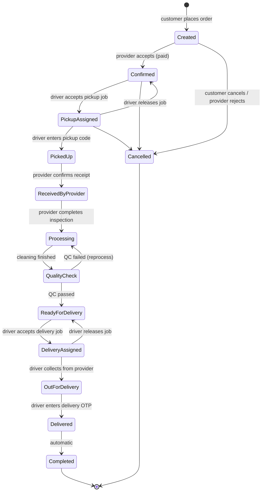
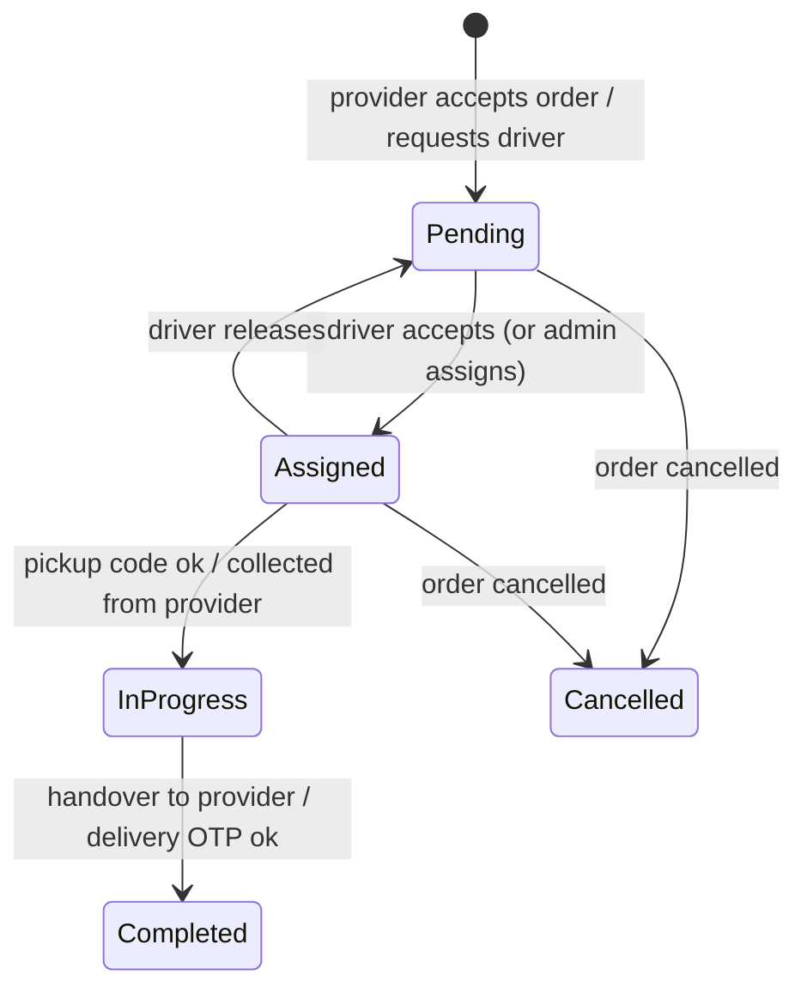
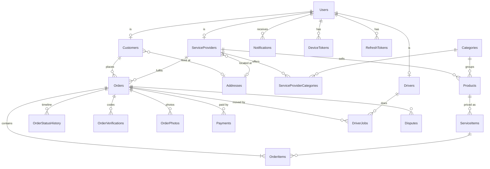

# EDry Cleaners – API & Workflow Guide

One place for everything about the EDry Cleaners API: how to call it, how each business flow works,
which endpoint does what, and which database tables each step reads and writes.

> **Source of truth:** the code in `DryCleaning.Api/`. This guide describes the API as of the
> `raj/api-integration` branch. Live, try-it-out docs: **Swagger** at `https://localhost:7180/swagger`
> (or `http://localhost:5180/swagger`) after `./run-api.sh`.

## Table of contents

1. [Quick start](#1-quick-start)
2. [Conventions](#2-conventions)
   - [Base URLs](#base-urls) · [Authentication](#authentication) · [JSON format](#json-format) ·
     [Paging](#paging) · [Errors](#errors) · [Status codes](#status-codes) · [Money, VAT and fees](#money-vat-and-fees)
3. [Roles and access](#3-roles-and-access)
4. [Workflows](#4-workflows)
   - [4.1 Sign-up, sign-in and sessions](#41-sign-up-sign-in-and-sessions)
   - [4.2 Order lifecycle (status machine)](#42-order-lifecycle-status-machine)
   - [4.3 End-to-end order walkthrough](#43-end-to-end-order-walkthrough)
   - [4.4 Payments (Paystack)](#44-payments-paystack)
   - [4.5 Driver jobs](#45-driver-jobs)
   - [4.6 Pickup code and delivery OTP](#46-pickup-code-and-delivery-otp)
   - [4.7 Cancellations, issues and disputes](#47-cancellations-issues-and-disputes)
   - [4.8 Notifications and push](#48-notifications-and-push)
   - [4.9 Provider onboarding and catalog](#49-provider-onboarding-and-catalog)
   - [4.10 Photos](#410-photos)
   - [4.11 Real-time updates (SignalR)](#411-real-time-updates-signalr)
5. [Endpoint reference](#5-endpoint-reference) (109 endpoints)
   - [5.1 Auth](#51-auth) · [5.2 Me (address, devices, notifications)](#52-me-address-devices-notifications) ·
     [5.3 Public catalog](#53-public-catalog) · [5.4 Customer](#54-customer) · [5.5 Provider](#55-provider) ·
     [5.6 Driver](#56-driver) · [5.7 Order photos](#57-order-photos) · [5.8 Payments webhook](#58-payments-webhook) ·
     [5.9 Admin](#59-admin)
6. [Request bodies and validation rules](#6-request-bodies-and-validation-rules)
7. [Response models](#7-response-models)
8. [Enums](#8-enums)
9. [Database tables](#9-database-tables)
   - [9.1 Table list](#91-table-list) · [9.2 Columns per table](#92-columns-per-table) ·
     [9.3 Which endpoints write which tables](#93-which-endpoints-write-which-tables)
10. [Configuration](#10-configuration)
11. [Testing checklist](#11-testing-checklist)

---

## 1. Quick start

1. Start SQL Server and the API: `./run-api.sh` (macOS) or `./run-api.ps1` (Windows).
2. Open `https://localhost:7180/swagger` (or `http://localhost:5180/swagger`).
3. `POST /api/auth/login` with a demo user (Development seed, password `Demo@12345`):

   | Role | Identifier |
   |---|---|
   | Customer | `sipho@example.co.za` |
   | Provider | `thandi@sparkledrycleaners.co.za` |
   | Driver | `bongani@drivers.edrycleaners.co.za` |
   | Admin | `admin@edrycleaners.co.za` |

4. Copy `accessToken`, click **Authorize**, paste it (without `Bearer `).
5. Call any endpoint for that role.

---

## 2. Conventions

### Base URLs

| Where | Base URL |
|---|---|
| Your Mac (Swagger, curl) | `https://localhost:7180` or `http://localhost:5180` |
| Android emulator | `http://10.0.2.2:5180` |
| iOS simulator | `http://localhost:5180` |
| Real phone on the same Wi-Fi | `http://<your-mac-ip>:5180` |
| Deployed server | `https://<your-domain>` (HTTPS is enforced outside Development) |

All routes start with `/api`. Health check: `GET /health`.

### Authentication

- **JWT bearer tokens.** Send `Authorization: Bearer <accessToken>` on every endpoint that isn't *Public*.
- **Access token** lasts **60 minutes** (`Jwt:ExpiryMinutes`; 24 hours in Development). It carries the user id, role and profile id.
- **Refresh token** lasts **30 days** (`Jwt:RefreshTokenDays`) and **rotates**: every `POST /api/auth/refresh`
  returns a new one and the old one stops working. Re-using an old one signs the user out on every device.
- **Who you are comes from the token**, never from the request body. `api/me/...` means "the signed-in user".

### JSON format

| Rule | Example |
|---|---|
| Property names are **camelCase** | `orderNumber`, `totalAmount` |
| Enums are **strings** | `"status": "ReadyForDelivery"` |
| Null properties are **left out** of responses | no `"description": null` |
| Ids are **GUIDs** | `"3fa85f64-5717-4562-b3fc-2c963f66afa6"` |
| Dates/times are **UTC**, ISO 8601 | `"2026-10-14T09:30:00Z"` |
| Pickup date is a **date only** | `"pickupDate": "2026-10-16"` |
| File uploads are **multipart/form-data** | photos, provider logo |

### Paging

List endpoints that take `page`, `pageSize`, `search`:

| Query | Default | Rules |
|---|---|---|
| `page` | 1 | minimum 1 |
| `pageSize` | 20 | 1 – 100 |
| `search` | — | free text (name, order number, … depending on the list) |

Response shape `PagedResult<T>`: `{ items: [...], page, pageSize, totalCount, totalPages }`.

### Errors

Errors use the standard **ProblemDetails** format:

```json
{ "type": "...", "title": "This order can no longer be cancelled because the items have been collected.", "status": 409 }
```

Validation errors (`400`) list the problems per field:

```json
{
  "title": "One or more validation errors occurred.",
  "status": 400,
  "errors": { "Password": ["Password must contain a number."] }
}
```

The `title` is written for end users – the app shows it as is.

### Status codes

| Code | Meaning |
|---|---|
| `200` | OK, body returned |
| `201` | Created (new order; `Location` header points to it) |
| `204` | OK, no body |
| `400` | Invalid request (validation, wrong code, missing address, …) |
| `401` | Not signed in, token expired, or wrong login |
| `403` | Signed in but not allowed (wrong role, account deactivated) |
| `404` | Not found – or not yours (other users' data always looks "not found") |
| `409` | Conflict with the current state (order already paid, job already taken, wrong status, duplicate email/phone) |
| `500` | Unexpected server error |

### Money, VAT and fees

All amounts are **ZAR** (`currency: "ZAR"`), decimals with 2 places. Prices are always calculated by the server.

| Value | Rule | Default (`Marketplace` settings) |
|---|---|---|
| `subTotal` | Σ (service item price × quantity) | — |
| `tax` | `subTotal × VatRate`, rounded to cents | VAT 15 % |
| `deliveryFee` | flat per order | R 45.00 |
| `totalAmount` | `subTotal + tax + deliveryFee` | — |
| Driver earning | flat per completed job (pickup or delivery) | R 35.00 |

---

## 3. Roles and access

| Role | Registers via | Uses | Notes |
|---|---|---|---|
| **Customer** | `POST /api/auth/register/customer` | Catalog, `api/customer/*`, `api/me/*` | Needs an address before ordering |
| **Provider** | `POST /api/auth/register/provider` | `api/provider/*`, `api/me/*` | Inactive until an admin approves; needs an address before accepting orders |
| **Driver** | `POST /api/auth/register/driver` | `api/driver/*`, `api/me/*` | Must be online to accept jobs; one active job at a time |
| **Admin** | Seeded only (no sign-up) | `api/admin/*` | Approves providers, assigns drivers, resolves disputes |

Every role can use: `api/auth/me*`, `api/notifications/*`, `api/me/devices`, and order photos for orders they're part of.

---

## 4. Workflows

### 4.1 Sign-up, sign-in and sessions

| Step | Endpoint | Result | Tables |
|---|---|---|---|
| Sign up | `POST /api/auth/register/{customer\|provider\|driver}` | Account + role profile. Customer/driver are signed in; provider gets tokens but stays inactive until approved (admins notified) | `Users`, `Customers` / `ServiceProviders` + `ServiceProviderCategories` / `Drivers`, `RefreshTokens`, `Notifications` |
| Sign in (password) | `POST /api/auth/login` | Access + refresh token | `RefreshTokens` |
| Sign in (OTP) | `POST /api/auth/otp/request` → `POST /api/auth/otp/verify` | 6-digit code, 5 min, 5 attempts | `RefreshTokens` (codes are in memory, not in a table) |
| Keep signed in | `POST /api/auth/refresh` | New access + refresh token (old one revoked) | `RefreshTokens` |
| Restore on app start | `POST /api/auth/refresh` with the stored refresh token | Same as above | `RefreshTokens` |
| Forgot password | `POST /api/auth/password/forgot` → `POST /api/auth/password/reset` | New password, signed in, other sessions revoked, "Password changed" notification | `Users`, `RefreshTokens`, `Notifications` |
| Change password | `POST /api/auth/me/change-password` | New password, all sessions revoked | `Users`, `RefreshTokens` |
| Sign out | `DELETE /api/me/devices?token=` then `POST /api/auth/logout` | Push stopped, refresh token revoked | `DeviceTokens`, `RefreshTokens` |

In Development, `otp/request` and `password/forgot` return the code as `devCode` (no SMS/email provider yet).

### 4.2 Order lifecycle (status machine)



From `Confirmed` up to `Completed`, either party can raise a dispute → **`Disputed`** (on hold). Only an admin
moves it on (`POST /api/admin/disputes/{id}/resolve` with an optional new order status).

| Status | Meaning | Set by (endpoint) | Who is notified |
|---|---|---|---|
| `Created` | Placed, waiting for payment and provider | Customer `POST /api/customer/orders` | — (provider is notified once paid) |
| `Confirmed` | Provider accepted; pickup job published | Provider `.../accept` (or driver `release` of a pickup job) | Customer; drivers ("job available") |
| `PickupAssigned` | A driver took the pickup job | Driver `jobs/{id}/accept` | Customer, provider |
| `PickedUp` | Driver has the items | Driver `jobs/{id}/pickup` (pickup code) | Customer, provider |
| `ReceivedByProvider` | Provider confirmed the items arrived | Provider `.../receive` (after driver `handover`) | Customer |
| `Processing` | Inspected; being cleaned | Provider `.../inspection` (or `reprocess`) | Customer |
| `QualityCheck` | Cleaning done; being checked | Provider `.../quality-check` | — |
| `ReadyForDelivery` | Packed | Provider `.../ready` (or driver `release` of a delivery job) | Customer |
| `DeliveryAssigned` | A driver took the delivery job | Driver `jobs/{id}/accept` | Customer, provider |
| `OutForDelivery` | Driver collected from the provider | Driver `jobs/{id}/start-delivery` | Customer |
| `Delivered` | Handed to the customer (OTP checked) | Driver `jobs/{id}/deliver` | Customer, provider |
| `Completed` | Closed (set right after `Delivered`) | Driver `jobs/{id}/deliver` | — |
| `Cancelled` | Stopped before pickup | Customer `.../cancel`, provider `.../reject` | Provider / customer |
| `Disputed` | On hold for admin review | Customer or provider `.../disputes` | The other party |

Every status change adds a row to `OrderStatusHistory` (who, when, notes) – that's the order timeline.

**Tabs in the apps** group these statuses:

| App | Tab | Statuses |
|---|---|---|
| Customer | Active | everything except Delivered, Completed, Cancelled |
| Customer | Completed | Delivered, Completed |
| Customer | Cancelled | Cancelled |
| Provider | New | Created (paid only) |
| Provider | Incoming | Confirmed, PickupAssigned, PickedUp |
| Provider | In process | ReceivedByProvider, Processing, QualityCheck |
| Provider | Ready | ReadyForDelivery, DeliveryAssigned, OutForDelivery |
| Provider | Completed | Delivered, Completed |
| Provider | Cancelled / Disputed | Cancelled / Disputed |

### 4.3 End-to-end order walkthrough

| # | Actor | Endpoint | Order status after | Job status after | Tables written | Push to |
|---|---|---|---|---|---|---|
| 1 | Customer | `PUT /api/me/address` (once) | — | — | `Addresses`, `Customers` | — |
| 2 | Customer | `GET /api/categories` → `GET /api/providers?categoryId=` → `GET /api/providers/{id}/catalog` | — | — | — (reads) | — |
| 3 | Customer | `POST /api/customer/orders` | `Created` | — | `Orders`, `OrderItems`, `OrderStatusHistory`, `OrderVerifications` (pickup code + delivery OTP) | — |
| 4 | Customer | `POST /api/customer/orders/{id}/payments/paystack` → browser → `GET .../payments/verify?reference=` | `Created` (paid) | — | `Payments` | Provider "New order received", customer "Payment successful" |
| 5 | Provider | `POST /api/provider/orders/{id}/accept` | `Confirmed` | Pickup job `Pending` | `Orders`, `OrderStatusHistory`, `DriverJobs` | Customer; online drivers |
| 6 | Driver | `PUT /api/driver/availability` `{isActive:true}` → `POST /api/driver/jobs/{jobId}/accept` | `PickupAssigned` | `Assigned` | `Drivers`, `DriverJobs`, `Orders`, `OrderStatusHistory` | Customer, provider |
| 7 | Driver | `POST /api/orders/{id}/photos` (type `Pickup`, optional) → `POST /api/driver/jobs/{jobId}/pickup` with the customer's **pickup code** | `PickedUp` | `InProgress` | `OrderPhotos`, `OrderVerifications`, `DriverJobs`, `Orders`, `OrderStatusHistory` | Customer, provider |
| 8 | Driver | `POST /api/driver/jobs/{jobId}/handover` | `PickedUp` | `Completed` | `DriverJobs` | Provider "Items delivered" |
| 9 | Provider | `POST /api/provider/orders/{id}/receive` | `ReceivedByProvider` | — | `Orders`, `OrderStatusHistory`, `OrderVerifications` | Customer |
| 10 | Provider | photos (type `Inspection`/`Damage`) → `POST .../inspection` | `Processing` | — | `OrderPhotos`, `Orders`, `OrderStatusHistory` | Customer |
| 11 | Provider | `POST .../quality-check` | `QualityCheck` | — | `Orders`, `OrderStatusHistory` | — |
| 12 | Provider | `POST .../ready` (or `.../reprocess` to go back) | `ReadyForDelivery` | — | `Orders`, `OrderStatusHistory` | Customer |
| 13 | Provider | `POST .../request-driver` | `ReadyForDelivery` | Delivery job `Pending` | `DriverJobs` | Online drivers |
| 14 | Driver | `POST /api/driver/jobs/{jobId}/accept` | `DeliveryAssigned` | `Assigned` | `DriverJobs`, `Orders`, `OrderStatusHistory` | Customer, provider |
| 15 | Driver | `POST /api/driver/jobs/{jobId}/start-delivery` | `OutForDelivery` | `InProgress` | `DriverJobs`, `Orders`, `OrderStatusHistory` | Customer |
| 16 | Driver | photos (type `Completion`) → `POST /api/driver/jobs/{jobId}/deliver` with the customer's **delivery OTP** | `Delivered` → `Completed` | `Completed` | `OrderVerifications`, `DriverJobs`, `Orders`, `OrderStatusHistory`, `OrderPhotos` | Customer, provider |

### 4.4 Payments (Paystack)

1. App: `POST /api/customer/orders/{id}/payments/paystack` → `{ paymentId, reference, authorizationUrl, accessCode, amount, currency, publicKey }`.
   Only for `Created`, unpaid orders. A `Payments` row is created with status `Pending`.
2. App opens `authorizationUrl` (WebAuthenticator). The customer pays on Paystack.
3. Paystack redirects to `edrycleaners://payment-complete?reference=...` (the app's callback).
4. App: `GET /api/customer/orders/{id}/payments/verify?reference=...` – the API asks Paystack and marks the
   payment `Success` or `Failed`.
5. Paystack also calls `POST /api/payments/paystack/webhook` (`charge.success`, HMAC-checked with the secret key).
   Whichever arrives first wins; the other is a no-op.
6. On success: provider gets "New order received", customer gets "Payment successful". The order now shows in the
   provider's **New** tab (unpaid orders are hidden while `Marketplace:RequirePaymentBeforeAccept` is `true`).

### 4.5 Driver jobs

Each order gets up to two jobs: a **Pickup** job (customer → provider) and a **Delivery** job (provider → customer).



| Job type · status | `nextStep` in the app | Driver endpoint |
|---|---|---|
| any · `Pending` | `Accept` | `POST /api/driver/jobs/{id}/accept` |
| Pickup · `Assigned` | `CollectFromCustomer` | `POST .../pickup` (pickup code) |
| Pickup · `InProgress` | `DropAtProvider` | `POST .../handover` |
| Delivery · `Assigned` | `CollectFromProvider` | `POST .../start-delivery` |
| Delivery · `InProgress` | `DeliverToCustomer` | `POST .../deliver` (delivery OTP) |
| `Completed` | `Done` | — |
| cancelled, taken by someone else, or order on hold | `Unavailable` | — |

Rules: the driver must be **online**; only **one active job** (Assigned/InProgress) at a time; a job can only be
**released** before it starts; jobs of `Cancelled` or `Disputed` orders can't be progressed. Admins can assign or
reassign any job with `POST /api/admin/driver-jobs/{jobId}/assign`. Earnings: flat `DriverEarningPerJob` per completed job.

### 4.6 Pickup code and delivery OTP

When the order is created the API makes two **4-digit codes** in `OrderVerifications`:

| Code | `OrderVerifications.Type` | Shown to | Used by | Endpoint |
|---|---|---|---|---|
| Pickup code | `QR` | Customer (`pickupCode` in order detail) | Driver at pickup | `POST /api/driver/jobs/{id}/pickup` `{ code }` |
| Delivery OTP | `OTP` | Customer (`deliveryOtp` in order detail) | Driver at delivery | `POST /api/driver/jobs/{id}/deliver` `{ code }` |

Item checks by the driver (pickup) and the provider (receive) are also recorded as `Item` verifications.
Codes are only returned to the customer, never to the provider or driver.

### 4.7 Cancellations, issues and disputes

| Action | Who | Endpoint | Allowed when | Effect |
|---|---|---|---|---|
| Cancel | Customer | `POST /api/customer/orders/{id}/cancel` `{ reason }` | `Created`, `Confirmed`, `PickupAssigned` | → `Cancelled`; open jobs cancelled; provider notified |
| Reject | Provider | `POST /api/provider/orders/{id}/reject` `{ reason }` | `Created` | → `Cancelled`; customer notified |
| Report issue | Provider | `POST /api/provider/orders/{id}/issues` `{ reason, description }` | any active status | `Disputes` row; customer notified; **order continues** |
| Raise dispute | Customer / provider | `POST .../{id}/disputes` `{ reason, description }` | `Confirmed` … `Completed` | `Disputes` row; order → `Disputed` (on hold); other party notified |
| Review | Admin | `POST /api/admin/disputes/{id}/review` | `Open` | Dispute → `UnderReview` |
| Resolve / reject | Admin | `POST /api/admin/disputes/{id}/resolve` `{ status, resolution, orderStatus? }` | any | Dispute → `Resolved`/`Rejected`; optional new order status; both parties notified |

### 4.8 Notifications and push

1. A business step calls `db.Notify(userId, order, title, message, type)` → a row in `Notifications`.
2. After the save succeeds, the notification is queued for push (in memory, never blocks the request).
3. A background worker looks up the user's `DeviceTokens` and sends through **Firebase Cloud Messaging**
   (Android + iOS). Without Firebase credentials pushes are only logged.
4. Push payload: `notification.title`, `notification.body`, and `data` = `{ notificationId, type, orderId? }`.
5. Tokens Firebase reports as dead are deleted.

The app reads the same rows with `GET /api/notifications` (bell list) and `GET /api/notifications/unread-count`
(badge). Phones register with `POST /api/me/devices` and unregister with `DELETE /api/me/devices?token=`.

| Event | Customer | Provider | Driver | Admin |
|---|---|---|---|---|
| Provider registers | | | | ✅ New provider registration |
| Provider approved / deactivated | | ✅ | | |
| Payment successful | ✅ | ✅ New order received | | |
| Order accepted / rejected | ✅ | | ✅ Job available (accept) | |
| Driver assigned (pickup / delivery) | ✅ | ✅ | | |
| Admin assigns a job | | | ✅ Job assigned | |
| Driver releases job | | ✅ | | |
| Items picked up | ✅ | ✅ Driver on the way (+ pickup notes) | | |
| Items handed to provider | | ✅ Please confirm receipt | | |
| Received / cleaning started / ready | ✅ | | | |
| Delivery job published | | | ✅ Job available | |
| Out for delivery | ✅ | | | |
| Delivered / completed | ✅ | ✅ | | |
| Order cancelled by customer | | ✅ | | |
| Issue reported / dispute raised | ✅ / other party | ✅ / other party | | |
| Dispute resolved / rejected | ✅ | ✅ | | |
| Password reset | ✅ the user | ✅ the user | ✅ the user | |

### 4.9 Provider onboarding and catalog

1. `POST /api/auth/register/provider` (with `categoryIds`) → business **inactive**; admins notified.
2. Admin: `GET /api/admin/providers?isActive=false` → `PUT /api/admin/providers/{id}/active` `{ isActive: true }` → provider notified.
3. Provider: `PUT /api/me/address` (needed before accepting orders), `PUT /api/provider/profile`, `POST /api/provider/profile/logo`.
4. Provider: `PUT /api/provider/categories` – which global categories it offers (admins manage the category list).
5. Provider: `POST /api/provider/products` (under a category) → `POST /api/provider/products/{id}/service-items` (price, estimated days).
6. Customers now see it in `GET /api/providers` and `GET /api/providers/{id}/catalog` (active items only).

Catalog shape: **Category** (global) → **Product** (per provider, e.g. "Suit") → **Service item** (priced, e.g. "Dry clean – R 120, 3 days").

### 4.10 Photos

`POST /api/orders/{orderId}/photos` (multipart: `file`, `type`), `GET /api/orders/{orderId}/photos`.

| `type` | Typical uploader | When |
|---|---|---|
| `Pickup` | Driver | At the customer, before entering the pickup code |
| `Inspection` | Provider | During inspection |
| `Damage` | Provider / driver | When something is damaged or stained |
| `Completion` | Driver | At delivery |

JPG, PNG, HEIC or WEBP; max 5 MB (`Storage:MaxUploadBytes`). The app shrinks every photo before upload
(longest side 1600 px, JPEG quality 80%), so a 17 MB phone photo arrives as about 1 MB.

**Where files live** (`Storage:Provider`):

| Provider | Where | `url` in responses | Use for |
|---|---|---|---|
| `Local` (default) | `wwwroot/uploads/orders/<orderId>/…` on the API's disk | relative, e.g. `/uploads/orders/…`; open it on the API base URL. Anyone with the link can open it. | Development, a single server with a persistent disk |
| `AzureBlob` | Azure Blob Storage | absolute. **Order photos**: private container, short-lived signed link (`Storage:AzureBlob:SignedLinkMinutes`, default 15) – list the photos again to get a fresh link. **Provider logos**: public-read container, plain link. | Azure hosting |

With `AzureBlob` the database stores `blob://container/path`, not a URL; the API turns it into a link on every response.
Older `/uploads/...` rows keep working. Sign-in to Azure uses the App Service's managed identity (role **Storage Blob
Data Contributor** on the storage account) – set `Storage__AzureBlob__AccountUrl`. For local testing with Azurite set
`Storage__AzureBlob__ConnectionString=UseDevelopmentStorage=true`.

### 4.11 Real-time updates (SignalR)

Signed-in apps keep one WebSocket open to the hub at **`/hubs/realtime`** so changes show up without polling
(provider creates a job → drivers see it; driver accepts → provider and customer see it).

**Connect** with the same JWT as the REST API. WebSockets can't send headers, so pass it as `?access_token=<jwt>`
(the SignalR client's `AccessTokenProvider` does this). Anonymous connections are rejected. The connection closes when
the token expires; reconnect with a fresh token.

The hub is **server → client only**. Events are small "something changed" signals – the app then re-reads the data with
the normal REST endpoints (so pickup codes and OTPs never travel over the hub). After any reconnect, refresh the current
screen, because events sent while offline are not replayed.

| Client method | Payload | Sent to | Typical app reaction |
|---|---|---|---|
| `OrderUpdated` | `{ orderId, orderNumber, status }` | The order's customer, provider and driver(s) | Reload that order / the order lists and counts |
| `DriverJobChanged` | `{ jobId, orderId, jobType, status }` | All **online** drivers, plus the job's current and previous driver | Reload available jobs / my jobs; if the open job became `Assigned` to someone else, show "no longer available" |
| `NotificationReceived` | `{ notificationId, userId, title, message, type, orderId?, createdAt }` | The notification's user | Bump the badge, prepend to the bell list |

Enums are sent as strings, like the REST API.

**What triggers events:** nothing is called from the business code. After each successful save the API looks at what changed:
an order's `Status`, a payment's `Status` (a paid order appears in the provider's **New** tab), a driver job added or its
`Status`/`DriverId` changed (accept, release, reassign), and every new `Notification` row. So every workflow in 4.3
produces events automatically.

**Push vs SignalR:** SignalR only reaches apps that are open and connected. Firebase push (4.8) still covers apps in the
background, so both stay on.

**Limits:** one API server only. Running several servers needs a SignalR backplane (Redis or Azure SignalR).

---

## 5. Endpoint reference

*Access:* **Public** = no token; **Signed in** = any role; otherwise the listed role(s).
Body/response type names link to [section 6](#6-request-bodies-and-validation-rules) and [section 7](#7-response-models).

### 5.1 Auth

| Method | Path | Access | Request | Response | What it does |
|---|---|---|---|---|---|
| `POST` | `/api/auth/register/customer` | Public | Body: `RegisterCustomerRequest` | `AuthResponse` | Create a customer account and sign in. Needs an email or a phone number (or both). |
| `POST` | `/api/auth/register/provider` | Public | Body: `RegisterProviderRequest` | `AuthResponse` | Create a provider account and business. The business stays **inactive** until an admin approves it; admins get a notification. |
| `POST` | `/api/auth/register/driver` | Public | Body: `RegisterDriverRequest` | `AuthResponse` | Create a driver account (shared marketplace driver) and sign in. |
| `POST` | `/api/auth/login` | Public | Body: `LoginRequest` | `AuthResponse` | Sign in with mobile number or email plus password. Returns access token (60 min) + refresh token (30 days). |
| `POST` | `/api/auth/refresh` | Public | Body: `RefreshTokenRequest` | `AuthResponse` | Swap a refresh token for a new access + refresh token. The old refresh token stops working (rotation); re-using it signs the user out everywhere. |
| `POST` | `/api/auth/logout` | Public | Body: `RefreshTokenRequest` | `204` | Revoke this device's refresh token. Call `DELETE /api/me/devices` first to stop pushes. |
| `POST` | `/api/auth/password/forgot` | Public | Body: `ForgotPasswordRequest` | `RequestOtpResponse` | Send a password-reset code. Always answers the same way, so it can't be used to discover accounts. In Development the code is returned as `devCode`. |
| `POST` | `/api/auth/password/reset` | Public | Body: `ResetPasswordRequest` | `AuthResponse` | Check the reset code, set the new password and sign in. All other sessions are signed out. |
| `POST` | `/api/auth/otp/request` | Public | Body: `RequestOtpRequest` | `RequestOtpResponse` | Send a 6-digit login code ("Continue with OTP"). Valid 5 minutes, 5 attempts. |
| `POST` | `/api/auth/otp/verify` | Public | Body: `VerifyOtpRequest` | `AuthResponse` | Check the login code and sign in. |
| `GET` | `/api/auth/me` | Signed in | — | `UserDto` | The signed-in user (id, role, name, email, phone, profileId). |
| `PUT` | `/api/auth/me` | Signed in | Body: `UpdateProfileRequest` | `UserDto` | Update my name, email or mobile number (must stay unique). |
| `POST` | `/api/auth/me/change-password` | Signed in | Body: `ChangePasswordRequest` | `204` | Change my password (current password required). |

### 5.2 Me (address, devices, notifications)

| Method | Path | Access | Request | Response | What it does |
|---|---|---|---|---|---|
| `GET` | `/api/me/address` | Customer, Provider, Driver | — | `AddressDto` or `204` | My saved address. `204 No Content` when none is set. |
| `PUT` | `/api/me/address` | Customer, Provider, Driver | Body: `UpsertAddressRequest` | `AddressDto` | Create or replace my address from a Google Places selection. Customers need one before ordering; providers before accepting orders. |
| `POST` | `/api/me/devices` | Signed in | Body: `RegisterDeviceRequest` | `204` | Register this phone's push token (`token`, `platform`). Call after sign-in, on app start and when the token changes. |
| `DELETE` | `/api/me/devices` | Signed in | Query: `token` | `204` | Stop pushes to this phone (`?token=`). Call on logout. |
| `POST` | `/api/me/photo` | Customer, Provider, Driver | Multipart: `File` | `UserDto` | Set or replace my profile photo (JPG, PNG, HEIC or WEBP, max 5 MB). Stored in the public-read area; `photoUrl` in the response. |
| `DELETE` | `/api/me/photo` | Customer, Provider, Driver | — | `UserDto` | Remove my profile photo (back to the initials avatar). |
| `GET` | `/api/notifications` | Signed in | Query: `page`, `pageSize`, `search`, `unreadOnly` | `PagedResult<NotificationDto>` | My in-app notifications, newest first (paged; `unreadOnly=true` to filter). |
| `GET` | `/api/notifications/unread-count` | Signed in | — | `int` | Number of unread notifications (for the bell badge). |
| `POST` | `/api/notifications/{id}/read` | Signed in | — | `204` | Mark one notification as read. |
| `POST` | `/api/notifications/read-all` | Signed in | — | `204` | Mark all my notifications as read. |

### 5.3 Public catalog

| Method | Path | Access | Request | Response | What it does |
|---|---|---|---|---|---|
| `GET` | `/api/categories` | Public | — | `IReadOnlyList<CategoryDto>` | Active categories (Dry Cleaning, Shoe Cleaning, …) in display order. |
| `GET` | `/api/categories/{id}` | Public | — | `CategoryDto` | One category. |
| `GET` | `/api/providers` | Public | Query: `categoryId`, `page`, `pageSize`, `search` | `PagedResult<ProviderSummaryDto>` | Approved providers (paged, `search`), optionally only those offering `categoryId`. |
| `GET` | `/api/providers/{providerId}` | Public | Query: `categoryId` | `ProviderSummaryDto` | One provider's summary (starting price and fastest turnaround, optionally for `categoryId`). |
| `GET` | `/api/catalog/products/{productId}` | Public | — | `ProductDto` | One product with its active service items (prices, estimated days). |
| `GET` | `/api/catalog/popular` | Public | Query: `take` | `IReadOnlyList<PopularServiceItemDto>` | "Popular right now": most-ordered service items in the last 30 days (`take`, default 6). |
| `GET` | `/api/providers/{providerId}/catalog` | Public | — | `ProviderCatalogDto` | A provider's active catalog: categories → products → service items. |
| `GET` | `/api/providers/{providerId}/working-hours` | Public | — | `IReadOnlyList<WorkingHourDto>` | The provider's pickup days and hours (seven entries, Sunday first) – the customer app only offers pickup slots inside them. |

### 5.4 Customer

| Method | Path | Access | Request | Response | What it does |
|---|---|---|---|---|---|
| `POST` | `/api/customer/orders/quote` | Customer | Body: `CreateOrderRequest` | `OrderQuoteDto` | Price a cart (subtotal, VAT, delivery fee, total) without creating an order. Not used by the app. |
| `POST` | `/api/customer/orders` | Customer | Body: `CreateOrderRequest` | `201` `OrderDetailDto` | Create an order from the cart. Prices come from the server; pickup address = my saved address. Creates the pickup code and delivery OTP. Status `Created`, unpaid. Returns `201` with the order. |
| `GET` | `/api/customer/orders` | Customer | Query: `filter`, `page`, `pageSize`, `search` | `PagedResult<OrderSummaryDto>` | My orders by tab: `filter` = Active / Completed / Cancelled / All. |
| `GET` | `/api/customer/orders/counts` | Customer | — | `CustomerOrderCountsDto` | Badge counts for the Active / Completed / Cancelled tabs. |
| `GET` | `/api/customer/orders/{id}` | Customer | — | `OrderDetailDto` | Order detail: items, totals, timeline, driver jobs, photos, payments, disputes, **pickup code** and **delivery OTP**. |
| `POST` | `/api/customer/orders/{id}/cancel` | Customer | Body: `ReasonRequest` | `OrderDetailDto` | Cancel with a reason. Only before pickup (`Created`, `Confirmed`, `PickupAssigned`). Open driver jobs are cancelled; the provider is notified. |
| `POST` | `/api/customer/orders/{id}/disputes` | Customer | Body: `IssueRequest` | `DisputeDto` | Raise a dispute: order → `Disputed` (on hold) until an admin resolves it. |
| `POST` | `/api/customer/orders/{id}/payments/paystack` | Customer | — | `InitializePaymentResponse` | Start Paystack checkout for a `Created`, unpaid order. Open `authorizationUrl` in a browser. |
| `GET` | `/api/customer/orders/{id}/payments/verify` | Customer | Query: `reference` | `PaymentDto` | After checkout returns, confirm the payment with Paystack (`?reference=`). On success the provider sees the order as New. |
| `GET` | `/api/customer/orders/{id}/payments` | Customer | — | `IReadOnlyList<PaymentDto>` | Payment attempts for my order. |

### 5.5 Provider

| Method | Path | Access | Request | Response | What it does |
|---|---|---|---|---|---|
| `GET` | `/api/provider/products` | Provider | Query: `categoryId` | `IReadOnlyList<ProductDto>` | My products (optionally one `categoryId`), with their service items. |
| `GET` | `/api/provider/products/{productId}` | Provider | — | `ProductDto` | One of my products. |
| `POST` | `/api/provider/products` | Provider | Body: `ProductRequest` | `ProductDto` | Add a product under one of my enabled categories. |
| `PUT` | `/api/provider/products/{productId}` | Provider | Body: `ProductRequest` | `ProductDto` | Edit a product (name, description, image, category, order). |
| `PUT` | `/api/provider/products/{productId}/active` | Provider | Body: `SetActiveRequest` | `204` | Show / hide a product in the customer catalog. |
| `POST` | `/api/provider/products/{productId}/service-items` | Provider | Body: `ServiceItemRequest` | `ServiceItemDto` | Add a priced service item (e.g. "Dry clean – R120, 3 days") to a product. |
| `GET` | `/api/provider/service-items/{serviceItemId}` | Provider | — | `ServiceItemDto` | One of my service items. |
| `PUT` | `/api/provider/service-items/{serviceItemId}` | Provider | Body: `ServiceItemRequest` | `ServiceItemDto` | Edit name, price, estimated days, image, order. |
| `PUT` | `/api/provider/service-items/{serviceItemId}/active` | Provider | Body: `SetActiveRequest` | `204` | Show / hide a service item. |
| `GET` | `/api/provider/dashboard` | Provider | — | `ProviderDashboardDto` | Dashboard: counts per tab, today's orders, recent activity, unread notifications. |
| `GET` | `/api/provider/orders` | Provider | Query: `filter`, `page`, `pageSize`, `search` | `PagedResult<OrderSummaryDto>` | My orders by tab: `filter` = New / Incoming / InProcess / Ready / Completed / Cancelled / Disputed / All. Unpaid orders are hidden. |
| `GET` | `/api/provider/orders/counts` | Provider | — | `ProviderOrderCountsDto` | Badge counts for every order tab. |
| `GET` | `/api/provider/orders/{id}` | Provider | — | `OrderDetailDto` | Order detail (no pickup code / OTP – those are the customer's). |
| `POST` | `/api/provider/orders/{id}/accept` | Provider | — | `OrderDetailDto` | Accept a paid `Created` order → `Confirmed`; publishes a **pickup job** to drivers. Needs my business address. |
| `POST` | `/api/provider/orders/{id}/reject` | Provider | Body: `ReasonRequest` | `OrderDetailDto` | Reject a new order with a reason → `Cancelled`. |
| `POST` | `/api/provider/orders/{id}/receive` | Provider | Body: `ReceiveOrderRequest` | `OrderDetailDto` | Confirm the driver handed the items over (actual item count) → `ReceivedByProvider`. |
| `POST` | `/api/provider/orders/{id}/inspection` | Provider | Body: `InspectionRequest` | `OrderDetailDto` | Inspection per item (received quantity, condition Good/Stained/Damaged, note) → `Processing`. |
| `POST` | `/api/provider/orders/{id}/quality-check` | Provider | — | `OrderDetailDto` | Cleaning finished → `QualityCheck`. |
| `POST` | `/api/provider/orders/{id}/reprocess` | Provider | Body: `ReasonRequest` | `OrderDetailDto` | Quality check failed (reason) → back to `Processing`. |
| `POST` | `/api/provider/orders/{id}/ready` | Provider | — | `OrderDetailDto` | Quality check passed, packed → `ReadyForDelivery`. |
| `POST` | `/api/provider/orders/{id}/request-driver` | Provider | — | `OrderDetailDto` | Publish a **delivery job** to drivers (order must be `ReadyForDelivery`). |
| `POST` | `/api/provider/orders/{id}/issues` | Provider | Body: `IssueRequest` | `DisputeDto` | Report a discrepancy or damage; the customer is notified, the order continues. |
| `POST` | `/api/provider/orders/{id}/disputes` | Provider | Body: `IssueRequest` | `DisputeDto` | Raise a dispute: order → `Disputed` (on hold) until an admin resolves it. |
| `GET` | `/api/provider/profile` | Provider | — | `ProviderProfileDto` | My business profile (owner, address, logo, categories, active/approved). |
| `PUT` | `/api/provider/profile` | Provider | Body: `UpdateProviderProfileRequest` | `ProviderProfileDto` | Update business name, description, phone, email, logo URL. |
| `POST` | `/api/provider/profile/logo` | Provider | Body: multipart form | `ProviderProfileDto` | Upload a new logo (multipart `file`; JPG, PNG, HEIC or WEBP). Returns the profile with the new `logoUrl`. |
| `GET` | `/api/provider/categories` | Provider | — | `IReadOnlyList<ProviderCategoryDto>` | All global categories with `isEnabled` for my business. |
| `PUT` | `/api/provider/categories` | Provider | Body: `SetProviderCategoriesRequest` | `IReadOnlyList<ProviderCategoryDto>` | Choose which global categories my business offers (providers can't create categories). |
| `GET` | `/api/provider/working-hours` | Provider | — | `IReadOnlyList<WorkingHourDto>` | My pickup days and hours: seven entries, Sunday (`day` 0) first. Until a provider sets hours they are open every day 09:00–19:00. |
| `PUT` | `/api/provider/working-hours` | Provider | Body: `SetWorkingHoursRequest` | `IReadOnlyList<WorkingHourDto>` | Set my pickup days and hours. Customers can only book pickup slots on open days inside the hours; `POST /api/customer/orders` enforces it. |

### 5.6 Driver

| Method | Path | Access | Request | Response | What it does |
|---|---|---|---|---|---|
| `GET` | `/api/driver/profile` | Driver | — | `DriverProfileDto` | My driver profile (user, licence number, availability, address). |
| `PUT` | `/api/driver/profile` | Driver | Body: `UpdateDriverProfileRequest` | `DriverProfileDto` | Update licence number, name, email, phone. |
| `GET` | `/api/driver/dashboard` | Driver | — | `DriverDashboardDto` | Dashboard: online status, available jobs, active job, completed and earnings today. |
| `PUT` | `/api/driver/availability` | Driver | Body: `SetActiveRequest` | `bool` | Go online (`isActive: true`) or offline. Must be online to accept jobs. |
| `GET` | `/api/driver/jobs/available` | Driver | Query: `page`, `pageSize`, `search` | `PagedResult<DriverJobDto>` | Jobs waiting for a driver (pickup and delivery), paged. |
| `GET` | `/api/driver/jobs` | Driver | Query: `status`, `page`, `pageSize`, `search` | `PagedResult<DriverJobDto>` | My jobs, optionally by `status` (Assigned / InProgress / Completed / Cancelled). |
| `GET` | `/api/driver/jobs/counts` | Driver | — | `DriverJobCountsDto` | Badge counts: Available / Mine / Completed. |
| `GET` | `/api/driver/jobs/by-order/{orderId}` | Driver | — | `DriverJobDetailDto` | The job a notification refers to: my job for that order, else an open one. |
| `GET` | `/api/driver/jobs/history` | Driver | Query: `page`, `pageSize`, `search` | `PagedResult<DriverJobDto>` | Completed jobs, newest first. |
| `GET` | `/api/driver/earnings` | Driver | Query: `period` | `DriverEarningsDto` | Earnings for `period` = Week (7 daily bars) or Month (4 weekly bars). Flat rate per job. |
| `GET` | `/api/driver/jobs/{jobId}` | Driver | — | `DriverJobDetailDto` | Job detail: addresses, items, `nextStep`; phone numbers once the job is mine. |
| `POST` | `/api/driver/jobs/{jobId}/accept` | Driver | — | `DriverJobDetailDto` | Take a `Pending` job (one active job at a time, must be online). Order → `PickupAssigned` or `DeliveryAssigned`. |
| `POST` | `/api/driver/jobs/{jobId}/release` | Driver | — | `DriverJobDetailDto` | Give an accepted job back before starting it. Order goes back to `Confirmed` / `ReadyForDelivery`. |
| `POST` | `/api/driver/jobs/{jobId}/pickup` | Driver | Body: `DriverPickupRequest` | `DriverJobDetailDto` | At the customer: item check + the customer's **pickup code** → job `InProgress`, order `PickedUp`. |
| `POST` | `/api/driver/jobs/{jobId}/handover` | Driver | Body: `VerifyCodeRequest` | `DriverJobDetailDto` | At the provider: items handed over → pickup job `Completed`. The provider then confirms with `receive`. |
| `POST` | `/api/driver/jobs/{jobId}/start-delivery` | Driver | Body: `StartDeliveryRequest` (optional) | `DriverJobDetailDto` | Collected the packed order from the provider (optional package count, notes) → job `InProgress`, order `OutForDelivery`. |
| `POST` | `/api/driver/jobs/{jobId}/deliver` | Driver | Body: `VerifyCodeRequest` | `DriverJobDetailDto` | At the customer: the customer's **delivery OTP** → job `Completed`, order `Delivered` then `Completed`. |

### 5.7 Order photos

| Method | Path | Access | Request | Response | What it does |
|---|---|---|---|---|---|
| `POST` | `/api/orders/{orderId}/photos` | Signed in | Body: multipart form | `OrderPhotoDto` | Upload an order photo (multipart: `file`, `type` = Pickup / Inspection / Completion / Damage). JPG, PNG, HEIC or WEBP, max 5 MB. Allowed for the order's customer, its provider, drivers who had a job on it, and admins. |
| `GET` | `/api/orders/{orderId}/photos` | Signed in | — | `IReadOnlyList<OrderPhotoDto>` | All photos of an order (same access rules as upload). |

### 5.8 Payments webhook

| Method | Path | Access | Request | Response | What it does |
|---|---|---|---|---|---|
| `POST` | `/api/payments/paystack/webhook` | Public | — | `200` | Called by Paystack's servers (not the app). Checks the `x-paystack-signature` HMAC; acts on `charge.success` the same way as verify. |

### 5.9 Admin

| Method | Path | Access | Request | Response | What it does |
|---|---|---|---|---|---|
| `GET` | `/api/admin/dashboard` | Admin | — | `AdminDashboardDto` | Totals (customers, providers, drivers, orders), revenue, open disputes, orders by status, last 30 days chart. |
| `GET` | `/api/admin/customers` | Admin | Query: `page`, `pageSize`, `search` | `PagedResult<AdminCustomerDto>` | Customers (paged, `search`) with order count and active flag. |
| `PUT` | `/api/admin/users/{userId}/active` | Admin | Body: `SetActiveRequest` | `204` | Deactivate / reactivate any user account (can't deactivate yourself). |
| `GET` | `/api/admin/providers` | Admin | Query: `page`, `pageSize`, `search`, `isActive` | `PagedResult<AdminProviderDto>` | Providers (paged, `search`, `isActive` – use `false` for pending approvals). |
| `PUT` | `/api/admin/providers/{providerId}/active` | Admin | Body: `SetActiveRequest` | `204` | Approve (`true`) or deactivate (`false`) a provider; the provider is notified. |
| `GET` | `/api/admin/providers/{providerId}/catalog` | Admin | — | `ProviderCatalogDto` | A provider's full catalog, including inactive items. |
| `GET` | `/api/admin/drivers` | Admin | Query: `page`, `pageSize`, `search` | `PagedResult<AdminDriverDto>` | Drivers (paged, `search`) with availability and job counts. |
| `PUT` | `/api/admin/drivers/{driverId}/active` | Admin | Body: `SetActiveRequest` | `204` | Activate / deactivate a driver (deactivating also sets them offline). |
| `GET` | `/api/admin/categories` | Admin | — | `IReadOnlyList<CategoryDto>` | All categories, including inactive. |
| `POST` | `/api/admin/categories` | Admin | Body: `CategoryRequest` | `CategoryDto` | Create a category. |
| `PUT` | `/api/admin/categories/{id}` | Admin | Body: `CategoryRequest` | `CategoryDto` | Edit a category. |
| `PUT` | `/api/admin/categories/{id}/active` | Admin | Body: `SetActiveRequest` | `204` | Show / hide a category everywhere. |
| `PUT` | `/api/admin/categories/order` | Admin | Body: `ReorderRequest` | `204` | Set the display order (list of category ids, first = top). |
| `GET` | `/api/admin/orders` | Admin | Query: `status`, `page`, `pageSize`, `search` | `PagedResult<AdminOrderDto>` | All orders (paged, `search`, `status`). |
| `GET` | `/api/admin/orders/{orderId}` | Admin | — | `OrderDetailDto` | Full order detail: items, history, photos, jobs, payments, disputes. |
| `GET` | `/api/admin/driver-jobs` | Admin | Query: `status`, `jobType`, `page`, `pageSize`, `search` | `PagedResult<DriverJobDto>` | All driver jobs (paged, `status`, `jobType`). |
| `POST` | `/api/admin/driver-jobs/{jobId}/assign` | Admin | Body: `AssignDriverRequest` | `DriverJobDto` | Assign or reassign a job to a driver (`driverId`); the driver is notified. |
| `GET` | `/api/admin/payments` | Admin | Query: `page`, `pageSize`, `search`, `status` | `PagedResult<AdminPaymentDto>` | All payments (paged, `status`). |
| `GET` | `/api/admin/disputes` | Admin | Query: `status`, `page`, `pageSize`, `search` | `PagedResult<DisputeDto>` | All disputes (paged, `status`). |
| `POST` | `/api/admin/disputes/{disputeId}/review` | Admin | — | `DisputeDto` | Mark a dispute `UnderReview`. |
| `POST` | `/api/admin/disputes/{disputeId}/resolve` | Admin | Body: `ResolveDisputeRequest` | `DisputeDto` | Resolve or reject with a resolution text, optionally moving the order to a new status (e.g. `Processing`, `Completed`, `Cancelled`). Both parties are notified. |

---

## 6. Request bodies and validation rules

Rules are enforced by FluentValidation; breaking one returns `400` with the field name.
*Password* = 8–100 characters with at least one letter and one number. *Phone* = `+` optional, 9–20 digits/spaces/brackets/dashes.

#### LoginRequest

Used by: `POST /api/auth/login`

| Field | Type | Required | Rules |
|---|---|---|---|
| `identifier` | string | yes | Mobile number or email, max 100 |
| `password` | string | yes | — |

#### RegisterCustomerRequest

Used by: `POST /api/auth/register/customer`

| Field | Type | Required | Rules |
|---|---|---|---|
| `name` | string | yes | max 100 |
| `email` | string | one of email/phone | valid email, max 100, unique |
| `phone` | string | one of email/phone | Phone, unique |
| `password` | string | yes | Password |

#### RegisterProviderRequest

Used by: `POST /api/auth/register/provider`

| Field | Type | Required | Rules |
|---|---|---|---|
| `name` | string | yes | Owner name, max 100 |
| `email` | string | one of email/phone | valid email, max 100, unique |
| `phone` | string | one of email/phone | Phone, unique |
| `password` | string | yes | Password |
| `businessName` | string | yes | max 100 |
| `description` | string | no | max 500 |
| `categoryIds` | guid[] | no | Active categories the business offers |

#### RegisterDriverRequest

Used by: `POST /api/auth/register/driver`

| Field | Type | Required | Rules |
|---|---|---|---|
| `name` | string | yes | max 100 |
| `email` | string | no | valid email, max 100, unique |
| `phone` | string | yes | Phone, unique |
| `password` | string | yes | Password |
| `licenseNumber` | string | yes | max 50 |

#### RefreshTokenRequest

Used by: `POST /api/auth/refresh`, `POST /api/auth/logout`

| Field | Type | Required | Rules |
|---|---|---|---|
| `refreshToken` | string | yes | max 200 |

#### RequestOtpRequest

Used by: `POST /api/auth/otp/request`

| Field | Type | Required | Rules |
|---|---|---|---|
| `identifier` | string | yes | Mobile number or email, max 100 |

#### VerifyOtpRequest

Used by: `POST /api/auth/otp/verify`

| Field | Type | Required | Rules |
|---|---|---|---|
| `identifier` | string | yes | — |
| `code` | string | yes | 4–8 digits |

#### ForgotPasswordRequest

Used by: `POST /api/auth/password/forgot`

| Field | Type | Required | Rules |
|---|---|---|---|
| `identifier` | string | yes | max 100 |

#### ResetPasswordRequest

Used by: `POST /api/auth/password/reset`

| Field | Type | Required | Rules |
|---|---|---|---|
| `identifier` | string | yes | max 100 |
| `code` | string | yes | 4–8 digits |
| `newPassword` | string | yes | Password |

#### ChangePasswordRequest

Used by: `POST /api/auth/me/change-password`

| Field | Type | Required | Rules |
|---|---|---|---|
| `currentPassword` | string | yes | — |
| `newPassword` | string | yes | Password, different from the current one |

#### UpdateProfileRequest

Used by: `PUT /api/auth/me`

| Field | Type | Required | Rules |
|---|---|---|---|
| `name` | string | yes | max 100 |
| `email` | string | no | valid email, max 100, unique |
| `phone` | string | no | Phone, unique |

#### UpsertAddressRequest

Used by: `PUT /api/me/address`

| Field | Type | Required | Rules |
|---|---|---|---|
| `formattedAddress` | string | yes | max 1000 |
| `googlePlaceId` | string | no | max 255 |
| `addressLine1 / addressLine2` | string | no | max 255 |
| `streetNumber` | string | no | max 50 |
| `route, subLocality, locality, administrativeAreaLevel1/2, country` | string | no | max 255 each |
| `countryCode, postalCode, plusCode` | string | no | short codes |
| `latitude / longitude` | decimal | yes | from Google Places |

#### RegisterDeviceRequest

Used by: `POST /api/me/devices`

| Field | Type | Required | Rules |
|---|---|---|---|
| `token` | string | yes | Push token, max 512 |
| `platform` | DevicePlatform | yes | `Android` or `iOS` |

#### CreateOrderRequest

Used by: `POST /api/customer/orders`, `POST /api/customer/orders/quote`

| Field | Type | Required | Rules |
|---|---|---|---|
| `serviceProviderId` | guid | yes | An approved provider |
| `items` | CreateOrderItemRequest[] | yes | 1–50 lines |
| `items[].serviceItemId` | guid | yes | Active item of that provider |
| `items[].quantity` | int | yes | 1–100 |
| `items[].notes` | string | no | Special instructions, max 500 |
| `pickupDate` | date | no | Today-1 … today+30 |
| `pickupSlot` | string | with pickupDate | e.g. `08:00 – 10:00`, max 50 |

#### SetWorkingHoursRequest

Used by: `PUT /api/provider/working-hours`

| Field | Type | Required | Rules |
|---|---|---|---|
| `days` | WorkingHourDto[] | yes | Exactly seven entries, one per `day` 0–6 (0 = Sunday); at least one open |
| `days[].day` | int | yes | 0–6 |
| `days[].isOpen` | bool | yes | `false` = no pickups that day |
| `days[].openTime`, `days[].closeTime` | string | when open | `HH:mm` (24-hour), closing at least two hours after opening |

#### ReasonRequest

Used by: cancel, reject, reprocess

| Field | Type | Required | Rules |
|---|---|---|---|
| `reason` | string | yes | max 400 |

#### IssueRequest

Used by: issues, disputes

| Field | Type | Required | Rules |
|---|---|---|---|
| `reason` | string | yes | max 200 |
| `description` | string | no | max 1000 |

#### ReceiveOrderRequest

Used by: `POST /api/provider/orders/{id}/receive`

| Field | Type | Required | Rules |
|---|---|---|---|
| `actualItemCount` | int | yes | ≥ 0 |
| `notes` | string | no | max 400 |

#### InspectionRequest

Used by: `POST /api/provider/orders/{id}/inspection`

| Field | Type | Required | Rules |
|---|---|---|---|
| `items` | InspectionItemRequest[] | yes | at least one |
| `items[].orderItemId` | guid | yes | Line of this order |
| `items[].receivedQuantity` | int | yes | ≥ 0 |
| `items[].condition` | ItemCondition | yes | `Good`, `Stained`, `Damaged` |
| `items[].note` | string | no | max 200 |

#### ProductRequest

Used by: provider products (create/edit)

| Field | Type | Required | Rules |
|---|---|---|---|
| `categoryId` | guid | yes | One of my enabled categories |
| `name` | string | yes | max 100 |
| `description` | string | no | max 500 |
| `imageUrl` | string | no | max 255 |
| `displayOrder` | int | no | ≥ 0 (default: last) |
| `isActive` | bool | yes | — |

#### ServiceItemRequest

Used by: provider service items (create/edit)

| Field | Type | Required | Rules |
|---|---|---|---|
| `name` | string | yes | max 100 |
| `description` | string | no | max 500 |
| `imageUrl` | string | no | max 255 |
| `price` | decimal | yes | > 0 (ZAR, VAT excluded) |
| `estimatedDays` | int | yes | 1–60 |
| `displayOrder` | int | no | ≥ 0 |
| `isActive` | bool | yes | — |

#### UpdateProviderProfileRequest

Used by: `PUT /api/provider/profile`

| Field | Type | Required | Rules |
|---|---|---|---|
| `businessName` | string | yes | max 100 |
| `description` | string | no | max 500 |
| `phone` | string | no | max 20 |
| `email` | string | no | valid email, max 100 |
| `logoUrl` | string | no | max 255 |

#### SetProviderCategoriesRequest

Used by: `PUT /api/provider/categories`

| Field | Type | Required | Rules |
|---|---|---|---|
| `categoryIds` | guid[] | yes | The full list to offer (replaces the current one) |

#### UpdateDriverProfileRequest

Used by: `PUT /api/driver/profile`

| Field | Type | Required | Rules |
|---|---|---|---|
| `licenseNumber` | string | yes | max 50 |
| `name` | string | no | 2–100 |
| `email` | string | no | valid email, max 100 |
| `phone` | string | no | max 20 |

#### SetActiveRequest

Used by: availability, all `.../active` endpoints

| Field | Type | Required | Rules |
|---|---|---|---|
| `isActive` | bool | yes | — |

#### DriverPickupRequest

Used by: `POST /api/driver/jobs/{id}/pickup`

| Field | Type | Required | Rules |
|---|---|---|---|
| `code` | string | yes | Customer's pickup code, max 10 |
| `items` | DriverItemCheckRequest[] | no | max 50 |
| `items[].orderItemId` | guid | yes | — |
| `items[].countedQuantity` | int | yes | 0–200 |
| `items[].condition` | ItemCondition | yes | — |
| `items[].note` | string | no | max 200 |
| `itemCount` | int | no | ≥ 0, total counted |
| `notes` | string | no | max 300 |

#### VerifyCodeRequest

Used by: `handover` (code ignored), `deliver` (delivery OTP)

| Field | Type | Required | Rules |
|---|---|---|---|
| `code` | string | yes | max 10 (send `""` for handover) |
| `itemCount` | int | no | ≥ 0 |
| `notes` | string | no | max 300 |

#### StartDeliveryRequest

Used by: `POST /api/driver/jobs/{id}/start-delivery` (body optional)

| Field | Type | Required | Rules |
|---|---|---|---|
| `packageCount` | int | no | 1–50 |
| `notes` | string | no | max 300 |

#### CategoryRequest

Used by: admin categories (create/edit)

| Field | Type | Required | Rules |
|---|---|---|---|
| `name` | string | yes | max 100 |
| `description` | string | no | max 500 |
| `imageUrl` | string | no | max 255 |
| `displayOrder` | int | yes | ≥ 0 |
| `isActive` | bool | yes | — |

#### ReorderRequest

Used by: `PUT /api/admin/categories/order`

| Field | Type | Required | Rules |
|---|---|---|---|
| `categoryIds` | guid[] | yes | All category ids in the new order |

#### AssignDriverRequest

Used by: `POST /api/admin/driver-jobs/{id}/assign`

| Field | Type | Required | Rules |
|---|---|---|---|
| `driverId` | guid | yes | An active driver |

#### ResolveDisputeRequest

Used by: `POST /api/admin/disputes/{id}/resolve`

| Field | Type | Required | Rules |
|---|---|---|---|
| `status` | DisputeStatus | yes | `Resolved` or `Rejected` |
| `resolution` | string | yes | max 1000 |
| `orderStatus` | OrderStatus | no | Move the order on (e.g. `Processing`, `Completed`, `Cancelled`) |

#### Multipart: photo

Used by: `POST /api/orders/{id}/photos`

| Field | Type | Required | Rules |
|---|---|---|---|
| `file` | file | yes | JPG, PNG, HEIC, WEBP; max 5 MB |
| `type` | PhotoType | yes | `Pickup`, `Inspection`, `Completion`, `Damage` |

#### Multipart: logo

Used by: `POST /api/provider/profile/logo`

| Field | Type | Required | Rules |
|---|---|---|---|
| `file` | file | yes | JPG, PNG, HEIC, WEBP; max 5 MB |


---

## 7. Response models

#### ActivityDto

| Field | Type |
|---|---|
| `orderId` | `Guid` |
| `orderNumber` | `string` |
| `status` | `OrderStatus` |
| `notes` | `string?` |
| `at` | `DateTime` |

#### AddressDto

| Field | Type |
|---|---|
| `id` | `Guid` |
| `googlePlaceId` | `string?` |
| `formattedAddress` | `string` |
| `addressLine1` | `string?` |
| `addressLine2` | `string?` |
| `streetNumber` | `string?` |
| `route` | `string?` |
| `subLocality` | `string?` |
| `locality` | `string?` |
| `administrativeAreaLevel1` | `string?` |
| `administrativeAreaLevel2` | `string?` |
| `country` | `string?` |
| `countryCode` | `string?` |
| `postalCode` | `string?` |
| `latitude` | `decimal` |
| `longitude` | `decimal` |
| `plusCode` | `string?` |

#### AdminCustomerDto

| Field | Type |
|---|---|
| `id` | `Guid` |
| `userId` | `Guid` |
| `name` | `string` |
| `phone` | `string?` |
| `email` | `string?` |
| `address` | `string?` |
| `orderCount` | `int` |
| `isActive` | `bool` |
| `createdAt` | `DateTime` |

#### AdminDashboardDto

| Field | Type |
|---|---|
| `totalCustomers` | `int` |
| `totalProviders` | `int` |
| `totalDrivers` | `int` |
| `activeOrders` | `int` |
| `completedOrders` | `int` |
| `revenue` | `decimal` |
| `openDisputes` | `int` |
| `currency` | `string` |
| `ordersByStatus` | `map<string, int>` |
| `ordersLast30Days` | `list<DailyCountDto>` |

#### AdminDriverDto

| Field | Type |
|---|---|
| `id` | `Guid` |
| `userId` | `Guid` |
| `name` | `string` |
| `phone` | `string?` |
| `licenseNumber` | `string` |
| `isAvailable` | `bool` |
| `activeJobs` | `int` |
| `completedJobs` | `int` |
| `isActive` | `bool` |

#### AdminOrderDto

| Field | Type |
|---|---|
| `id` | `Guid` |
| `orderNumber` | `string` |
| `customerName` | `string` |
| `providerName` | `string` |
| `driverName` | `string?` |
| `status` | `OrderStatus` |
| `totalAmount` | `decimal` |
| `createdAt` | `DateTime` |

#### AdminPaymentDto

| Field | Type |
|---|---|
| `id` | `Guid` |
| `orderId` | `Guid` |
| `orderNumber` | `string` |
| `customerName` | `string` |
| `amount` | `decimal` |
| `method` | `PaymentMethod` |
| `transactionId` | `string?` |
| `status` | `PaymentStatus` |
| `paidAt` | `DateTime?` |
| `createdAt` | `DateTime` |

#### AdminProviderDto

| Field | Type |
|---|---|
| `id` | `Guid` |
| `userId` | `Guid` |
| `ownerName` | `string` |
| `businessName` | `string` |
| `categories` | `list<string>` |
| `orderCount` | `int` |
| `isActive` | `bool` |
| `createdAt` | `DateTime` |

#### AuthResponse

Returned by every sign-in endpoint. Store `accessToken` and `refreshToken` securely.

| Field | Type |
|---|---|
| `accessToken` | `string` |
| `expiresAt` | `DateTime` |
| `user` | `UserDto` |
| `refreshToken` | `string?` |
| `refreshTokenExpiresAt` | `DateTime?` |

#### CatalogCategoryDto

| Field | Type |
|---|---|
| `id` | `Guid` |
| `name` | `string` |
| `description` | `string?` |
| `imageUrl` | `string?` |
| `products` | `list<ProductDto>` |

#### CategoryDto

| Field | Type |
|---|---|
| `id` | `Guid` |
| `name` | `string` |
| `description` | `string?` |
| `imageUrl` | `string?` |
| `displayOrder` | `int` |
| `isActive` | `bool` |

#### CustomerOrderCountsDto

| Field | Type |
|---|---|
| `active` | `int` |
| `completed` | `int` |
| `cancelled` | `int` |

#### DailyCountDto

| Field | Type |
|---|---|
| `date` | `DateOnly` |
| `orders` | `int` |
| `revenue` | `decimal` |

#### DisputeDto

| Field | Type |
|---|---|
| `id` | `Guid` |
| `orderId` | `Guid` |
| `orderNumber` | `string` |
| `raisedByUserId` | `Guid` |
| `raisedByName` | `string` |
| `reason` | `string` |
| `description` | `string?` |
| `status` | `DisputeStatus` |
| `resolution` | `string?` |
| `createdAt` | `DateTime` |

#### DriverDashboardDto

| Field | Type |
|---|---|
| `driverName` | `string` |
| `isAvailable` | `bool` |
| `availableJobs` | `int` |
| `activeJob` | `DriverJobDetailDto?` |
| `completedToday` | `int` |
| `earningsToday` | `decimal` |
| `unreadNotifications` | `int` |
| `todaysJobs` | `list<DriverJobDto>` |
| `currency` | `string` |

#### DriverEarningsDto

| Field | Type |
|---|---|
| `period` | `EarningsPeriod` |
| `from` | `DateTime` |
| `to` | `DateTime` |
| `total` | `decimal` |
| `jobCount` | `int` |
| `pickupCount` | `int` |
| `deliveryCount` | `int` |
| `ratePerJob` | `decimal` |
| `averagePerJob` | `decimal` |
| `currency` | `string` |
| `bars` | `list<EarningsBarDto>` |
| `jobs` | `list<DriverJobDto>` |

#### DriverJobCountsDto

| Field | Type |
|---|---|
| `available` | `int` |
| `mine` | `int` |
| `completed` | `int` |

#### DriverJobDetailDto

`customerPhone` / `providerPhone` only once the job is the caller's (`isMine`).

| Field | Type |
|---|---|
| `job` | `DriverJobDto` |
| `nextStep` | `DriverJobStep` |
| `isMine` | `bool` |
| `customerName` | `string` |
| `customerPhone` | `string?` |
| `providerName` | `string` |
| `providerPhone` | `string?` |
| `items` | `list<OrderItemDto>` |

#### DriverJobDto

| Field | Type |
|---|---|
| `id` | `Guid` |
| `orderId` | `Guid` |
| `orderNumber` | `string` |
| `jobType` | `DriverJobType` |
| `status` | `DriverJobStatus` |
| `driverId` | `Guid?` |
| `driverName` | `string?` |
| `driverPhone` | `string?` |
| `driverPhotoUrl` | `string?` |
| `pickupName` | `string` |
| `pickupAddress` | `AddressDto` |
| `deliveryName` | `string` |
| `deliveryAddress` | `AddressDto` |
| `itemCount` | `int` |
| `estimatedEarnings` | `decimal` |
| `assignedAt` | `DateTime?` |
| `completedAt` | `DateTime?` |
| `createdAt` | `DateTime` |
| `orderStatus` | `OrderStatus` |
| `pickupDate` | `DateTime?` |
| `pickupSlot` | `string?` |
| `isOnHold` | `bool` |

#### DriverProfileDto

| Field | Type |
|---|---|
| `id` | `Guid` |
| `user` | `UserDto` |
| `licenseNumber` | `string` |
| `isAvailable` | `bool` |
| `isActive` | `bool` |
| `address` | `AddressDto?` |

#### EarningsBarDto

| Field | Type |
|---|---|
| `label` | `string` |
| `start` | `DateTime` |
| `amount` | `decimal` |
| `jobs` | `int` |

#### InitializePaymentResponse

Open `authorizationUrl` in a browser to pay.

| Field | Type |
|---|---|
| `paymentId` | `Guid` |
| `reference` | `string` |
| `authorizationUrl` | `string` |
| `accessCode` | `string` |
| `amount` | `decimal` |
| `currency` | `string` |
| `publicKey` | `string` |

#### NotificationDto

| Field | Type |
|---|---|
| `id` | `Guid` |
| `orderId` | `Guid?` |
| `title` | `string` |
| `message` | `string` |
| `type` | `NotificationType` |
| `isRead` | `bool` |
| `createdAt` | `DateTime` |

#### OrderDetailDto

`pickupCode` and `deliveryOtp` are only filled for the order's customer.

| Field | Type |
|---|---|
| `id` | `Guid` |
| `orderNumber` | `string` |
| `status` | `OrderStatus` |
| `customer` | `PartyDto` |
| `provider` | `PartyDto` |
| `pickupAddress` | `AddressDto` |
| `providerAddress` | `AddressDto?` |
| `pickupDate` | `DateTime?` |
| `pickupSlot` | `string?` |
| `items` | `list<OrderItemDto>` |
| `subTotal` | `decimal` |
| `tax` | `decimal` |
| `deliveryFee` | `decimal` |
| `totalAmount` | `decimal` |
| `currency` | `string` |
| `isPaid` | `bool` |
| `history` | `list<StatusHistoryDto>` |
| `photos` | `list<OrderPhotoDto>` |
| `driverJobs` | `list<DriverJobDto>` |
| `payments` | `list<PaymentDto>` |
| `disputes` | `list<DisputeDto>` |
| `pickupCode` | `string?` |
| `deliveryOtp` | `string?` |
| `createdAt` | `DateTime` |
| `updatedAt` | `DateTime` |

#### OrderItemDto

| Field | Type |
|---|---|
| `id` | `Guid` |
| `productId` | `Guid` |
| `serviceItemId` | `Guid` |
| `categoryName` | `string` |
| `productName` | `string` |
| `serviceItemName` | `string` |
| `quantity` | `int` |
| `unitPrice` | `decimal` |
| `totalPrice` | `decimal` |
| `notes` | `string?` |
| `estimatedDays` | `int` |

#### OrderPhotoDto

| Field | Type |
|---|---|
| `id` | `Guid` |
| `type` | `PhotoType` |
| `url` | `string` |
| `uploadedBy` | `UploadedBy` |
| `createdAt` | `DateTime` |

#### OrderQuoteDto

| Field | Type |
|---|---|
| `subTotal` | `decimal` |
| `tax` | `decimal` |
| `deliveryFee` | `decimal` |
| `totalAmount` | `decimal` |
| `currency` | `string` |

#### OrderSummaryDto

| Field | Type |
|---|---|
| `id` | `Guid` |
| `orderNumber` | `string` |
| `status` | `OrderStatus` |
| `customerName` | `string` |
| `providerName` | `string` |
| `itemCount` | `int` |
| `itemsText` | `string` |
| `totalAmount` | `decimal` |
| `isPaid` | `bool` |
| `hasOpenDispute` | `bool` |
| `pickupDate` | `DateTime?` |
| `pickupSlot` | `string?` |
| `createdAt` | `DateTime` |
| `updatedAt` | `DateTime` |

#### PagedResult<T>

Wrapper for every paged list.

| Field | Type |
|---|---|
| `items` | `list<T>` |
| `page` | `int` |
| `pageSize` | `int` |
| `totalCount` | `int` |
| `totalPages` | `int` |

#### PartyDto

| Field | Type |
|---|---|
| `id` | `Guid` |
| `name` | `string` |
| `phone` | `string?` |

#### PaymentDto

| Field | Type |
|---|---|
| `id` | `Guid` |
| `amount` | `decimal` |
| `status` | `PaymentStatus` |
| `method` | `PaymentMethod` |
| `transactionId` | `string?` |
| `paidAt` | `DateTime?` |
| `createdAt` | `DateTime` |

#### PopularServiceItemDto

| Field | Type |
|---|---|
| `serviceItemId` | `Guid` |
| `productId` | `Guid` |
| `providerId` | `Guid` |
| `providerName` | `string` |
| `categoryId` | `Guid` |
| `categoryName` | `string` |
| `productName` | `string` |
| `serviceItemName` | `string` |
| `price` | `decimal` |
| `estimatedDays` | `int` |
| `orderedQuantity` | `int` |

#### ProductDto

| Field | Type |
|---|---|
| `id` | `Guid` |
| `serviceProviderId` | `Guid` |
| `categoryId` | `Guid` |
| `categoryName` | `string` |
| `name` | `string` |
| `description` | `string?` |
| `imageUrl` | `string?` |
| `displayOrder` | `int` |
| `isActive` | `bool` |
| `startingPrice` | `decimal?` |
| `serviceItems` | `list<ServiceItemDto>` |

#### ProviderCatalogDto

| Field | Type |
|---|---|
| `providerId` | `Guid` |
| `businessName` | `string` |
| `currency` | `string` |
| `categories` | `list<CatalogCategoryDto>` |

#### ProviderCategoryDto

| Field | Type |
|---|---|
| `categoryId` | `Guid` |
| `name` | `string` |
| `isEnabled` | `bool` |

#### ProviderDashboardDto

| Field | Type |
|---|---|
| `businessName` | `string` |
| `newCount` | `int` |
| `incomingCount` | `int` |
| `inProcessCount` | `int` |
| `readyCount` | `int` |
| `completedCount` | `int` |
| `unreadNotifications` | `int` |
| `todaysOrders` | `list<OrderSummaryDto>` |
| `recentActivity` | `list<ActivityDto>` |

#### ProviderOrderCountsDto

| Field | Type |
|---|---|
| `new` | `int` |
| `incoming` | `int` |
| `inProcess` | `int` |
| `ready` | `int` |
| `completed` | `int` |
| `cancelled` | `int` |
| `disputed` | `int` |

#### ProviderProfileDto

| Field | Type |
|---|---|
| `id` | `Guid` |
| `businessName` | `string` |
| `description` | `string?` |
| `phone` | `string?` |
| `email` | `string?` |
| `logoUrl` | `string?` |
| `isActive` | `bool` |
| `owner` | `UserDto` |
| `address` | `AddressDto?` |
| `categories` | `list<CategoryDto>` |

#### ProviderSummaryDto

| Field | Type |
|---|---|
| `id` | `Guid` |
| `businessName` | `string` |
| `description` | `string?` |
| `logoUrl` | `string?` |
| `locality` | `string?` |
| `categories` | `list<string>` |
| `startingPrice` | `decimal?` |
| `fastestDays` | `int?` |

#### RequestOtpResponse

`devCode` only when `Otp:ExposeCodeInResponse` is true (Development).

| Field | Type |
|---|---|
| `destination` | `string` |
| `expiresInSeconds` | `int` |
| `devCode` | `string?` |

#### ServiceItemDto

| Field | Type |
|---|---|
| `id` | `Guid` |
| `productId` | `Guid` |
| `name` | `string` |
| `description` | `string?` |
| `imageUrl` | `string?` |
| `price` | `decimal` |
| `estimatedDays` | `int` |
| `displayOrder` | `int` |
| `isActive` | `bool` |

#### StatusHistoryDto

| Field | Type |
|---|---|
| `status` | `OrderStatus` |
| `notes` | `string?` |
| `changedByUserId` | `Guid?` |
| `createdAt` | `DateTime` |

#### UserDto

| Field | Type |
|---|---|
| `id` | `Guid` |
| `role` | `UserRole` |
| `name` | `string` |
| `email` | `string?` |
| `phone` | `string?` |
| `profileId` | `Guid?` |
| `isActive` | `bool` |
| `photoUrl` | `string?` |


---

## 8. Enums

All enums are sent and returned as strings.

| Enum | Values | Notes |
|---|---|---|
| `UserRole` | `Customer`, `Provider`, `Driver`, `Admin` | Account type |
| `OrderStatus` | `Created`, `Confirmed`, `PickupAssigned`, `PickedUp`, `ReceivedByProvider`, `Processing`, `QualityCheck`, `ReadyForDelivery`, `DeliveryAssigned`, `OutForDelivery`, `Delivered`, `Completed`, `Cancelled`, `Disputed` | See [4.2](#42-order-lifecycle-status-machine) |
| `DriverJobType` | `Pickup`, `Delivery` | Customer → provider, or provider → customer |
| `DriverJobStatus` | `Pending`, `Assigned`, `InProgress`, `Completed`, `Cancelled` | See [4.5](#45-driver-jobs) |
| `DriverJobStep` | `Accept`, `CollectFromCustomer`, `DropAtProvider`, `CollectFromProvider`, `DeliverToCustomer`, `Done`, `Unavailable` | What the driver app shows next |
| `PaymentStatus` | `Pending`, `Success`, `Failed` | — |
| `PaymentMethod` | `Card`, `UPI`, `COD`, `Wallet` | Paystack payments are `Card` |
| `DisputeStatus` | `Open`, `UnderReview`, `Resolved`, `Rejected` | — |
| `VerificationType` | `OTP`, `QR`, `Signature`, `Item` | `QR` = pickup code, `OTP` = delivery code, `Item` = item check |
| `PhotoType` | `Pickup`, `Inspection`, `Completion`, `Damage` | — |
| `UploadedBy` | `Customer`, `Provider`, `Driver` | Set from the uploader's role |
| `NotificationType` | `Order`, `Payment`, `Promo`, `System` | — |
| `DevicePlatform` | `Android`, `iOS` | — |
| `ItemCondition` | `Good`, `Stained`, `Damaged` | Inspection and driver item check |
| `CustomerOrderFilter` | `Active`, `Completed`, `Cancelled`, `All` | Customer order tabs |
| `ProviderOrderFilter` | `New`, `Incoming`, `InProcess`, `Ready`, `Completed`, `Cancelled`, `Disputed`, `All` | Provider order tabs |
| `EarningsPeriod` | `Week`, `Month` | Week = 7 daily bars, Month = 4 weekly bars |

---

## 9. Database tables

SQL Server, EF Core migrations in `DryCleaning.Api/Data/Migrations`. Every table has `Id` (GUID, primary key),
`CreatedAt` and `UpdatedAt` (UTC). Enums are stored as text.

### 9.1 Table list

| Table | Purpose | Written by |
|---|---|---|
| [`Users`](#users) | Every account: role, name, email, phone, password hash, active flag | Auth register/update, admin deactivate |
| [`Customers`](#customers) | Customer profile (1:1 with a user) and saved address | Register customer, `PUT /api/me/address` |
| [`ServiceProviders`](#serviceproviders) | Provider business: name, contact, logo, approved/active | Register provider, provider profile, admin approve |
| [`Drivers`](#drivers) | Driver profile: licence, online (`IsAvailable`), active | Register driver, driver profile/availability, admin |
| [`Addresses`](#addresses) | Google Places addresses (customers, providers, drivers, job routes) | `PUT /api/me/address` |
| [`Categories`](#categories) | Global service categories (Dry Cleaning, Shoe Cleaning, …) | Admin categories |
| [`ServiceProviderCategories`](#serviceprovidercategories) | Which categories each provider offers | Register provider, `PUT /api/provider/categories` |
| [`ProviderWorkingHours`](#providerworkinghours) | Pickup days and hours per provider | `PUT /api/provider/working-hours` |
| [`Products`](#products) | Provider's products under a category (e.g. "Suit") | Provider products |
| [`ServiceItems`](#serviceitems) | Priced services of a product (price, estimated days) | Provider service items |
| [`Orders`](#orders) | Orders: number `EDC-10001…`, status, totals, pickup slot | Every order step |
| [`OrderItems`](#orderitems) | Order lines with the price at order time and notes | Create order |
| [`OrderStatusHistory`](#orderstatushistory) | Timeline: every status change, who and notes | Every status change |
| [`OrderVerifications`](#orderverifications) | Pickup code (QR), delivery OTP, item checks; when and by whom verified | Create order, pickup, receive, deliver |
| [`OrderPhotos`](#orderphotos) | Photo URLs per order (pickup, inspection, completion, damage) | Order photos |
| [`Payments`](#payments) | Paystack payment attempts and results | Payments initialize/verify/webhook |
| [`DriverJobs`](#driverjobs) | Pickup and delivery jobs, the assigned driver and route | Provider accept/request-driver, driver job steps, admin assign |
| [`Disputes`](#disputes) | Issues and disputes with resolution | Issues/disputes, admin review/resolve |
| [`Notifications`](#notifications) | In-app notifications (also sent as push) | Most business steps; read/read-all |
| [`DeviceTokens`](#devicetokens) | Push tokens per phone (unique) | `POST`/`DELETE /api/me/devices`, dead-token cleanup |
| [`RefreshTokens`](#refreshtokens) | Sessions: hashed refresh tokens, expiry, revocation | Sign-in, refresh, logout, password change/reset |

Relationships (simplified):



### 9.2 Columns per table

#### Users

Every account: role, name, email, phone, password hash, active flag.

| Column | Type | Notes |
|---|---|---|
| `Id` | `Guid` | primary key |
| `Role` | `UserRole` | enum, stored as text |
| `Name` | `string` | — |
| `Email` | `string?` | — |
| `Phone` | `string?` | — |
| `PasswordHash` | `string` | BCrypt hash – never returned |
| `IsActive` | `bool` | — |
| `CreatedAt`, `UpdatedAt` | `DateTime` | UTC |

#### Customers

Customer profile (1:1 with a user) and saved address.

| Column | Type | Notes |
|---|---|---|
| `Id` | `Guid` | primary key |
| `UserId` | `Guid` | foreign key |
| `AddressId` | `Guid?` | foreign key |
| `CreatedAt`, `UpdatedAt` | `DateTime` | UTC |

#### ServiceProviders

Provider business: name, contact, logo, approved/active.

| Column | Type | Notes |
|---|---|---|
| `Id` | `Guid` | primary key |
| `UserId` | `Guid` | foreign key |
| `AddressId` | `Guid?` | foreign key |
| `BusinessName` | `string` | — |
| `Description` | `string?` | — |
| `Phone` | `string?` | — |
| `Email` | `string?` | — |
| `LogoUrl` | `string?` | — |
| `IsActive` | `bool` | — |
| `CreatedAt`, `UpdatedAt` | `DateTime` | UTC |

#### Drivers

Driver profile: licence, online (`IsAvailable`), active.

| Column | Type | Notes |
|---|---|---|
| `Id` | `Guid` | primary key |
| `UserId` | `Guid` | foreign key |
| `AddressId` | `Guid?` | foreign key |
| `LicenseNumber` | `string` | — |
| `IsAvailable` | `bool` | — |
| `IsActive` | `bool` | — |
| `CreatedAt`, `UpdatedAt` | `DateTime` | UTC |

#### Addresses

Google Places addresses (customers, providers, drivers, job routes).

| Column | Type | Notes |
|---|---|---|
| `Id` | `Guid` | primary key |
| `GooglePlaceId` | `string?` | — |
| `FormattedAddress` | `string` | — |
| `AddressLine1` | `string?` | — |
| `AddressLine2` | `string?` | — |
| `StreetNumber` | `string?` | — |
| `Route` | `string?` | — |
| `SubLocality` | `string?` | — |
| `Locality` | `string?` | — |
| `AdministrativeAreaLevel1` | `string?` | — |
| `AdministrativeAreaLevel2` | `string?` | — |
| `Country` | `string?` | — |
| `CountryCode` | `string?` | — |
| `PostalCode` | `string?` | — |
| `Latitude` | `decimal` | — |
| `Longitude` | `decimal` | — |
| `PlusCode` | `string?` | — |
| `CreatedAt`, `UpdatedAt` | `DateTime` | UTC |

#### Categories

Global service categories (Dry Cleaning, Shoe Cleaning, …).

| Column | Type | Notes |
|---|---|---|
| `Id` | `Guid` | primary key |
| `Name` | `string` | — |
| `Description` | `string?` | — |
| `ImageUrl` | `string?` | — |
| `DisplayOrder` | `int` | — |
| `IsActive` | `bool` | — |
| `CreatedAt`, `UpdatedAt` | `DateTime` | UTC |

#### ServiceProviderCategories

Which categories each provider offers.

| Column | Type | Notes |
|---|---|---|
| `Id` | `Guid` | primary key |
| `ServiceProviderId` | `Guid` | foreign key |
| `CategoryId` | `Guid` | foreign key |
| `IsActive` | `bool` | — |
| `CreatedAt`, `UpdatedAt` | `DateTime` | UTC |

#### ProviderWorkingHours

A provider's pickup hours, one row per weekday (a provider with no rows is open every day 09:00–19:00).

| Column | Type | Notes |
|---|---|---|
| `Id` | `Guid` | primary key |
| `ServiceProviderId` | `Guid` | foreign key; unique with `Day` |
| `Day` | `DayOfWeek` | 0 = Sunday … 6 = Saturday |
| `IsOpen` | `bool` | `false` = no pickups that day |
| `OpenTime`, `CloseTime` | `time` | pickup windows must fall inside |
| `CreatedAt`, `UpdatedAt` | `DateTime` | UTC |

#### Products

Provider's products under a category (e.g. "Suit").

| Column | Type | Notes |
|---|---|---|
| `Id` | `Guid` | primary key |
| `ServiceProviderId` | `Guid` | foreign key |
| `CategoryId` | `Guid` | foreign key |
| `Name` | `string` | — |
| `Description` | `string?` | — |
| `ImageUrl` | `string?` | — |
| `DisplayOrder` | `int` | — |
| `IsActive` | `bool` | — |
| `CreatedAt`, `UpdatedAt` | `DateTime` | UTC |

#### ServiceItems

Priced services of a product (price, estimated days).

| Column | Type | Notes |
|---|---|---|
| `Id` | `Guid` | primary key |
| `ProductId` | `Guid` | foreign key |
| `Name` | `string` | — |
| `Description` | `string?` | — |
| `ImageUrl` | `string?` | — |
| `Price` | `decimal` | — |
| `EstimatedDays` | `int` | — |
| `DisplayOrder` | `int` | — |
| `IsActive` | `bool` | — |
| `CreatedAt`, `UpdatedAt` | `DateTime` | UTC |

#### Orders

Orders: number `EDC-10001…`, status, totals, pickup slot.

| Column | Type | Notes |
|---|---|---|
| `Id` | `Guid` | primary key |
| `OrderNumber` | `string` | from SQL sequence, `EDC-10001`… |
| `CustomerId` | `Guid` | foreign key |
| `ServiceProviderId` | `Guid` | foreign key |
| `PickupAddressId` | `Guid` | foreign key |
| `Status` | `OrderStatus` | enum, stored as text |
| `SubTotal` | `decimal` | — |
| `Tax` | `decimal` | VAT amount |
| `DeliveryFee` | `decimal` | — |
| `TotalAmount` | `decimal` | — |
| `PickupDate` | `DateTime?` | — |
| `PickupSlot` | `string?` | — |
| `CreatedAt`, `UpdatedAt` | `DateTime` | UTC |

#### OrderItems

Order lines with the price at order time and notes.

| Column | Type | Notes |
|---|---|---|
| `Id` | `Guid` | primary key |
| `OrderId` | `Guid` | foreign key |
| `ServiceItemId` | `Guid` | foreign key |
| `ProductId` | `Guid` | foreign key |
| `Quantity` | `int` | — |
| `UnitPrice` | `decimal` | price at order time |
| `TotalPrice` | `decimal` | — |
| `Notes` | `string?` | — |
| `CreatedAt`, `UpdatedAt` | `DateTime` | UTC |

#### OrderStatusHistory

Timeline: every status change, who and notes.

| Column | Type | Notes |
|---|---|---|
| `Id` | `Guid` | primary key |
| `OrderId` | `Guid` | foreign key |
| `Status` | `OrderStatus` | enum, stored as text |
| `ChangedByUserId` | `Guid?` | foreign key |
| `Notes` | `string?` | — |
| `CreatedAt`, `UpdatedAt` | `DateTime` | UTC |

#### OrderVerifications

Pickup code (QR), delivery OTP, item checks; when and by whom verified.

| Column | Type | Notes |
|---|---|---|
| `Id` | `Guid` | primary key |
| `OrderId` | `Guid` | foreign key |
| `Type` | `VerificationType` | enum, stored as text |
| `OtpCode` | `string?` | 4-digit code (QR/OTP types) |
| `VerifiedAt` | `DateTime?` | — |
| `VerifiedByUserId` | `Guid?` | foreign key |
| `CreatedAt`, `UpdatedAt` | `DateTime` | UTC |

#### OrderPhotos

Photo URLs per order (pickup, inspection, completion, damage).

| Column | Type | Notes |
|---|---|---|
| `Id` | `Guid` | primary key |
| `OrderId` | `Guid` | foreign key |
| `Type` | `PhotoType` | enum, stored as text |
| `Url` | `string` | — |
| `UploadedBy` | `UploadedBy` | enum, stored as text |
| `CreatedAt`, `UpdatedAt` | `DateTime` | UTC |

#### Payments

Paystack payment attempts and results.

| Column | Type | Notes |
|---|---|---|
| `Id` | `Guid` | primary key |
| `OrderId` | `Guid` | foreign key |
| `Amount` | `decimal` | — |
| `Status` | `PaymentStatus` | enum, stored as text |
| `Method` | `PaymentMethod` | enum, stored as text |
| `TransactionId` | `string?` | — |
| `PaidAt` | `DateTime?` | — |
| `CreatedAt`, `UpdatedAt` | `DateTime` | UTC |

#### DriverJobs

Pickup and delivery jobs, the assigned driver and route.

| Column | Type | Notes |
|---|---|---|
| `Id` | `Guid` | primary key |
| `OrderId` | `Guid` | foreign key |
| `DriverId` | `Guid?` | foreign key |
| `JobType` | `DriverJobType` | enum, stored as text |
| `Status` | `DriverJobStatus` | enum, stored as text |
| `PickupAddressId` | `Guid` | foreign key |
| `DeliveryAddressId` | `Guid` | foreign key |
| `AssignedAt` | `DateTime?` | — |
| `CompletedAt` | `DateTime?` | — |
| `CreatedAt`, `UpdatedAt` | `DateTime` | UTC |

#### Disputes

Issues and disputes with resolution.

| Column | Type | Notes |
|---|---|---|
| `Id` | `Guid` | primary key |
| `OrderId` | `Guid` | foreign key |
| `RaisedByUserId` | `Guid` | foreign key |
| `Reason` | `string` | — |
| `Description` | `string?` | — |
| `Status` | `DisputeStatus` | enum, stored as text |
| `Resolution` | `string?` | — |
| `CreatedAt`, `UpdatedAt` | `DateTime` | UTC |

#### Notifications

In-app notifications (also sent as push).

| Column | Type | Notes |
|---|---|---|
| `Id` | `Guid` | primary key |
| `UserId` | `Guid` | foreign key |
| `OrderId` | `Guid?` | foreign key |
| `Title` | `string` | — |
| `Message` | `string` | — |
| `Type` | `NotificationType` | enum, stored as text |
| `IsRead` | `bool` | — |
| `CreatedAt`, `UpdatedAt` | `DateTime` | UTC |

#### DeviceTokens

Push tokens per phone (unique).

| Column | Type | Notes |
|---|---|---|
| `Id` | `Guid` | primary key |
| `UserId` | `Guid` | foreign key |
| `Platform` | `DevicePlatform` | enum, stored as text |
| `Token` | `string` | unique |
| `LastSeenAt` | `DateTime` | — |
| `CreatedAt`, `UpdatedAt` | `DateTime` | UTC |

#### RefreshTokens

Sessions: hashed refresh tokens, expiry, revocation.

| Column | Type | Notes |
|---|---|---|
| `Id` | `Guid` | primary key |
| `UserId` | `Guid` | foreign key |
| `TokenHash` | `string` | SHA-256 of the token – unique |
| `ExpiresAt` | `DateTime` | — |
| `RevokedAt` | `DateTime?` | — |
| `ReplacedByTokenHash` | `string?` | — |
| `CreatedAt`, `UpdatedAt` | `DateTime` | UTC |


### 9.3 Which endpoints write which tables

| Action | Tables written |
|---|---|
| Register (customer/provider/driver) | Users, Customers / ServiceProviders + ServiceProviderCategories / Drivers, RefreshTokens, Notifications (admins, provider sign-up) |
| Login, OTP verify, refresh | RefreshTokens |
| Logout | RefreshTokens |
| Password reset / change | Users, RefreshTokens, Notifications (reset) |
| Update me | Users |
| `PUT /api/me/address` | Addresses, Customers / ServiceProviders / Drivers |
| `POST`/`DELETE /api/me/devices` | DeviceTokens |
| Notifications read / read-all | Notifications |
| Create order | Orders, OrderItems, OrderStatusHistory, OrderVerifications |
| Cancel order (customer) | Orders, OrderStatusHistory, DriverJobs, Notifications |
| Paystack initialize | Payments |
| Paystack verify / webhook | Payments, Notifications |
| Provider accept | Orders, OrderStatusHistory, DriverJobs, Notifications |
| Provider reject | Orders, OrderStatusHistory, Notifications |
| Provider receive | Orders, OrderStatusHistory, OrderVerifications, DriverJobs, Notifications |
| Provider inspection / quality-check / reprocess / ready | Orders, OrderStatusHistory, Notifications |
| Provider request-driver | DriverJobs, Notifications |
| Issues / disputes (customer, provider) | Disputes, Orders + OrderStatusHistory (disputes only), Notifications |
| Provider profile / logo / categories | ServiceProviders, ServiceProviderCategories |
| Provider products / service items | Products, ServiceItems |
| Driver profile / availability | Users, Drivers |
| Driver accept / release | DriverJobs, Orders, OrderStatusHistory, Notifications |
| Driver pickup | OrderVerifications, DriverJobs, Orders, OrderStatusHistory, Notifications |
| Driver handover | DriverJobs, Notifications |
| Driver start-delivery | DriverJobs, Orders, OrderStatusHistory, Notifications |
| Driver deliver | OrderVerifications, DriverJobs, Orders, OrderStatusHistory, Notifications |
| Order photos upload | OrderPhotos |
| Admin users / providers / drivers active | Users / ServiceProviders / Drivers, Notifications (provider) |
| Admin categories | Categories |
| Admin assign driver | DriverJobs, Orders, OrderStatusHistory, Notifications |
| Admin dispute review / resolve | Disputes, Orders + OrderStatusHistory (if status given), Notifications |

All `GET` endpoints only read. Every write to `Notifications` also queues a push to the user's `DeviceTokens`.

---

## 10. Configuration

`DryCleaning.Api/appsettings.json` (override with user-secrets or environment variables, e.g. `Paystack__SecretKey`).

| Section | Key | Default | Purpose |
|---|---|---|---|
| `ConnectionStrings` | `DefaultConnection` | local Docker SQL Server | Database |
| `Marketplace` | `Currency` | `ZAR` | Currency code in responses |
| | `VatRate` | `0.15` | VAT on the subtotal |
| | `DeliveryFee` | `45.00` | Flat fee per order |
| | `DriverEarningPerJob` | `35.00` | Driver pay per completed job |
| | `RequirePaymentBeforeAccept` | `true` | Providers only see paid new orders |
| `Jwt` | `Issuer`, `Audience` | `EDryCleaners`, `EDryCleaners.App` | Token validation |
| | `SigningKey` | *(secret, ≥ 32 chars)* | Token signing – the API won't start without it |
| | `ExpiryMinutes` | `60` (`1440` in Development) | Access token lifetime |
| | `RefreshTokenDays` | `30` | Refresh token lifetime |
| `Push` | `Enabled` | `true` | Send pushes |
| | `FirebaseCredentialsPath` | *(empty = log only)* | Firebase service-account JSON |
| `Paystack` | `SecretKey`, `PublicKey` | *(secret)* | Payments + webhook signature |
| | `CallbackUrl` | `edrycleaners://payment-complete` | Where Paystack returns to the app |
| `Otp` | `Length`, `ExpirySeconds`, `MaxAttempts` | `6`, `300`, `5` | Login / reset codes |
| | `ExposeCodeInResponse` | `false` (`true` in Development) | Return `devCode` for testing |
| `Storage` | `Provider` | `Local` | `Local` (wwwroot) or `AzureBlob` |
| | `UploadsFolder`, `MaxUploadBytes` | `uploads`, 5 MB | Local folder and max photo size |
| | `AzureBlob:AccountUrl` / `ConnectionString` | *(empty)* | Storage account (managed identity) or connection string (Azurite) |
| | `AzureBlob:PrivateContainer`, `PublicContainer` | `order-photos`, `public-assets` | Containers (created on first upload) |
| | `AzureBlob:SignedLinkMinutes` | `15` | How long a signed photo link works |
| `Database` | `InitializeOnStartup`, `SeedDemoData` | `true`, Development only | Migrate and seed demo data on start |
| `Swagger` | `Enabled` | `true` | Swagger UI at `/swagger` |
| `Cors` | `AllowedOrigins` | *(empty = any)* | Browser clients |

---

## 11. Testing checklist

Run through one full order in Swagger (sign in as each demo user in turn – keep one browser tab per role):

- [ ] **Customer** – `PUT /api/me/address`, `GET /api/providers/{id}/catalog`, `POST /api/customer/orders`
- [ ] **Customer** – pay: `POST .../payments/paystack` → open `authorizationUrl` (Paystack test card) → `GET .../payments/verify`
- [ ] **Provider** – `GET /api/provider/orders?filter=New` → `POST .../accept`
- [ ] **Driver** – `PUT /api/driver/availability` → `GET /api/driver/jobs/available` → `POST .../accept`
- [ ] **Customer** – `GET /api/customer/orders/{id}` → note `pickupCode` and `deliveryOtp`
- [ ] **Driver** – `POST .../pickup` `{ code: pickupCode }` → `POST .../handover`
- [ ] **Provider** – `receive` → `inspection` → `quality-check` → `ready` → `request-driver`
- [ ] **Driver** – `accept` delivery job → `start-delivery` → `deliver` `{ code: deliveryOtp }`
- [ ] **Everyone** – `GET /api/notifications` shows each step; the order timeline (`history`) lists every status
- [ ] **Admin** – `GET /api/admin/orders/{id}` shows items, history, jobs, payments
